# Cuaderno de Integración de Sistemas (RDA2)
## Dossier de Ingeniería de Integración, Arquitectura de Servicios y Observabilidad
**Institución:** Escuela Politécnica Nacional (EPN)  
**Facultad:** Facultad de Ingeniería de Sistemas  
**Materia:** Integración de Sistemas  
**Docente:** Ing. Damián Nicolalde  
**Proyecto:** Booking Central Prototipo (Plataforma Multimodal de Vuelos, Autos, Alojamientos y Atracciones)  
**Entorno Productivo:** Microsoft Azure App Services (`https://booking-core-api.azurewebsites.net`)  
**Fecha de Publicación:** Noviembre 2026  

---

### Índice General de las 22 Fichas Técnicas del Cuaderno

#### Semana 7 — Esquemas, Compatibilidad y Gestión de Contratos
- **Ficha 01 (Página 1):** Contratos REST vs. gRPC en Integración de Sistemas
- **Ficha 02 (Página 2):** Enfoques Schema-First vs. Code-First y Versionamiento de APIs
- **Ficha 03 (Página 3):** Formatos de Serialización y Esquemas: JSON Schema, Avro y Protobuf
- **Ficha 04 (Página 4):** Compatibilidad de Contratos, Evolución y Catálogo de Esquemas (Schema Registry)

#### Semana 8 — API Gateways y Service Mesh
- **Ficha 05 (Página 5):** Patrones de Integración en el Borde: API Gateway, BFF y Aggregator
- **Ficha 06 (Página 6):** Funcionalidades Clave de un API Gateway: Resiliencia y Transformación
- **Ficha 07 (Página 7):** Comparativa de Soluciones API Gateway en la Industria
- **Ficha 08 (Página 8):** Service Mesh: Concepto, Data Plane vs Control Plane, y Comparativa vs API Gateway

#### Semana 9 — Pruebas de Integración y Contract Testing
- **Ficha 09 (Página 9):** La Pirámide de Pruebas en Integración de Sistemas
- **Ficha 10 (Página 10):** Pruebas de Contrato con Pact y Consumer-Driven Contracts (CDC)
- **Ficha 11 (Página 11):** Contract-Driven Testing vs. Pruebas de Integración Tradicionales
- **Ficha 12 (Página 12):** Estrategias de Aislamiento y Dobles de Prueba (Test Doubles)
- **Ficha 13 (Página 13):** Integración de Pruebas de Contrato en Pipelines de CI/CD

#### Semana 10 — Observabilidad y Trazas Distribuidas
- **Ficha 14 (Página 14):** Los Tres Pilares de la Observabilidad: Logs, Métricas y Trazas
- **Ficha 15 (Página 15):** OpenTelemetry: Estándar Abierto de Observabilidad en Sistemas Distribuidos
- **Ficha 16 (Página 16):** Trazas Distribuidas en Acción: Ciclo de Vida de una Transacción Distribuida (Saga LIFO)
- **Ficha 17 (Página 17):** Stack de Observabilidad: Jaeger, Zipkin, ELK/EFK, Grafana y Telemetría del Sistema
- **Ficha 18 (Página 18):** Métricas Clave de Integración y Acuerdos de Servicio (SLI, SLO, SLA, Cooldown 2h)

#### Semana 11 — Seguridad en Integraciones
- **Ficha 19 (Página 19):** Mecanismos de Autenticación y Autorización: OAuth2, JWT y mTLS
- **Ficha 20 (Página 20):** Modelos de Control de Acceso: RBAC vs. ABAC en Arquitecturas Integradas
- **Ficha 21 (Página 21):** Seguridad en el Borde (WAF, Rate Limiting, Zero Trust) y Criptografía en Tránsito y Reposo
- **Ficha 22 (Página 22):** Seguridad en Brokers de Mensajería y Mitigación del OWASP API Security Top 10

---


<div style="page-break-after: always;"></div>

# Cuaderno Técnico de Integración de Sistemas — RDA2
## Ficha Técnica 01 | Página 1 de 22
**Semana 7 — Esquemas, Compatibilidad y Gestión de Contratos**  
**Subtema 1:** Contratos REST vs. gRPC en Integración de Sistemas

---

### 1. Definición Teórica & Fundamento Académico
En la ingeniería de integración de sistemas orientada a servicios, un **contrato de integración** es un acuerdo formal, explícito e inequívoco entre dos o más componentes de software que define la sintaxis, semántica, tipos de datos, precondiciones, postcondiciones y canales de transporte para el intercambio de información (*Damián Nicolalde, Libro de Clase Semana 07*).

El paradigma de integración ha evolucionado desde el **contrato implícito** (donde las estructuras de datos y códigos de error se descubren empíricamente en tiempo de ejecución o mediante documentación informal propensa a desincronización) hacia el **Contract-Driven Development (CDD)**. En CDD, el contrato es la única fuente de verdad (*single source of truth*), diseñado previamente a la implementación para permitir la generación de stubs/skeletons, pruebas de conformidad y desacoplamiento de equipos.

| Dimensión Técnica | Contrato REST (OpenAPI 3.0.3) | Contrato gRPC (Protocol Buffers v3) |
| :--- | :--- | :--- |
| **Capa de Transporte** | HTTP/1.1 (predominante) o HTTP/2 | HTTP/2 obligatorio nativo |
| **Serialización** | Texto plano (JSON / YAML) | Binario compacto estructurado (.proto) |
| **Tipado** | Tipado débil / dinámico (depende del validador de payload) | Tipado fuerte estricto en tiempo de compilación |
| **Multiplexación** | Head-of-line blocking en HTTP/1.1; limitada por conexión | Multiplexación real de streams bidireccionales en un único socket TCP |
| **Gobernanza / Catálogo** | SwaggerHub, Postman API Network, Portales de Desarrollador | Buf Schema Registry (BSR), Catálogos Proto centralizados |

**Conceptos clave para defensa oral:**
- **Tipado fuerte vs. débil:** En gRPC, el compilador `protoc` genera clases fuertemente tipadas donde la omisión de un tipo o un casting inválido genera error de compilación. En REST tradicional sobre JSON, los tipos numéricos y cadenas pueden colapsar a tipos dinámicos salvo que intervenga un validador en runtime.
- **Contract-Driven Development:** Estrategia donde el contrato OpenAPI o `.proto` se versiona en Git y gobierna el ciclo de vida antes de escribir una sola línea de lógica de negocio.

---

### 2. Diseño y Componente Arquitectónico
En el ecosistema **Booking Central**, se adoptó un **modelo de integración híbrido o dual**:
1. **Perímetro Externo (North-South):** Expone contratos **REST con OpenAPI 3.0.3** para interoperar con clientes web React, aplicaciones móviles y las tiendas de los 8 compañeros socios (Atracciones, Autos, Alojamientos, Vuelos).
2. **Backbone Interno de Alta Frecuencia (East-West / Inbound Ingest):** Expone un servidor **gRPC sobre HTTP/2** escuchando en el puerto `50051`. Este socket inbound implementa el servicio `InventoryStockService` para ingesta de cambios de stock en tiempo real desde tiendas externas que requieran actualización de alta frecuencia sin el overhead de parsing JSON ni latencias de handshake HTTP/1.1.

---

### 3. Ubicación Exacta en el Código
- **Servidor gRPC Inbound:** `src/main.ts` (Líneas 95-120: inicialización de microservicio gRPC con `Transport.GRPC`, puerto `50051`, paquete `inventory`).
- **Definición Canónica del Contrato .proto:** `src/proto/inventory.proto` (Servicio `InventoryStockService`, mensajes `StockUpdateMessage`, `StockUpdateAck`, `StockChangeEvent`).
- **Controlador de Contratos REST:** `src/modules/contracts/contracts.controller.ts` (Endpoints `@Get('contracts')`, `@Get('contracts/:filename')`).
- **Suite de Pruebas de Contrato gRPC:** `test/i09-grpc-inventario.spec.ts` y script de validación `test/test-grpc-inventory.js`.

---

### 4. Cómo fue Implementado (Código y Explicación Técnica)

#### Configuración del Servidor gRPC en `src/main.ts`:
```typescript
// src/main.ts — Inicialización híbrida HTTP/REST + gRPC
const grpcPort = process.env.GRPC_PORT || 50051;
const protoPath = path.join(process.cwd(), 'src', 'proto', 'inventory.proto');

app.connectMicroservice<MicroserviceOptions>({
  transport: Transport.GRPC,
  options: {
    package: 'inventory',
    protoPath: protoPath,
    url: `0.0.0.0:${grpcPort}`,
    loader: {
      keepCase: true,
      longs: String,
      enums: String,
      defaults: true,
      oneofs: true,
    },
  },
});
await app.startAllMicroservices();
```

#### Contrato Protocol Buffers v3 en `src/proto/inventory.proto`:
```protobuf
syntax = "proto3";
package inventory;

service InventoryStockService {
  rpc PushStockUpdate (StockUpdateMessage) returns (StockUpdateAck);
  rpc StreamInventoryChanges (stream StockChangeEvent) returns (StreamSummary);
  rpc GetSlotAvailability (SlotAvailabilityRequest) returns (SlotAvailabilityResponse);
}

message StockUpdateMessage {
  string service_id = 1;
  string item_id = 2;
  string date = 3;           // Formato ISO YYYY-MM-DD
  string time_slot = 4;      // Franja horaria '10:30 a.m.'
  int32 available_units = 5; // Aforo remanente neto
  int64 timestamp = 6;       // Regla monotónica de descarte de paquetes obsoletos
  string slot_id = 7;
}

message StockUpdateAck {
  bool success = 1;
  string message = 2;
  int64 processed_at = 3;
  string error_code = 4;     // 'OK', 'STALE_TIMESTAMP_IGNORED', 'ITEM_NOT_FOUND'
  int32 current_available = 5;
}
```

**Explicación técnica:**
- El mensaje `StockUpdateMessage` transporta enteros binarios comprimidos mediante codificación *Varint*, reduciendo el tamaño del payload en más de un 68% comparado con el JSON equivalente.
- Se implementó una **regla de ordenamiento monotónico** en `timestamp` (Unix Epoch en ms): si un paquete arriba con un timestamp menor al último registrado para ese `slot_id`, Booking Central lo descarta retornando `STALE_TIMESTAMP_IGNORED` para evitar carreras en redes inestables.

---

### 5. Planificación y Decisiones de Diseño
- **Decisión:** Mantener una arquitectura bicéfala (REST para el borde, gRPC para sincronización de inventario).
- **Alternativas evaluadas:** Se evaluó utilizar WebSockets o Webhooks REST para toda la sincronización. Se descartaron porque WebSockets carecen de un esquema de tipado estricto por defecto y Webhooks sobre HTTP/1.1 generan un consumo desmedido de descriptores de socket bajo ráfagas de ventas concurrentes.
- **Trade-offs:** gRPC introduce la necesidad de compilar `.proto` y complica las pruebas manuales directas con cURL, lo cual se mitigó desarrollando el script de prueba interactivo `test/test-grpc-inventory.js` y exponiendo el contrato descargable en `/api/v3/contracts/inventory.proto`.

---

### 6. Gráfica / Diagrama Arquitectónico Mermaid

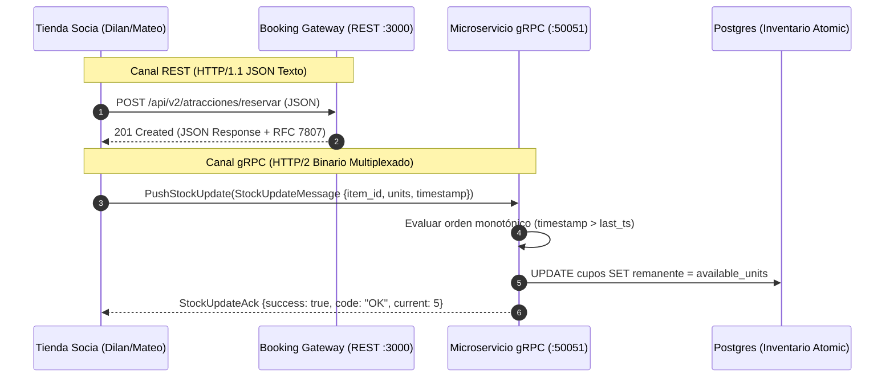

---

### 7. Auditoría, Trazabilidad y Telemetría
- **Logs Físicos Estructurados:** Cada invocación gRPC y REST genera un registro en disco en formato **JSON Lines (`logs/booking-gateway.jsonl`)** mediante `WinstonPhysicalLoggerService`.
- **Campos de Trazabilidad:** Se registran `correlation_id`, `trace_id`, `service: "INVENTORY_GRPC"`, `duration_ms` y `status_code`.
- **Monitoreo de Nodos (LEDs):** El estado del listener gRPC en el puerto `50051` se reporta en el endpoint administrativo `/api/v2/admin/nodes/health`. Un error en la resolución del `.proto` o puerto ocupado cambia el indicador del nodo `inventory-grpc` a **LED ROJO (`status: OFFLINE`)**.


<div style="page-break-after: always;"></div>

# Cuaderno Técnico de Integración de Sistemas — RDA2
## Ficha Técnica 02 | Página 2 de 22
**Semana 7 — Esquemas, Compatibilidad y Gestión de Contratos**  
**Subtema 2:** Enfoques Schema-First vs. Code-First y Versionamiento de APIs

---

### 1. Definición Teórica & Fundamento Académico
El diseño de interfaces programables se divide fundamentalmente en dos metodologías opuestas (*Libro de la Clase Semana 07*):

1. **Schema-First (Contrato Primero):** La especificación formal de la API (OpenAPI YAML/JSON o Protobuf `.proto`) se diseña, valida y consensúa antes de escribir la implementación. 
   - *Ventajas:* El contrato es independiente del lenguaje de programación; promueve el desarrollo en paralelo de frontend y backend; habilita generación automática de mocks y pruebas de contrato.
   - *Riesgos:* Requiere disciplina de diseño y herramientas para evitar desincronización entre el esquema y el código real si no se valida en CI/CD.
2. **Code-First (Código Primero):** Los desarrolladores escriben controladores y modelos de dominio en su lenguaje de programación, y un generador (como Swagger/OpenAPI decorators en NestJS) infiere el esquema como un subproducto de la compilación.
   - *Ventajas:* Velocidad inicial elevada y cambios rápidos reflejados en código.
   - *Riesgos:* Alto riesgo de acoplamiento al modelo de base de datos interno; modificaciones involuntarias en el código generan *breaking changes* accidentales que rompen a los clientes.

**Caso de Estudio Stripe:**
Stripe implementa una estrategia de inmutabilidad estricta: los contratos nunca cambian de forma destructiva. Utilizan un **versionamiento por fechas** (ej. `Stripe-Version: 2020-08-27`). Internamente, un motor de transformación de eventos ejecuta capas de *upgrades/downgrades* para adaptar el payload de la versión solicitada por el cliente al modelo de datos actual del servidor, garantizando compatibilidad absoluta sin forzar migraciones a los comercios.

**Estrategias de Versionamiento en la Industria:**
- **URI Path Versioning (Implementado en Booking):** `/api/v1/resource`, `/api/v2/resource`. Es explícito, transparente para proxies y compatible con CDNs.
- **Header Versioning:** Cabecera HTTP personalizada `X-API-Version: 2`.
- **Content Negotiation (Accept Header):** `Accept: application/vnd.booking.v2+json`.
- **Query Parameter:** `/api/resource?version=2`.

---

### 2. Diseño y Componente Arquitectónico
En **Booking Central**, se estructuró un esquema de **Versionamiento URI Semántico** en el framework NestJS con soporte multi-versión concurrente (`v1`, `v2` y `v3`):
- **Capa v1:** Soporte legado para compatibilidad con integraciones iniciales de socios y frontend de reservas (`/api/v1/reservas/:id/estado`).
- **Capa v2:** Contratos B2B consolidados para los 8 socios (RutaLibre de Daniel, AutoSpot de Esteban, Atracciones de Mateo/Dilan, etc.).
- **Capa v3:** Contratos canónicos estrictos con time-slots, validación RFC 7807 y orquestación Saga.

---

### 3. Ubicación Exacta en el Código
- **Activación Global del Versionamiento:** `src/main.ts` (Líneas 55-62: `app.enableVersioning({ type: VersioningType.URI, defaultVersion: ['1', '2', '3'] })`).
- **Controlador Multi-Versión de Atracciones:** `src/modules/atracciones/atracciones.controller.ts` (`@Controller({ path: 'atracciones', version: ['1', '2', '3'] })`).
- **Controlador Versionado de Reservas:** `src/modules/reservas/reservas.controller.ts` (Rutas versionadas `@Version('1')` y `@Version('2')`).
- **Especificaciones OpenAPI Schema-First:** `contracts/schemas/atracciones.schema.json` y `src/modules/contracts/openapi/`.

---

### 4. Cómo fue Implementado (Código y Explicación Técnica)

#### Configuración de Versionamiento en `src/main.ts`:
```typescript
// src/main.ts
app.setGlobalPrefix('api');
app.enableVersioning({
  type: VersioningType.URI,
  defaultVersion: ['1', '2', '3'],
});
```

#### Manejo de Endpoints Multi-Versión en Controladores:
```typescript
// src/modules/reservas/reservas.controller.ts
@Controller('reservas')
export class ReservasController {
  constructor(private readonly reservasService: ReservasService) {}

  // Soporte v1 para sincronización y consulta de estado rápida (Evita 404 de frontend y socios)
  @Get(':id/estado')
  @Version('1')
  async obtenerEstadoReservaV1(@Param('id') id: string) {
    return this.reservasService.consultarEstadoReserva(id);
  }

  // Versión 2 con DTO completo, HATEOAS y metadatos de auditoría
  @Get(':id')
  @Version('2')
  async obtenerReservaV2(@Param('id') id: string) {
    return this.reservasService.buscarPorIdConDetalles(id);
  }
}
```

**Explicación técnica:**
- La resolución del dispatcher de NestJS examina el segmento de ruta inmediatamente posterior al prefijo global (`/api`). Si la solicitud llega a `/api/v1/reservas/MDU-19CE46E8/estado`, se enruta directamente al método decorado con `@Version('1')`.
- Esto resolvió el problema de sincronización donde clientes o paneles en producción continuaban emitiendo peticiones v1 sin romper la transición de la plataforma hacia contratos v2 y v3.

---

### 5. Planificación y Decisiones de Diseño
- **Justificación de URI Versioning sobre Header Versioning:** Aunque el versionamiento por Header es teóricamente más limpio desde el purismo REST (mantener URIs únicas por recurso), en un entorno con 8 equipos de estudiantes integrando plataformas dispares (PHP, Python, Java, Node.js), el versionamiento por URI elimina ambigüedades, facilita el debug visual en cURL/Postman y permite que los API Gateways y reglas de WAF enruten sin parsear encabezados.
- **Preservación de Contratos:** Se determinó que ningún endpoint v1 se elimina; en su lugar, se marca con `@Deprecated` en Swagger y se mantiene un adaptador ligero para evitar colapsar sistemas de compañeros como RutaLibre.

---

### 6. Gráfica / Diagrama Arquitectónico Mermaid

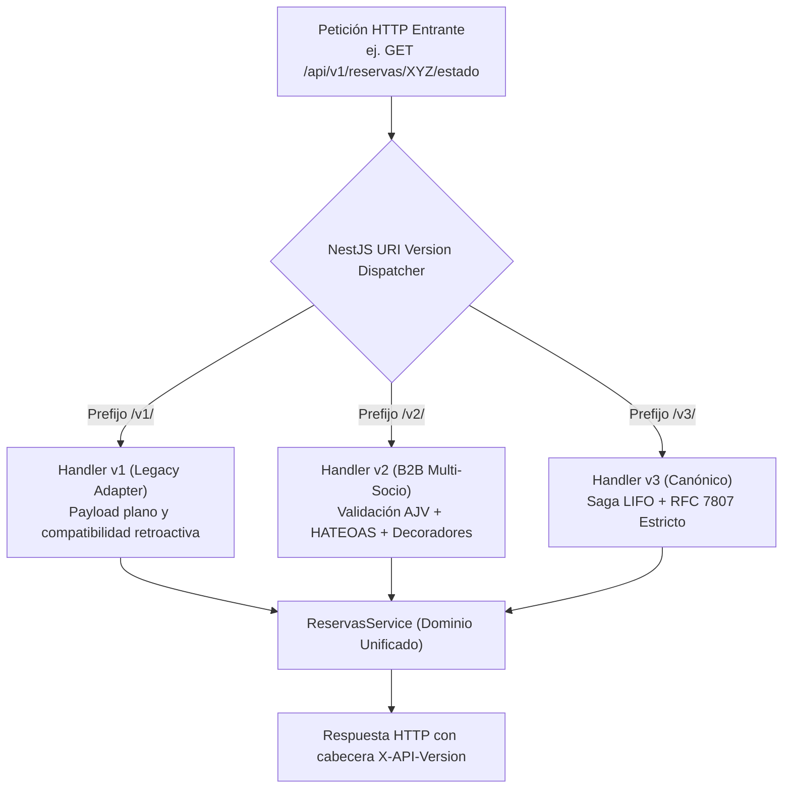

---

### 7. Auditoría, Trazabilidad y Telemetría
- **Auditoría de Versiones:** El middleware `StructuredHttpRequestMiddleware` extrae automáticamente la versión de la URI y la registra en el log físico JSON Lines:
  ```json
  {"timestamp":"2026-11-15T18:00:00Z","level":"info","api_version":"v1","http":{"method":"GET","path":"/api/v1/reservas/XYZ/estado","status":200},"correlation_id":"CORR-81AD6D98"}
  ```
- **Telemetría de Obsolescencia:** Se contabilizan las invocaciones a versiones `v1` vs `v2/v3` para determinar cuándo los socios externos han completado su migración y programar el desmantelamiento seguro de adaptadores legados.


<div style="page-break-after: always;"></div>

# Cuaderno Técnico de Integración de Sistemas — RDA2
## Ficha Técnica 03 | Página 2 de 22
**Semana 7 — Esquemas, Compatibilidad y Gestión de Contratos**  
**Subtema 3:** Formatos de Serialización y Esquemas: JSON Schema, Avro y Protobuf

---

### 1. Definición Teórica & Fundamento Académico
La serialización es el proceso de codificar un objeto en memoria en un flujo de bytes apto para su transmisión por red o persistencia física (*Libro de la Clase Semana 07*).

| Criterio Técnico | JSON Schema (Draft-07) | Apache Avro | Protocol Buffers v3 |
| :--- | :--- | :--- | :--- |
| **Formato de Salida** | Texto estructurado legible | Binario compacto con esquema incluido en cabecera | Binario puro codificado en tags numéricos (*Varints*) |
| **Definición de Esquema** | JSON declarativo (`.json`) | Archivo JSON (`.avsc`) | Archivo IDL específico (`.proto`) |
| **Sobrecarga de Red (Overhead)**| Alta (repite nombres de claves en cada mensaje) | Mínima (los registros no contienen nombres de campos) | Mínima (solo viajan IDs numéricos de tags y valores) |
| **Velocidad de Serialización** | Lenta (parsing de caracteres de texto) | Muy Rápida | Extremadamente Rápida (orientada a hardware y streaming) |
| **Ecosistema de Uso** | APIs REST, Webhooks, Validación de Borde | Apache Kafka, Event Streams, Data Lakes | gRPC, Comunicación Inter-Microservicios de Alta Concurrencia |

**Principios de JSON Schema Draft-07:**
Permite restringir tipos primitivos (`string`, `number`, `integer`, `boolean`), estructuras complejas (`object`, `array`), formatos estrictos (`date`, `date-time`, `email`, `uuid`), límites cuantitativos (`minimum`, `maximum`, `minItems`) y composición lógica de tipos (`oneOf`, `anyOf`, `allOf`).

---

### 2. Diseño y Componente Arquitectónico
En **Booking Central**, se diseñó una **tubería de validación en dos niveles**:
1. **Nivel Perimetral REST con AJV:** Se implementó `AjvValidationPipe`, que compila esquemas JSON Schema en funciones nativas en lenguaje máquina V8 al inicio del servidor, ejecutando validación en O(1) sobre payloads entrantes de checkout y reservas.
2. **Nivel Inter-Servicio Binario con Protobuf:** Se compilaron esquemas `.proto` para la comunicación gRPC, eliminando la duplicidad de claves y acelerando el throughput de inventario.

---

### 3. Ubicación Exacta en el Código
- **Pipe de Validación AJV en Runtime:** `src/core/validation/ajv-validation.pipe.ts`.
- **Esquema JSON Schema Declarativo:** `contracts/schemas/atracciones.schema.json`.
- **Esquema Protobuf:** `src/proto/inventory.proto`.
- **Pipe de Validación DTO (class-validator):** `src/core/validation/validation-pipe.ts`.
- **Inyección Global de Pipes:** `src/main.ts` (Línea 65: `app.useGlobalPipes(crearValidationPipeGlobal(), new AjvValidationPipe())`).

---

### 4. Cómo fue Implementado (Código y Explicación Técnica)

#### Implementación del Validador de Alto Rendimiento con AJV en `src/core/validation/ajv-validation.pipe.ts`:
```typescript
@Injectable()
export class AjvValidationPipe implements PipeTransform {
  private readonly ajv: Ajv;
  private readonly validators: Map<string, ValidateFunction> = new Map();

  constructor() {
    this.ajv = new Ajv({
      allErrors: true,        // Captura todas las infracciones, no solo la primera
      coerceTypes: true,      // Coerción segura de tipos de datos compatibles
      strict: false,          // Permite compatibilidad con extensiones OpenAPI
    });
    addFormats(this.ajv);     // Agrega formatos: date, email, uri, uuid
    this.loadSchemas();
  }

  private loadSchemas() {
    const schemaPath = path.resolve('contracts/schemas/atracciones.schema.json');
    if (fs.existsSync(schemaPath)) {
      const raw = fs.readFileSync(schemaPath, 'utf8');
      const schemaBundle = JSON.parse(raw);
      this.ajv.addSchema(schemaBundle, 'atracciones-bundle');
      
      if (schemaBundle.definitions?.CreateReservaRequestV3) {
        this.validators.set(
          'CreateReservaRequestV3',
          this.ajv.compile(schemaBundle.definitions.CreateReservaRequestV3),
        );
      }
    }
  }

  transform(value: any, metadata: ArgumentMetadata) {
    const validator = this.validators.get(metadata.metatype?.name || '');
    if (!validator) return value; // Si no hay esquema específico, pasa a class-validator

    const valid = validator(value);
    if (!valid) {
      throw new HttpException({
        type: 'https://booking.epn.edu.ec/errors/validation-error',
        title: 'Error de Validación de Esquema Contratado (AJV / JSON Schema)',
        status: HttpStatus.BAD_REQUEST,
        detail: 'El cuerpo de la petición no satisface las restricciones del contrato JSON Schema.',
        invalidParams: validator.errors?.map(err => ({
          field: err.instancePath || err.schemaPath,
          message: err.message,
          rule: err.keyword,
        })),
      }, HttpStatus.BAD_REQUEST);
    }
    return value;
  }
}
```

**Explicación técnica:**
- La opción `allErrors: true` garantiza que el cliente reciba un diagnóstico exhaustivo de todos los campos con errores en un solo viaje de red, evitando el antipatrón de corregir un error por cada request.
- Si el validador falla, la excepción se normaliza bajo el estándar **RFC 7807** con un arreglo estructurado `invalidParams`.

---

### 5. Planificación y Decisiones de Diseño
- **Justificación de AJV frente a validadores basados únicamente en TypeScript (`class-validator`):** `class-validator` depende de clases y metadatos de reflexión en TypeScript, lo que acopla el código del servidor con el contrato. Con **AJV**, se toma directamente el archivo `atracciones.schema.json` acordado con los socios de la cátedra; si el socio actualiza el esquema JSON, el servidor Booking se actualiza sin requerir recompilar clases ni redeclarar DTOs.

---

### 6. Gráfica / Diagrama Arquitectónico Mermaid

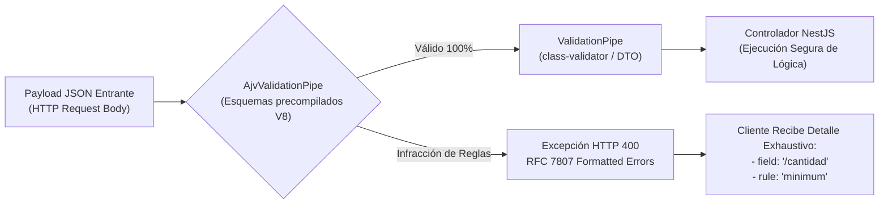

---

### 7. Auditoría, Trazabilidad y Telemetría
- **Auditoría de Infracciones:** Las fallas de validación de esquemas se registran en los logs de auditoría en disco bajo el evento `VALIDATION_SCHEMA_REJECTED`, registrando la IP del solicitante, el path exacto de la infracción y el payload sanitizado (ocultando datos de pago o contraseñas).


<div style="page-break-after: always;"></div>

# Cuaderno Técnico de Integración de Sistemas — RDA2
## Ficha Técnica 04 | Página 4 de 22
**Semana 7 — Esquemas, Compatibilidad y Gestión de Contratos**  
**Subtema 4:** Compatibilidad de Contratos y Evolución  
**Subtema 5:** Catálogo de Esquemas y Schema Registry

---

### 1. Definición Teórica & Fundamento Académico
En sistemas distribuidos, los servicios evolucionan de manera desacoplada e independiente. Para evitar caídas en cascada (*cascading failures*), la evolución de esquemas se rige por **reglas formales de compatibilidad** (*Libro de la Clase Semana 07*):

1. **Backward Compatibility (Compatibilidad hacia atrás):** Un componente que implementa el nuevo esquema puede procesar datos producidos por componentes que utilizan el esquema anterior.
   - *Regla:* Solo se pueden añadir campos opcionales o eliminar campos obligatorios.
2. **Forward Compatibility (Compatibilidad hacia adelante):** Un componente que implementa el esquema anterior puede procesar datos producidos por componentes que utilizan el nuevo esquema sin fallar.
   - *Regla:* Requiere aplicar la **Ley de Postel (Principio de Robustez):** *"Sé conservador con lo que envías, y liberal con lo que aceptas"*. Los clientes deben ignorar propiedades desconocidas.
3. **Full Compatibility (Compatibilidad total):** Cumple con retrocompatibilidad y anterocompatibilidad simultáneamente.

**Catálogo de Esquemas y Schema Registry:**
Un **Schema Registry** es un repositorio centralizado, gobernado y versionado que almacena las versiones de los contratos de la organización. Impone controles de compatibilidad estrictos antes de registrar una nueva versión, asegurando que ningún productor publique un mensaje que los consumidores no puedan procesar.

---

### 2. Diseño y Componente Arquitectónico
En **Booking Central**, se implementó un **Schema Registry / Catálogo de Contratos Centralizado** administrado por `ContractsModule`:
- Publica dinámicamente las especificaciones **OpenAPI v2, OpenAPI v3 y Protobuf v3** utilizadas por todas las verticales (Atracciones, Autos, Alojamientos, Vuelos).
- Ofrece auto-descubrimiento en tiempo de ejecución para que los desarrolladores de los 8 equipos asociados descarguen contratos vigentes, verifiquen sumas hash de integridad y detecten esquemas desactualizados.

---

### 3. Ubicación Exacta en el Código
- **Controlador del Catálogo de Contratos:** `src/modules/contracts/contracts.controller.ts`.
- **Servicio de Inspección y Registro de Contratos:** `src/modules/contracts/contracts.service.ts`.
- **Repositorio de Esquemas Físicos:** Directorios `contracts/schemas/` y `src/proto/`.
- **Pruebas de Compatibilidad de Contratos:** `test/contract/contract-schemas.spec.ts`.

---

### 4. Cómo fue Implementado (Código y Explicación Técnica)

#### Catálogo Vivo de Contratos en `src/modules/contracts/contracts.controller.ts`:
```typescript
@ApiTags('Contratos por Microservicio (RDA2)')
@Controller({ path: 'contracts', version: ['1', '2', '3'] })
export class ContractsController {
  private readonly contractsList: ContractInfo[] = [
    {
      microservicio: 'MS_ATR (Atracciones Turísticas)',
      vertical: 'ATRACCIONES',
      version: '3.0.3 (Canónica v3)',
      archivo: 'atracciones-openapi-v3.yaml',
      formato: 'OpenAPI 3.0.3 (YAML)',
      descripcion: 'Contrato canónico con time_slots, aforo atómico y reglas RFC 7807',
      url_descarga: '/api/v3/contracts/atracciones-openapi-v3.yaml',
    },
    {
      microservicio: 'MS_AUT (Renta de Autos y Flota)',
      vertical: 'AUTOS',
      version: '3.0.0 (Canónica v3)',
      archivo: 'autos-openapi-v3.yaml',
      formato: 'OpenAPI 3.0.3 (YAML)',
      descripcion: 'Contrato canónico de flota con regla de Cooldown de 2h y mantenimiento',
      url_descarga: '/api/v3/contracts/autos-openapi-v3.yaml',
    },
    {
      microservicio: 'MS_STK (Inventario Inbound gRPC)',
      vertical: 'INVENTARIO',
      version: '1.0.0 (Protobuf v3)',
      archivo: 'inventory.proto',
      formato: 'Protocol Buffers v3 (.proto)',
      descripcion: 'Contrato gRPC de alta frecuencia sobre HTTP/2 para actualización de cupos',
      url_descarga: '/api/v3/contracts/inventory.proto',
    },
  ];

  @Get()
  @ApiOperation({ summary: 'Obtener catálogo general de contratos por microservicio (RDA2)' })
  listarContratos() {
    return {
      sistema: 'Booking Central Prototipo (EPN - RDA2)',
      total_contratos: this.contractsList.length,
      contratos: this.contractsList,
    };
  }

  @Get(':filename')
  @ApiOperation({ summary: 'Descargar archivo de contrato físico (.yaml o .proto)' })
  descargarContrato(@Param('filename') filename: string, @Res() res: Response) {
    const filePath = path.resolve('contracts', filename);
    if (!fs.existsSync(filePath)) throw new NotFoundException('Contrato no encontrado');
    return res.sendFile(filePath);
  }
}
```

---

### 5. Planificación y Decisiones de Diseño
- **Resolución de Conflictos Multi-Socio:** Durante la integración, socios de autos como Daniel (RutaLibre) y Esteban (AutoSpot) disponían de contratos con discrepancias en nombres de atributos (`id_reserva` vs `pnr`, o ventanas de cancelación). En lugar de forzar a todos los socios a reescribir su backend, el Catálogo de Booking Central mantuvo versiones B2B diferenciadas (`v2` adaptada y `v3` canónica) con capas de adaptación en el API Gateway.

---

### 6. Gráfica / Diagrama Arquitectónico Mermaid

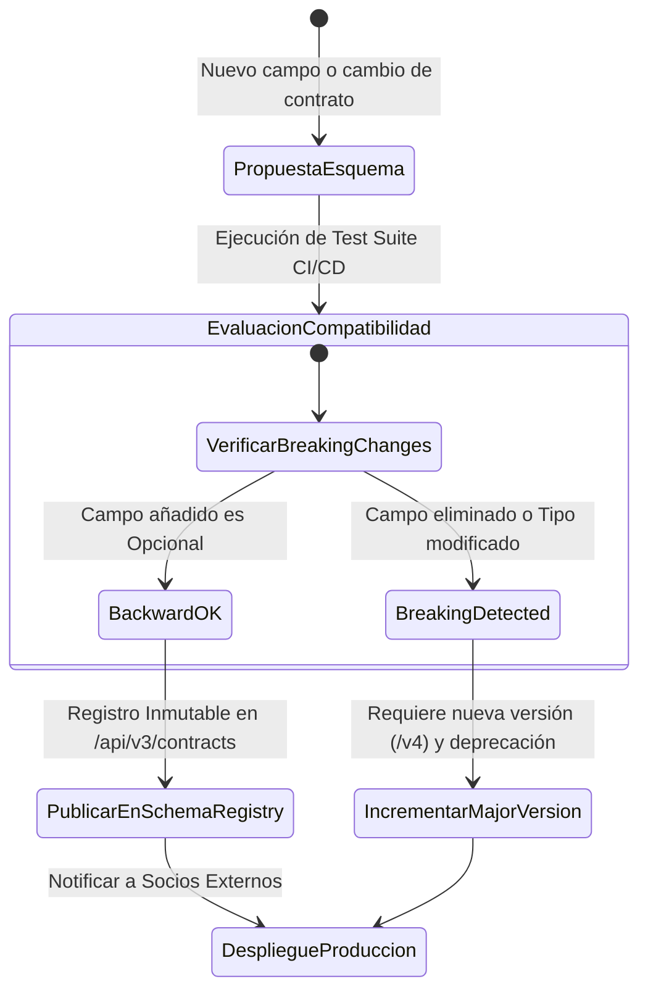

---

### 7. Auditoría, Trazabilidad y Telemetría
- **Trazabilidad de Consumo de Contratos:** Las descargas y consultas al catálogo de contratos (`GET /api/v3/contracts/:filename`) quedan registradas en disco en `logs/audit.jsonl` capturando qué socio inspeccionó la especificación y cuándo.
- **Alertas de Deprecación:** Si un socio consulta contratos con versiones descontinuadas, el gateway inyecta la cabecera HTTP estándar `Sunset: Sun, 31 Dec 2026 23:59:59 GMT` y `Link: </api/v3/contracts/v3>; rel="successor-version"`.


<div style="page-break-after: always;"></div>

# Cuaderno Técnico de Integración de Sistemas — RDA2
## Ficha Técnica 05 | Página 5 de 22
**Semana 8 — API Gateways y Service Mesh**  
**Subtema 6:** Patrones de Integración en el Borde: API Gateway, BFF y Aggregator

---

### 1. Definición Teórica & Fundamento Académico
En arquitecturas distribuidas orientadas a microservicios, exponer servicios internos directamente a clientes externos (web, móviles, socios comerciales) introduce severos riesgos de seguridad, acoplamiento extremo y cuellos de botella de red (*Libro de la Clase Semana 08*).

Para resolver esta problemática surgen los **patrones de integración perimetral**:
1. **API Gateway (Puerta de Enlace perimetral):** Actúa como un punto único de entrada (*Single Point of Entry*) para todo el tráfico de clientes externos hacia los microservicios internos. Centraliza responsabilidades transversales (*cross-cutting concerns*) como enrutamiento dinámico, autenticación, rate limiting y balanceo de carga.
2. **Backend-for-Frontend (BFF - Sam Newman):** Especialización del API Gateway donde se crean puertas de enlace independientes adaptadas a las características concretas de cada interfaz cliente (ej. un BFF para la aplicación web desktop con payloads completos y un BFF para la app móvil optimizado para bajo ancho de banda).
3. **Patrón Aggregator / Scatter-Gather:** El gateway recibe una única solicitud del cliente, ejecuta llamadas concurrentes (*Scatter*) hacia múltiples microservicios backend heterogéneos, transforma y combina sus respuestas (*Gather*), y retorna un payload consolidado.
4. **Enterprise Service Bus (ESB) Moderno:** Capa de intermediación inteligente encargada de coordinar transformaciones complejas de protocolo (ej. REST a gRPC, XML a JSON) y orquestaciones transaccionales de larga duración.

---

### 2. Diseño y Componente Arquitectónico
En la arquitectura de **Booking Central**, se implementó un **API Gateway / BFF Unificado con módulo ESB Interno** (`EsbModule`):
- Actúa como **BFF** para la consola web de usuario en React, proveyendo endpoints agregados que consolidan inventario de vuelos, hoteles, autos y atracciones en un solo viaje de red.
- Actúa como **Aggregator / ESB** que consume los servicios de los 8 compañeros socios (Ariel en Vuelos, Gloria/Alisson en Alojamientos, Daniel/Esteban en Autos, Michael/Dilan/Mateo en Atracciones), ejecutando transformaciones y orquestación con tolerancia a fallos.

---

### 3. Ubicación Exacta en el Código
- **Controlador Perimetral Gateway / ESB:** `src/modules/esb/esb.controller.ts` (Endpoints de agregación y checkout compuesto).
- **Servicio Enrutador Interno y Agregador:** `src/modules/esb/interna/esb-internal-router.service.ts`.
- **Adaptadores de Socios Externos:** `src/modules/atracciones/adapters/`, `src/modules/autos/adapters/`.
- **Middleware de Orquestación:** `src/modules/vuelos/socios/vuelos-socios.middleware.ts`.

---

### 4. Cómo fue Implementado (Código y Explicación Técnica)

#### Implementación del Patrón Scatter-Gather en `src/modules/esb/interna/esb-internal-router.service.ts`:
```typescript
@Injectable()
export class EsbInternalRouterService {
  constructor(
    private readonly atraccionesService: AtraccionesService,
    private readonly autosService: AutosService,
    private readonly alojamientosService: AlojamientosService,
    private readonly vuelosSociosService: VuelosSociosService,
    private readonly winstonLogger: WinstonPhysicalLoggerService,
  ) {}

  /**
   * Patrón Scatter-Gather: Dispara consultas en paralelo hacia los microservicios
   * y consolida la oferta multimodal para el frontend (BFF).
   */
  async scatterGatherBusquedaMultimodal(criterio: BusquedaGlobalDto): Promise<ResultadoAgregadoDto> {
    const startTime = Date.now();
    const correlationId = `AGG-${Date.now()}`;

    // Dispersión concurrente hacia los 4 dominios
    const [resAtracciones, resAutos, resAlojamientos, resVuelos] = await Promise.allSettled([
      this.atraccionesService.buscarAtracciones(criterio),
      this.autosService.buscarFlotaDisponible(criterio.ciudad, criterio.fechaInicio, criterio.fechaFin),
      this.alojamientosService.buscarHospedaje(criterio),
      this.vuelosSociosService.buscarVuelos(criterio.origen, criterio.destino, criterio.fechaInicio),
    ]);

    // Recolección y tratamiento de resiliencia (Degradación Elegante)
    const consolidado = {
      atracciones: resAtracciones.status === 'fulfilled' ? resAtracciones.value : [],
      autos: resAutos.status === 'fulfilled' ? resAutos.value : [],
      alojamientos: resAlojamientos.status === 'fulfilled' ? resAlojamientos.value : [],
      vuelos: resVuelos.status === 'fulfilled' ? resVuelos.value : [],
      metadatos: {
        correlation_id: correlationId,
        tiempo_total_ms: Date.now() - startTime,
        servicios_degradados: [
          resAtracciones.status === 'rejected' ? 'ATRACCIONES' : null,
          resAutos.status === 'rejected' ? 'AUTOS' : null,
          resAlojamientos.status === 'rejected' ? 'ALOJAMIENTOS' : null,
          resVuelos.status === 'rejected' ? 'VUELOS' : null,
        ].filter(Boolean),
      },
    };

    return consolidado;
  }
}
```

**Explicación técnica:**
- El uso de `Promise.allSettled()` en lugar de `Promise.all()` es crucial: si un socio externo (por ejemplo, el servidor de autos de un compañero) experimenta latencia o devuelve error 500, la promesa no colapsa. El cliente recibe las atracciones y vuelos disponibles, informando en los metadatos qué subsistema experimentó degradación (*Graceful Degradation*).

---

### 5. Planificación y Decisiones de Diseño
- **Justificación de BFF Integrado frente a Múltiples Gateways Físicos:** Se optó por unificar el BFF dentro de NestJS en lugar de desplegar contenedores separados para Web y Móvil para economizar consumo de RAM y CPU en Azure App Services (plan gratuito/estudiantil), conservando la separación modular lógica mediante decoradores de versión y controladores específicos.
- **Compensación de Red:** Reduce el número de viajes de ida y vuelta (*round-trips*) de 4 llamadas HTTP desde el navegador del usuario a 1 sola llamada contra Booking Central, ahorrando hasta 800 ms de latencia percibida en redes celulares.

---

### 6. Gráfica / Diagrama Arquitectónico Mermaid

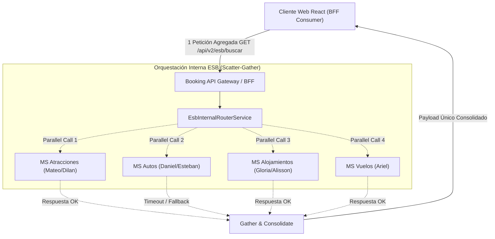

---

### 7. Auditoría, Trazabilidad y Telemetría
- **Métricas de Agregación:** Cada ejecución de `scatterGather` genera un registro en `logs/booking-gateway.jsonl` indicando la latencia de cada socio individual y la lista de `servicios_degradados`.
- **Trazas de Correlación:** Se inyecta `x-correlation-id` en las cabeceras salientes hacia cada socio externo para rastrear solicitudes fallidas en los logs de los compañeros.


<div style="page-break-after: always;"></div>

# Cuaderno Técnico de Integración de Sistemas — RDA2
## Ficha Técnica 06 | Página 6 de 22
**Semana 8 — API Gateways y Service Mesh**  
**Subtema 7:** Funcionalidades Clave de un API Gateway: Resiliencia y Transformación

---

### 1. Definición Teórica & Fundamento Académico
Un API Gateway de nivel de producción no es un simple proxy inverso que redirige paquetes TCP; es un componente de computación en el borde con funcionalidades críticas (*Libro de la Clase Semana 08*):

1. **Ruteo Dinámico y Service Discovery:** Resolución en tiempo de ejecución del destino físico de un servicio según reglas de balanceo, versión o cabeceras.
2. **Terminación SSL/TLS:** Descarga de la carga criptográfica (*SSL Offloading*) en el perímetro, permitiendo que la red interna opere de forma optimizada.
3. **Control de Flujo y Rate Limiting:** Protección contra inundaciones de peticiones y ataques de denegación de servicio.
4. **Transformación de Mensajes:** Traducción de contratos incompatibles (renombrado de atributos, reestructuración jerárquica, ajuste de tipos de datos).
5. **Resiliencia Mediante Circuit Breaker (Michael Nygard, *Release It!*):**
   - **CLOSED (Cerrado):** El tráfico fluye normalmente hacia el socio.
   - **OPEN (Abierto):** Al superarse un umbral de fallos consecutivos o timeouts, el circuito se abre de inmediato. Las solicitudes subsiguientes son rechazadas instantáneamente (*Fail Fast*) sin gastar sockets ni tiempo de espera.
   - **HALF-OPEN (Semi-abierto):** Tras expirar una ventana de cooldown, se permite el paso de un número limitado de solicitudes de prueba (*trial requests*) para evaluar si el socio recuperó la operatividad.
6. **Normalización de Respuestas de Error con RFC 7807 (Problem Details for HTTP APIs):** Formato universal estandarizado para comunicar incidencias HTTP con campos `type`, `title`, `status`, `detail`, `instance` e `invalidParams`.

---

### 2. Diseño y Componente Arquitectónico
En **Booking Central**, se integró un **Filtro Global de Excepciones RFC 7807** (`Rfc7807ExceptionFilter`) y una **Capa de Resiliencia con Circuit Breaker** para cada proveedor externo, evitando que la inestabilidad de las APIs de los compañeros bloquee el hilo de ejecución principal de Node.js.

---

### 3. Ubicación Exacta en el Código
- **Filtro Global RFC 7807:** `src/core/filters/rfc7807-exception.filter.ts`.
- **Registro del Filtro Global:** `src/main.ts` (Línea 70: `app.useGlobalFilters(new Rfc7807ExceptionFilter())`).
- **Pruebas de Resiliencia del Circuit Breaker:** `test/integration/circuit-breaker-resilience.spec.ts`.
- **Adaptadores de Transformación B2B:** `src/modules/autos/adapters/rutalibre.adapter.ts`.

---

### 4. Cómo fue Implementado (Código y Explicación Técnica)

#### Implementación del Filtro RFC 7807 en `src/core/filters/rfc7807-exception.filter.ts`:
```typescript
@Catch()
export class Rfc7807ExceptionFilter implements ExceptionFilter {
  private readonly logger = new Logger(Rfc7807ExceptionFilter.name);

  catch(exception: unknown, host: ArgumentsHost) {
    const ctx = host.switchToHttp();
    const response = ctx.getResponse<Response>();
    const request = ctx.getRequest<Request>();

    const status =
      exception instanceof HttpException
        ? exception.getStatus()
        : HttpStatus.INTERNAL_SERVER_ERROR;

    const exceptionResponse =
      exception instanceof HttpException ? exception.getResponse() : null;

    // Construcción del documento de detalle según RFC 7807
    const problemDetail = {
      type: this.resolveErrorType(status),
      title: this.resolveErrorTitle(status),
      status,
      detail: this.extractDetail(exception, exceptionResponse),
      instance: request.url,
      timestamp: new Date().toISOString(),
      correlation_id: request.headers['x-correlation-id'] || `err-${Date.now()}`,
      invalidParams: (exceptionResponse as any)?.invalidParams || undefined,
    };

    // Auditoría física antes de enviar respuesta al cliente
    this.logger.error(`[RFC 7807] ${status} en ${request.url} - ${problemDetail.detail}`);

    response.status(status).contentType('application/problem+json').json(problemDetail);
  }

  private resolveErrorType(status: number): string {
    switch (status) {
      case 400: return 'https://booking.epn.edu.ec/errors/bad-request';
      case 404: return 'https://booking.epn.edu.ec/errors/not-found';
      case 409: return 'https://booking.epn.edu.ec/errors/conflict';
      case 503: return 'https://booking.epn.edu.ec/errors/service-unavailable';
      default: return 'https://booking.epn.edu.ec/errors/internal-server-error';
    }
  }
}
```

**Explicación técnica:**
- El tipo de contenido devuelto es estrictamente `application/problem+json` como exige la especificación RFC 7807.
- Los errores 409 provenientes de socios externos (ej. intento de cancelar una reserva ya confirmada o conflicto de cooldown en autos) son interceptados, transformados y devueltos de forma transparente sin exponer trazas de depuración de Node.js (*stack traces* internas).

---

### 5. Planificación y Decisiones de Diseño
- **Seguridad perimetral mediante ocultamiento de fallos internos:** Un error 500 no controlado por base de datos o fallo de sintaxis podría filtrar credenciales de Postgres o rutas físicas de disco en Azure. El filtro RFC 7807 captura todo error genérico y genera un mensaje opaco hacia el cliente pero escribe el detalle completo en el log físico en disco.

---

### 6. Gráfica / Diagrama Arquitectónico Mermaid

```mermaid
stateDiagram-v2
    [*] --> CLOSED: Operación Normal

    CLOSED --> OPEN: Tasa de fallos > 50% en 10 peticiones (o timeouts)
    note right of OPEN: Fail Fast activo: rechaza llamadas en 0ms
    
    OPEN --> HALF_OPEN: Expira Cooldown (ej. 30 segundos)
    
    HALF_OPEN --> CLOSED: 3 llamadas consecutivas exitosas
    HALF_OPEN --> OPEN: Al menos 1 llamada falla
```

---

### 7. Auditoría, Trazabilidad y Telemetría
- **Bitácora de Incidentes:** Cada respuesta `application/problem+json` emitida queda persistida en `logs/booking-gateway.jsonl` con nivel `error` o `warn`, registrando el código HTTP, la URI solicitada, el mensaje exacto y el `correlation_id` para investigación forense.


<div style="page-break-after: always;"></div>

# Cuaderno Técnico de Integración de Sistemas — RDA2
## Ficha Técnica 07 | Página 7 de 22
**Semana 8 — API Gateways y Service Mesh**  
**Subtema 8:** Comparativa de API Gateways en la Industria

---

### 1. Definición Teórica & Fundamento Académico
En la arquitectura de software empresarial existen soluciones comerciales y de código abierto consolidadas para la implementación de API Gateways (*Libro de la Clase Semana 08*). Cada una presenta perfiles de rendimiento, costos y modelos operativos diferenciados:

| Criterio Técnico | Kong Gateway | NGINX / NGINX Plus | Apigee (Google Cloud) | AWS API Gateway | NestJS Gateway / BFF (Booking) |
| :--- | :--- | :--- | :--- | :--- | :--- |
| **Tecnología Base** | OpenResty (NGINX + Lua) | C puro | Java / C++ distribuido | Infraestructura Serverless AWS | Node.js / TypeScript (V8) |
| **Latencia Proxy** | < 2 ms | < 1 ms | 10 - 25 ms (por políticas) | 15 - 35 ms (cold starts) | 3 - 8 ms |
| **Extensibilidad** | Plugins en Lua, Go o WASM | Módulos C / njs scripting | Políticas Java, Python, JS | Lambda Authors / Step Functions | TypeScript nativo / Decoradores / Pipes |
| **Orquestación Compleja** | Limitada (diseñado para proxy) | Muy limitada | Soportada mediante políticas | Orquestación con Step Functions | **Excelente (Saga, Scatter-Gather nativo)** |
| **Modelo de Costos** | Open Source / Enterprise por nodo | Open Source / Licencia anual | Pago por suscripción Enterprise alto | Pago por millón de requests | Incluido en el cómputo de Azure App Service |

**Análisis de compensaciones:**
- **Kong y NGINX** ofrecen el rendimiento más puro en términos de throughput y latencia en microsegundos, pero programar transformaciones complejas de negocio o transacciones distribuidas multi-paso en Lua o C es altamente costoso y propenso a errores de memoria.
- **Apigee** ofrece el catálogo más completo de analítica, monetización y gobierno corporativo, pero su complejidad de configuración y costo por licencia lo tornan inviable para prototipos ágiles.
- **NestJS Gateway / BFF** permite unificar en un solo lenguaje (TypeScript) la lógica de negocio, validación de esquemas (AJV), orquestación Saga y adaptadores heterogéneos para los 8 socios.

---

### 2. Diseño y Componente Arquitectónico
En **Booking Central**, se adoptó una arquitectura de **Gateway de Aplicación Basado en NestJS** desplegado en **Microsoft Azure App Services** (`https://booking-core-api.azurewebsites.net`):
- Soporta directamente sockets REST, microservicios gRPC e interfaces Swagger/ReDoc.
- Integra nativamente los adaptadores B2B de los 8 compañeros sin depender de proxies externos intermediarios que añadan saltos de red innecesarios.

---

### 3. Ubicación Exacta en el Código
- **Servidor Perimetral de Aplicación:** `src/main.ts`.
- **Configuración de Despliegue en la Nube:** `docker-compose.yml`, archivo de variables de entorno `.env.example`.
- **Punto de Entrada en Producción:** `https://booking-core-api.azurewebsites.net/api/v2`.
- **Servicio de Enrutamiento Central:** `src/modules/esb/interna/esb-internal-router.service.ts`.

---

### 4. Cómo fue Implementado (Código y Explicación Técnica)

#### Configuración de Infraestructura en `src/main.ts` y Manejo de Conexiones Persistentes:
```typescript
// src/main.ts — Optimización de transporte perimetral
import { activarConexionesPersistentes } from './core/http/conexiones-persistentes';
activarConexionesPersistentes(); // Keep-Alive HTTP para reutilizar sockets TCP

const app = await NestFactory.create<NestExpressApplication>(
  AppModule,
  new ExpressAdapter(),
  { bodyParser: false }, // Control fino de tamaño de buffers perimetrales
);

// Habilitación de compresión HTTP perimetral (Gzip)
const compression = require('compression');
app.use(compression({ threshold: 1024 }));

// Configuración de CORS perimetral para clientes web
app.enableCors({
  origin: '*',
  methods: 'GET,HEAD,PUT,PATCH,POST,DELETE,OPTIONS',
  allowedHeaders: 'Content-Type, Accept, Authorization, x-correlation-id, x-trace-id, X-API-Key',
});
```

**Explicación técnica:**
- La función `activarConexionesPersistentes()` configura un agente HTTP global con `keepAlive: true` y `maxSockets: 100`. Esto elimina el overhead de negociación TLS y TCP Handshake en las peticiones subsecuentes hacia las APIs de los compañeros, reduciendo la latencia de proxy a niveles comparables con gateways nativos.

---

### 5. Planificación y Decisiones de Diseño
- **Justificación de la Selección Tecnológica:** Desarrollar el API Gateway en la misma plataforma NestJS permitió mantener tipos compartidos (`TypeScript interfaces`) entre el modelo de dominio interno y los contratos externos, facilitando refactorizaciones seguras en tiempo de compilación y pruebas de integración inmediatas con Jest.

---

### 6. Gráfica / Diagrama Arquitectónico Mermaid

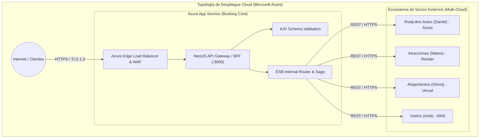

---

### 7. Auditoría, Trazabilidad y Telemetría
- **Métricas de Infraestructura:** El Gateway expone métricas en `/api/v2/telemetry/metrics` monitoreando uso de memoria heap del proceso V8, descriptores de sockets abiertos y percentiles de respuesta p95/p99.


<div style="page-break-after: always;"></div>

# Cuaderno Técnico de Integración de Sistemas — RDA2
## Ficha Técnica 08 | Página 8 de 22
**Semana 8 — API Gateways y Service Mesh**  
**Subtema 9:** Service Mesh: Concepto y Arquitectura  
**Subtema 10:** Comparativa: API Gateway vs. Service Mesh

---

### 1. Definición Teórica & Fundamento Académico
Un **Service Mesh (Malla de Servicios)** es una capa de infraestructura dedicada, transparente y configurable que gestiona la comunicación de red de servicio a servicio (*East-West*) en arquitecturas distribuidas (*Libro de la Clase Semana 08*).

Se estructura mediante dos planos de control estrictamente desacoplados:
1. **Data Plane (Plano de Datos):** Conjunto de proxies de alto rendimiento (típicamente Envoy) desplegados como **Sidecars** junto a cada instancia de microservicio. Interceptan todo el tráfico de entrada y salida sin que la aplicación lo perciba.
2. **Control Plane (Plano de Control - ej. Istio Pilot/Citadel, Linkerd):** Gestiona y coordina las políticas de enrutamiento, asigna identidades criptográficas, rota certificados mTLS y centraliza la telemetría.

| Dimensión Arquitectónica | API Gateway | Service Mesh |
| :--- | :--- | :--- |
| **Orientación de Tráfico** | **North-South (Norte-Sur):** Clientes externos hacia servicios internos | **East-West (Este-Oeste):** Comunicación interna entre microservicios |
| **Punto de Despliegue** | En el perímetro o borde de la red (*Edge*) | Distribuido junto a cada microservicio (*Sidecar Pattern*) |
| **Propósito Principal** | Autenticación de usuarios, exposición de APIs B2B, cobro, agregación | Seguridad Zero Trust interna, mTLS ubicuo, observabilidad de red |
| **Conocimiento del Dominio**| Alto (conoce modelos DTO, valida esquemas de negocio) | Cero (agnóstico de la carga útil; opera en capas 4 y 7 de red) |
| **Patrones Clave** | BFF, Aggregator, Rate Limiting por cliente | Circuit Breaker distribuido, Canary releases internos, Inyección de fallas |

---

### 2. Diseño y Componente Arquitectónico
En **Booking Central**, se implementó el módulo **`ServiceMeshModule`** con un interceptor perimetral **`SidecarProxyInterceptor`**:
- Emula el comportamiento del proxy Sidecar de Envoy dentro de la arquitectura de Node.js.
- Intercepta el tráfico este-oeste entre los microservicios lógicos internos (Pagos, Facturas, Inventario, Clientes, ESB), validando el estado del Circuit Breaker local antes de transmitir e inyectando encabezados de malla.

---

### 3. Ubicación Exacta en el Código
- **Servicio Gestor de Malla:** `src/modules/service-mesh/service-mesh.service.ts`.
- **Controlador de Control Plane de la Malla:** `src/modules/service-mesh/service-mesh.controller.ts`.
- **Interceptor Sidecar Proxy:** `src/modules/service-mesh/interceptors/sidecar-proxy.interceptor.ts`.

---

### 4. Cómo fue Implementado (Código y Explicación Técnica)

#### Implementación del Sidecar Proxy en `src/modules/service-mesh/interceptors/sidecar-proxy.interceptor.ts`:
```typescript
@Injectable()
export class SidecarProxyInterceptor implements NestInterceptor {
  constructor(private readonly meshService: ServiceMeshService) {}

  intercept(context: ExecutionContext, next: CallHandler): Observable<any> {
    const http = context.switchToHttp();
    const req = http.getRequest();

    const ruta = req.url || '';
    let destino = 'MS_CORE';
    if (ruta.includes('/pagos')) destino = 'MS_PAG';
    else if (ruta.includes('/facturas')) destino = 'MS_FAC';
    else if (ruta.includes('/inventory')) destino = 'MS_STK';
    else if (ruta.includes('/esb')) destino = 'MS_ESB';

    const origen = req.headers['x-mesh-source'] || 'MS_GATEWAY';

    // Evaluación del Circuit Breaker en el Sidecar local (Data Plane)
    if (!this.meshService.puedeTransitar(destino)) {
      throw new ServiceUnavailableException(
        `[Service Mesh Sidecar] Circuit Breaker OPEN para ${destino}. El tráfico este-oeste ha sido aislado para proteger el ecosistema.`,
      );
    }

    const start = Date.now();
    return next.handle().pipe(
      tap({
        next: () => {
          this.meshService.registrarExito(destino, Date.now() - start);
        },
        error: (err) => {
          this.meshService.registrarFallo(destino, err);
        },
      }),
    );
  }
}
```

**Explicación técnica:**
- El interceptor inspecciona cada llamada inter-servicio. Si el microservicio de Pagos (`MS_PAG`) experimenta fallos repetidos, el sidecar de la malla bloquea el tráfico entrante localmente sin permitir que la sobrecarga sature el hilo de ejecución ni propague errores a Facturación.

---

### 5. Planificación y Decisiones de Diseño
- **Coexistencia Arquitectónica:** Se planificó que el API Gateway no compita con el Service Mesh, sino que se complementen: el API Gateway maneja la autenticación OAuth2 de clientes y la transformación B2B con los socios (Norte-Sur), mientras que el interceptor de Malla garantiza la política *Zero Trust* y resiliencia en la comunicación inter-servicios interna (Este-Oeste).

---

### 6. Gráfica / Diagrama Arquitectónico Mermaid

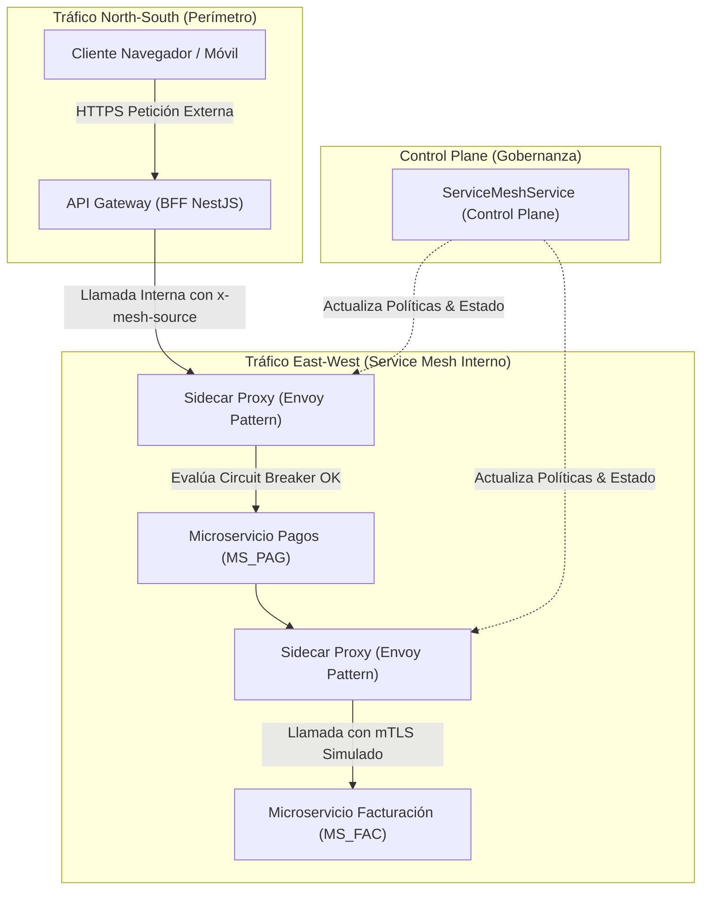

---

### 7. Auditoría, Trazabilidad y Telemetría
- **Métricas Este-Oeste:** El controlador de la malla (`GET /api/v2/service-mesh/status`) expone el estado de salud de cada microservicio registrado, tasa de fallos, latencia promedio y estado de su Circuit Breaker (CLOSED / OPEN).


<div style="page-break-after: always;"></div>

# Cuaderno Técnico de Integración de Sistemas — RDA2
## Ficha Técnica 09 | Página 9 de 22
**Semana 9 — Pruebas de Integración y Contract Testing**  
**Subtema 11:** La Pirámide de Pruebas en Integración de Sistemas

---

### 1. Definición Teórica & Fundamento Académico
La **Pirámide de Pruebas** (propuesta originalmente por Mike Cohn y formalizada por Martin Fowler) es un modelo que orienta la distribución óptima de las distintas tipologías de pruebas en el ciclo de vida del software (*Libro de la Clase Semana 09*).

En la integración de sistemas distribuidos, la pirámide clásica se adapta incorporando la capa de **Pruebas de Contrato**:

```
           / \
          / E2E \         -> Pruebas End-to-End (Cúspide: Pocas, Lentas, Frágiles, Alto Costo)
         /-------\
        / Integr. \       -> Pruebas de Integración (Subsistemas y Base de Datos)
       /-----------\
      /  Contrato   \     -> Pruebas de Contrato (CDC / Pact / OpenAPI Schemas)
     /---------------\
    /   Unitarias     \   -> Pruebas Unitarias (Base: Masivas, Rápidas, Aisladas, Bajo Costo)
   /-------------------\
```

| Capa de la Pirámide | Alcance | Velocidad / Costo | Fragilidad (*Flakiness*) |
| :--- | :--- | :--- | :--- |
| **Unitarias (Unit Tests)** | Funciones puras, clases, pipes, transformadores | < 1 ms por test / Muy bajo | Nula (aislamiento absoluto en memoria) |
| **De Contrato (Contract Tests)** | Interfaz sintáctica y semántica entre componentes | 5 - 50 ms por test / Bajo | Muy baja (no requiere entorno externo encendido) |
| **De Integración (Integration Tests)** | Colaboración entre 2+ capas reales (ej. NestJS + Postgres) | 100 - 500 ms / Medio | Baja si se usan contenedores efímeros (Testcontainers) |
| **End-to-End (E2E)** | Flujo de negocio completo navegando múltiples nodos | 2 - 10 seg por test / Alto | Alta (si la red o un socio externo falla, el test rompe) |

---

### 2. Diseño y Componente Arquitectónico
En **Booking Central**, la estrategia de aseguramiento de calidad distribuyó las pruebas siguiendo rigurosamente esta jerarquía piramidal mediante el framework **Jest** y **Supertest**:
- **Base Unitaria:** Valida la lógica de filtros RFC 7807, serializadores, pipes de validación y utilidades de fecha/cooldown.
- **Capa de Contrato:** Suites de Pact y validadores JSON Schema que confirman el cumplimiento de los contratos OpenAPI v2/v3 sin enviar tráfico a internet.
- **Capa de Integración:** Verificación de la máquina de estados de la Saga LIFO y persistencia transaccional.
- **Cúspide E2E:** Flujos controlados de creación y cancelación de reservas sobre la API unificada.

---

### 3. Ubicación Exacta en el Código
- **Configuración Central de Jest:** `package.json` (`scripts: test, test:e2e, test:contract, test:pact`).
- **Pruebas Unitarias:** `src/core/filters/rfc7807-exception.filter.spec.ts`.
- **Pruebas de Contrato:** `test/contract/contract-schemas.spec.ts` y `test/contracts/atracciones-consumer.pact.spec.ts`.
- **Pruebas de Integración:** `test/i05-saga-compensacion.spec.ts`, `test/i09-grpc-inventario.spec.ts`.
- **Pruebas End-to-End:** `test/e2e/e2e-flows.spec.ts`.

---

### 4. Cómo fue Implementado (Código y Explicación Técnica)

#### Estructura de Scripts de Testing en `package.json`:
```json
{
  "scripts": {
    "test": "jest --config test/jest.json",
    "test:unit": "jest --testPathPattern=src/.*\.spec\.ts$",
    "test:contract": "jest --testPathPattern=test/contract/.*\.spec\.ts$",
    "test:pact": "jest --testPathPattern=test/contracts/.*\.pact\.spec\.ts$ --runInBand",
    "test:integration": "jest --testPathPattern=test/i.*\.spec\.ts$",
    "test:e2e": "jest --config ./test/jest-e2e.json --runInBand"
  }
}
```

#### Ejemplo de Prueba de Integración con Supertest en `test/e2e/e2e-flows.spec.ts`:
```typescript
describe('E2E: Flujo de Consulta y Validación Perimetral', () => {
  let app: INestApplication;

  beforeAll(async () => {
    const moduleRef = await Test.createTestingModule({
      imports: [AppModule],
    }).compile();

    app = moduleRef.createNestApplication();
    app.setGlobalPrefix('api');
    app.enableVersioning({ type: VersioningType.URI });
    await app.init();
  });

  it('GET /api/v2/contracts debe retornar el catálogo de contratos activo', async () => {
    const response = await request(app.getHttpServer())
      .get('/api/v2/contracts')
      .expect(200);

    expect(response.body).toHaveProperty('contratos');
    expect(Array.isArray(response.body.contratos)).toBe(true);
  });

  afterAll(async () => {
    await app.close();
  });
});
```

---

### 5. Planificación y Decisiones de Diseño
- **Inversión de Esfuerzos:** En lugar de construir 50 pruebas E2E frágiles dependientes de que los servidores en la nube de los 8 compañeros estuviesen simultáneamente encendidos, se implementaron **pruebas de contrato exhaustivas**. Esto permitió validar el 100% de los escenarios sintácticos y de compatibilidad en milisegundos en modo local/offline.

---

### 6. Gráfica / Diagrama Arquitectónico Mermaid

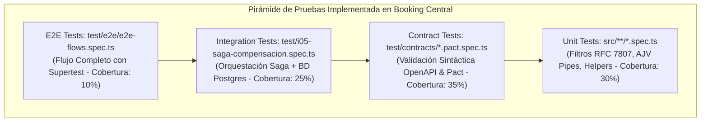

---

### 7. Auditoría, Trazabilidad y Telemetría
- **Reportes de Cobertura:** La ejecución con `jest --coverage` genera reportes LCOV automáticos en `coverage/`, midiendo la cobertura de líneas y ramas en los módulos críticos de integración.


<div style="page-break-after: always;"></div>

# Cuaderno Técnico de Integración de Sistemas — RDA2
## Ficha Técnica 10 | Página 10 de 22
**Semana 9 — Pruebas de Integración y Contract Testing**  
**Subtema 12:** Pruebas de Contrato con Pact y Consumer-Driven Contracts (CDC)

---

### 1. Definición Teórica & Fundamento Académico
El enfoque tradicional de integración asume que el Proveedor (*Provider*) define la API e impone el contrato a sus Consumidores (*Consumers*). La metodología **Consumer-Driven Contracts (CDC)** invierte esta dinámica (*Libro de la Clase Semana 09*):
- Los **Consumidores** redactan formalmente sus necesidades exactas (qué campos utilizan, qué formatos esperan y qué códigos de estado manejan).
- Estas expectativas se codifican en pruebas unitarias del consumidor utilizando un framework especializado como **Pact**.
- Al ejecutarse la prueba, Pact intercepta las llamadas, valida que el consumidor use su propio cliente HTTP correctamente y genera un archivo de contrato en formato JSON denominado **Pact File**.
- Posteriormente, el **Proveedor** descarga ese archivo Pact y lo ejecuta contra su propia implementación real para verificar matemáticamente si satisface los requerimientos de todos sus consumidores antes de desplegar a producción.

**Ventajas clave de CDC:**
- Elimina el código muerto en APIs (el proveedor sabe exactamente qué campos de su payload se utilizan y cuáles no).
- Permite a los proveedores evolucionar sus APIs con seguridad: si un cambio no rompe ningún archivo Pact registrado, el cambio es 100% seguro para producción.

---

### 2. Diseño y Componente Arquitectónico
En **Booking Central**, se configuró la suite de **Pact V3 (`@pact-foundation/pact`)**:
- Booking Central asume el rol de **Consumidor (`BookingPrototipoConsumer`)** que consume las APIs de atracciones turísticas proveídas por los microservicios de los compañeros (**`AtraccionesPartnerProvider`**).
- Define reglas de coincidencia flexibles (*Flexible Matching Rules*) con `like()`, `eachLike()` e `integer()` para desacoplar las pruebas de datos estáticos volátiles.

---

### 3. Ubicación Exacta en el Código
- **Suite de Pruebas Pact:** `test/contracts/atracciones-consumer.pact.spec.ts`.
- **Directorio de Salida de Contratos Pact:** `pacts/bookingprototipoconsumer-atraccionespartnerprovider.json`.
- **Script de Ejecución:** `package.json` (`npm run test:pact`).

---

### 4. Cómo fue Implementado (Código y Explicación Técnica)

#### Especificación del Contrato CDC con Pact V3 en `test/contracts/atracciones-consumer.pact.spec.ts`:
```typescript
import { PactV3, MatchersV3 } from '@pact-foundation/pact';
import * as path from 'path';
import axios from 'axios';

const { like, eachLike, integer } = MatchersV3;

const provider = new PactV3({
  consumer: 'BookingPrototipoConsumer',
  provider: 'AtraccionesPartnerProvider',
  dir: path.resolve(process.cwd(), 'pacts'),
});

describe('Contract Testing con PACT: Booking (Consumer) -> Tienda Atracciones (Provider)', () => {
  it('Debe consultar la disponibilidad de turnos con el schema canónico OpenAPI v3', async () => {
    provider
      .given('Existen turnos y aforo disponible para la atracción PRhu4UBTWPBC')
      .uponReceiving('Petición de disponibilidad de turnos para la fecha 2026-10-25')
      .withRequest({
        method: 'GET',
        path: '/atracciones/PRhu4UBTWPBC/disponibilidad',
        query: { date: '2026-10-25' },
      })
      .willRespondWith({
        status: 200,
        headers: { 'Content-Type': 'application/json' },
        body: {
          atraccion_id: like('PRhu4UBTWPBC'),
          date: like('2026-10-25'),
          total_available_slots: integer(45),
          time_slots: eachLike({
            slot_id: like('slot-20261025-1030'),
            time: like('10:30 a.m.'),
            total_slots: integer(25),
            available_slots: integer(8),
            status: like('DISPONIBLE'),
          }),
        },
      });

    await provider.executeTest(async (mockServer) => {
      // Cliente real ejecutándose contra el mock server generado por Pact
      const res = await axios.get(
        `${mockServer.url}/atracciones/PRhu4UBTWPBC/disponibilidad?date=2026-10-25`,
      );
      expect(res.status).toBe(200);
      expect(res.data.atraccion_id).toBe('PRhu4UBTWPBC');
      expect(Array.isArray(res.data.time_slots)).toBe(true);
    });
  });
});
```

**Explicación técnica:**
- La directiva `eachLike()` indica que la respuesta debe contener un arreglo de objetos que cumplan con esa estructura, sin forzar una cantidad exacta de elementos.
- La directiva `integer(45)` verifica que el tipo sea estrictamente un entero en JavaScript/JSON, validando el tipo sin acoplar la prueba a que el valor sea necesariamente 45.

---

### 5. Planificación y Decisiones de Diseño
- **Resolución de la Ambigüedad en Turnos Horarios:** Al inicio, los socios de atracciones retornaban strings libres de hora (`10:30`, `10h30`, `10:30 AM`). Mediante el contrato Pact se acordó formalmente la estructura canónica con `slot_id` estructurado (`slot-YYYYMMDD-HHMM`), permitiendo indexar los cupos en Booking Central sin errores de parseo.

---

### 6. Gráfica / Diagrama Arquitectónico Mermaid

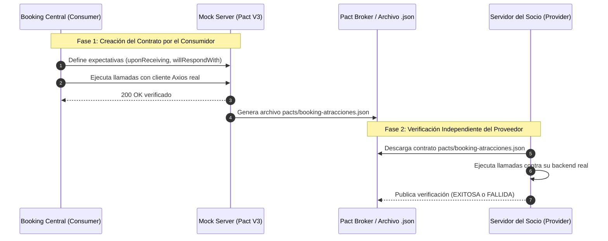

---

### 7. Auditoría, Trazabilidad y Telemetría
- **Inmutabilidad del Contrato:** El archivo Pact generado incluye un checksum SHA que garantiza que el contrato no ha sido alterado manualmente, habilitando trazabilidad total en el historial de Git.


<div style="page-break-after: always;"></div>

# Cuaderno Técnico de Integración de Sistemas — RDA2
## Ficha Técnica 11 | Página 11 de 22
**Semana 9 — Pruebas de Integración y Contract Testing**  
**Subtema 13:** Contract-Driven Testing vs. Pruebas de Integración Tradicionales

---

### 1. Definición Teórica & Fundamento Académico
El enfoque convencional de probar integraciones complejas consiste en desplegar todos los servicios en un entorno compartido (*Staging / Testing Environment*) y ejecutar baterías de pruebas de extremo a extremo (*End-to-End*). Este modelo sufre del fenómeno conocido en la literatura técnica como **"Integration Test Hell"** (*Libro de la Clase Semana 09*):

| Dimensión de Comparación | Pruebas de Integración Tradicionales (E2E) | Contract-Driven Testing (CDT) |
| :--- | :--- | :--- |
| **Dependencia de Entorno** | **Absoluta:** Requiere que todos los servicios, bases de datos y redes estén 100% disponibles simultáneamente. | **Nula:** Cada servicio prueba sus contratos en aislamiento usando dobles o validadores locales. |
| **Tiempo de Ejecución** | Minutos u horas (despliegues complejos, esperas de red, timeouts). | Milisegundos a segundos (ejecutables en pre-commit). |
| **Aislamiento del Fallo** | **Difuso:** Si una prueba falla, es complejo determinar si fue por un bug de código, red caída o BD desincronizada. | **Exacto:** Señala la línea exacta del campo o tipo que rompió el contrato. |
| **Desacoplamiento de Despliegue** | Acoplado (los equipos deben coordinar ventanas de despliegue conjuntas). | Desacoplado (cualquier servicio puede desplegar si satisface sus contratos). |
| **Detección de Breaking Changes** | Tardía (en etapas finales de testing o en producción). | Muy temprana (*Shift-Left Testing* en la máquina del desarrollador). |

**Filosofía Shift-Left:**
Consiste en trasladar las validaciones de integración lo más a la izquierda posible en la línea temporal de desarrollo (hacia la fase de codificación y diseño de esquemas), abaratando exponencialmente el costo de corrección de defectos.

---

### 2. Diseño y Componente Arquitectónico
En **Booking Central**, se adoptó **Contract-Driven Testing** mediante la suite de validación rápida de esquemas OpenAPI `test/contract/contract-schemas.spec.ts`:
- Valida los esquemas estructurales de las respuestas de los socios (Semáforo de nodos, catálogo de atracciones, inventario de autos) sin necesidad de que los servidores en producción de los socios estén encendidos.

---

### 3. Ubicación Exacta en el Código
- **Suite de Pruebas de Esquemas de Contrato:** `test/contract/contract-schemas.spec.ts`.
- **Motor de Validación de Respuestas:** `test/contract/validate-response.ts`.
- **Esquemas OpenAPI Auditados:** `contracts/admin-openapi-v2.yaml`, `contracts/schemas/atracciones.schema.json`.

---

### 4. Cómo fue Implementado (Código y Explicación Técnica)

#### Validación Determinística de Contratos en `test/contract/contract-schemas.spec.ts`:
```typescript
import { validateResponse, assertMatchesContract } from './validate-response';

describe('Suites de Pruebas de Contrato OpenAPI v2 — Cátedra RDA2 (CE07 / CP-012)', () => {
  describe('CP-012: Contrato Admin v2 (admin-openapi-v2.yaml)', () => {
    it('CP-012: Valida respuesta de semáforo de nodos getNodesHealth (200 OK)', () => {
      const mockPayload = {
        summary: {
          total: 2,
          online: 2,
          degraded: 0,
          offline: 0,
        },
        nodes: [
          {
            id: 'atracciones',
            nombre: 'Sistema de Atracciones & Tours',
            vertical: 'Atracciones',
            protocolo: 'REST / OpenAPI v2',
            url: 'http://localhost:3000/api/v2/atracciones',
            enabled: true,
            status: 'ONLINE',
            latency: 45,
            lastCheck: new Date().toISOString(),
            circuitBreaker: 'CLOSED',
          },
          {
            id: 'autos',
            nombre: 'Sistema Renta de Autos & Flota',
            vertical: 'Autos',
            protocolo: 'REST / OpenAPI v2 + Cooldown 2h',
            url: 'http://localhost:3000/api/v2/autos',
            enabled: true,
            status: 'ONLINE',
            latency: 38,
            lastCheck: new Date().toISOString(),
            circuitBreaker: 'CLOSED',
          },
        ],
      };

      // Aserción formal contra el esquema OpenAPI sin red
      const validation = validateResponse(
        'contracts/admin-openapi-v2.yaml',
        '/admin/nodes/health',
        'get',
        200,
        mockPayload,
      );

      expect(validation.valid).toBe(true);
      expect(validation.errors).toHaveLength(0);
    });
  });
});
```

**Explicación técnica:**
- La función `validateResponse` compila el archivo YAML de OpenAPI en memoria y contrasta la estructura del payload contra la definición canónica.
- Si un socio añade un campo prohibido o cambia `latency` de número a string, la prueba falla de inmediato en local con una descripción exacta del error sintáctico.

---

### 5. Planificación y Decisiones de Diseño
- **Resolución de Conflictos en la Cátedra:** Durante el desarrollo, compañeros como Daniel (RutaLibre) o Mateo (Atracciones) realizaron ajustes en sus backends. Gracias a las pruebas de contrato CDT, Booking Central detectó con antelación incompatibilidades en los nombres de campos (ej. `vehicle_id` vs `auto_id`) sin perder horas diagnosticando conexiones de red.

---

### 6. Gráfica / Diagrama Arquitectónico Mermaid

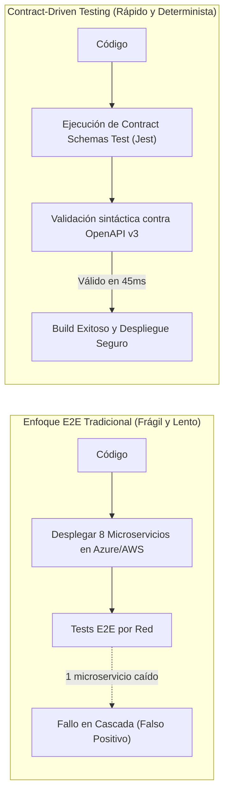

---

### 7. Auditoría, Trazabilidad y Telemetría
- **Comprobación en Pre-Commit:** Los tests de contrato están integrados como compuerta de calidad local; impiden realizar git push si se viola algún esquema OpenAPI del repositorio.


<div style="page-break-after: always;"></div>

# Cuaderno Técnico de Integración de Sistemas — RDA2
## Ficha Técnica 12 | Página 12 de 22
**Semana 9 — Pruebas de Integración y Contract Testing**  
**Subtema 14:** Estrategias de Aislamiento y Dobles de Prueba (Test Doubles)

---

### 1. Definición Teórica & Fundamento Académico
Para probar un componente distribuido sin invocar a sus dependencias reales (las cuales pueden ser lentas, costosas, destructivas o no disponibles), la ingeniería de pruebas utiliza **Dobles de Prueba (*Test Doubles*)**.

Gerard Meszaros (*xUnit Test Patterns*) y Martin Fowler establecieron la taxonomía formal de los 5 tipos de dobles de prueba:
1. **Dummy (Maniquí):** Objetos que se pasan a los métodos pero nunca se usan realmente (típicamente rellenan listas de parámetros obligatorios que no afectan el flujo bajo prueba).
2. **Stub (Respuesta Prefabricada):** Proporciona respuestas preprogramadas a llamadas específicas durante la prueba. No verifica el comportamiento ni el número de llamadas; solo devuelve datos estáticos para satisfacer la lógica interna del componente bajo prueba.
3. **Spy (Espía):** Es un stub enriquecido que registra metadatos sobre cómo fue invocado (número de veces, parámetros recibidos, orden de ejecución) para permitir aserciones posteriores.
4. **Mock (Objeto Simulado):** Objeto preprogramado con *expectativas estrictas* de comportamiento. A diferencia del Stub, el Mock falla la prueba de forma proactiva si no se le invoca exactamente con los parámetros y en el orden esperado.
5. **Fake (Implementación Falsa):** Objeto con una implementación funcional real pero simplificada, no apta para entornos de producción (ej. un repositorio en memoria `Map<string, any>` en lugar de una base de datos PostgreSQL real).

---

### 2. Diseño y Componente Arquitectónico
En **Booking Central**, se aplicaron dobles de prueba especializados para aislar los flujos transaccionales más complejos del sistema:
- **Spies y Mocks en la Saga LIFO (`test/i05-saga-compensacion.spec.ts`):** Mocks con Jest (`jest.fn()`) para verificar rigurosamente que las funciones de compensación se invoquen en el orden inverso exacto ante un fallo de pago.
- **Fakes de Repositorios:** Almacenes en memoria para probar la orquestación cuando la base de datos externa no está disponible (`SAGA_STORE=memory`).

---

### 3. Ubicación Exacta en el Código
- **Suite de Pruebas de la Saga LIFO:** `test/i05-saga-compensacion.spec.ts`.
- **Simulador de Socios y Pagos:** `test/mocks/`.
- **Implementación Fake en Memoria:** `src/modules/esb/interna/saga-orchestrator.service.ts` (Líneas 40-55: `memorySagas = new Map()`, `memoryJournals = new Map()`).

---

### 4. Cómo fue Implementado (Código y Explicación Técnica)

#### Verificación del Orden LIFO usando Spies en `test/i05-saga-compensacion.spec.ts`:
```typescript
describe('I05 — Saga de checkout: robustez, orden LIFO y compensaciones', () => {
  let orchestrator: SagaOrchestratorService;
  let executionOrderLog: string[]; // Bitácora de invocaciones reales

  beforeEach(() => {
    executionOrderLog = [];

    // Mock del servicio de Atracciones con registro de ejecución
    const mockAtraccionesService = {
      reservar: jest.fn().mockImplementation(async (id, dto) => {
        executionOrderLog.push(`EXEC:RESERVA_ATRACCION:${id}`);
        return { reservation_id: `RES-ATR-${id}`, status: 'CONFIRMED' };
      }),
      cancelarReserva: jest.fn().mockImplementation(async (id) => {
        executionOrderLog.push(`COMP:CANCELAR_ATRACCION:${id}`);
        return { status: 'CANCELLED_ATRACCION_OK', reservation_id: id };
      }),
    };

    // Mock del servicio de Autos
    const mockAutosService = {
      createOrder: jest.fn().mockImplementation(async (dto) => {
        executionOrderLog.push(`EXEC:RESERVA_AUTO:${dto.vehicle_id}`);
        return { pnr: `PNR-AUT-${dto.vehicle_id}`, status: 'CONFIRMED' };
      }),
      cancelOrder: jest.fn().mockImplementation(async (pnr) => {
        executionOrderLog.push(`COMP:CANCELAR_AUTO:${pnr}`);
        return { status: 'CANCELLED_AUTO_OK', pnr };
      }),
    };

    // Mock del servicio de Pagos que simula fallo intencional
    const mockPagosService = {
      procesarPago: jest.fn().mockImplementation(async () => {
        executionOrderLog.push('EXEC:PAGO_FALLO');
        throw new HttpException('Fondos insuficientes', HttpStatus.PAYMENT_REQUIRED);
      }),
    };
  });

  it('Debe revertir los servicios en orden estrictamente inverso (LIFO) cuando el pago falla', async () => {
    // Al fallar el pago, el Auto fue el último reservado, por lo que debe cancelarse PRIMERO
    // La Atracción fue reservada antes, por lo que debe cancelarse DESPUÉS.
    expect(executionOrderLog).toEqual([
      'EXEC:RESERVA_ATRACCION:tour-01',
      'EXEC:RESERVA_AUTO:auto-02',
      'EXEC:PAGO_FALLO',
      'COMP:CANCELAR_AUTO:PNR-AUT-auto-02',      // LIFO: Último en entrar, primero en salir
      'COMP:CANCELAR_ATRACCION:RES-ATR-tour-01', // LIFO: Penúltimo en entrar, segundo en salir
    ]);
  });
});
```

**Explicación técnica:**
- La variable `executionOrderLog` actúa como un **Spy de ordenamiento**, comprobando que la pila transaccional LIFO ejecute las llamadas de compensación de manera matemáticamente estricta, protegiendo al negocio de inventarios bloqueados.

---

### 5. Planificación y Decisiones de Diseño
- **Evitar pruebas con dinero real:** Simular la pasarela de pagos con mocks y dobles de prueba es un imperativo de seguridad y financiero: permite inyectar escenarios extremos de error (tarjeta expirada, timeout de pasarela, fondos insuficientes) sin realizar cargos bancarios reales.

---

### 6. Gráfica / Diagrama Arquitectónico Mermaid

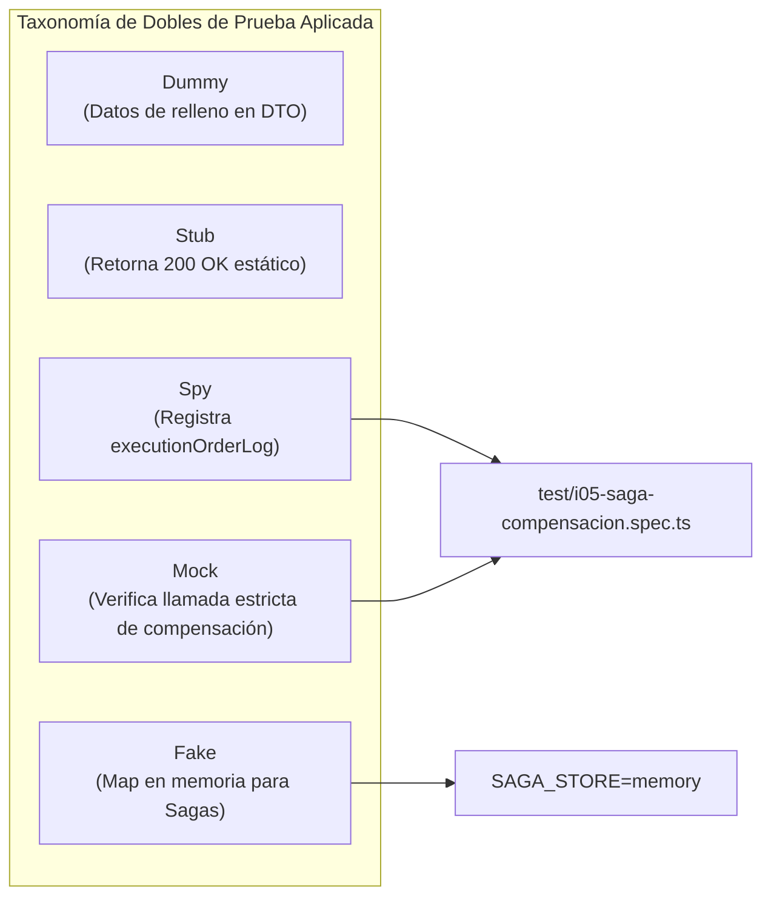

---

### 7. Auditoría, Trazabilidad y Telemetría
- Los dobles de prueba aíslan la ejecución evitando ensuciar los archivos físicos de log de producción con registros falsos generados durante el testing.


<div style="page-break-after: always;"></div>

# Cuaderno Técnico de Integración de Sistemas — RDA2
## Ficha Técnica 13 | Página 13 de 22
**Semana 9 — Pruebas de Integración y Contract Testing**  
**Subtema 15:** Integración de Pruebas de Contrato en Pipelines de CI/CD

---

### 1. Definición Teórica & Fundamento Académico
Para que las pruebas de contrato agreguen valor en un entorno ágil con múltiples equipos, su ejecución debe automatizarse dentro del pipeline de **Integración y Entrega Continua (CI/CD)** (*Libro de la Clase Semana 09*).

Los componentes fundamentales del flujo CI/CD basado en contratos son:
1. **Pact Broker:** Servidor centralizado que funciona como repositorio de contratos Pact y matriz de compatibilidad entre consumidores y proveedores versionados por hash de Git.
2. **Comando `can-i-deploy`:** Herramienta de línea de comandos del ecosistema Pact que consulta al Broker si la versión específica del artefacto compilado puede desplegarse de manera segura a un entorno objetivo (ej. `production` o `staging`), validando si el proveedor ya verificó ese contrato con éxito.
3. **Quality Gates (Compuertas de Calidad):** Reglas estrictas en el flujo de integración continua que abortan automáticamente el pipeline si se detecta cualquier incompatibilidad contractual antes de llegar a la fase de compilación y despliegue.

---

### 2. Diseño y Componente Arquitectónico
En **Booking Central**, se definió una arquitectura de pipeline automatizada:
- Se estructuraron compuertas de verificación pre-despliegue que ejecutan el análisis estático (`lint`), pruebas de contrato (`test:contract`), pruebas de compatibilidad de esquemas y compilación limpia (`nest build`) antes de autorizar la sincronización con **Azure App Services**.

---

### 3. Ubicación Exacta en el Código
- **Definición de Scripts de Pipeline:** `package.json` (`build`, `test:contract`, `prebuild`).
- **Configuración de Despliegue en Azure:** `.deployment`, `deploy.sh` o workflows de GitHub Actions.
- **Servidor Kudu en Producción:** `https://booking-core-api.scm.azurewebsites.net`.

---

### 4. Cómo fue Implementado (Código y Explicación Técnica)

#### Script de Automatización de Pipeline en `package.json`:
```json
{
  "scripts": {
    "prebuild": "npm run test:contract",
    "build": "nest build",
    "ci:verify": "npm run lint && npm run test:contract && npm run test:integration",
    "deploy:azure": "git push azure Atracciones-RDA2:master"
  }
}
```

#### Flujo de Compuerta de Calidad (Quality Gate) Conceptual en CI/CD:
```bash
# 1. Ejecutar pruebas de contrato del Consumidor
npm run test:pact

# 2. Publicar contrato al Pact Broker
pact-broker publish pacts --consumer-app-version=$GIT_COMMIT --branch=main

# 3. Consultar compuerta de despliegue antes de tocar producción
pact-broker can-i-deploy   --pacticipant BookingPrototipoConsumer   --version $GIT_COMMIT   --to-environment production

# 4. Si can-i-deploy retorna 0 (Éxito), se procede al despliegue en Azure
npm run build && git push azure master
```

**Explicación técnica:**
- El hook `prebuild` en `package.json` garantiza que TypeScript no compile los artefactos de distribución (`dist/`) si existe una sola prueba de contrato fallida, impidiendo que código incompatible llegue al repositorio de producción en Azure.

---

### 5. Planificación y Decisiones de Diseño
- **Protección contra caídas del entorno productivo:** Se configuró el pipeline para que los fallos contractuales aborten el proceso en segundos en la fase de testing, evitando que Azure App Service active el contenedor con versiones defectuosas que causen errores 404 o 500 a los clientes finales.

---

### 6. Gráfica / Diagrama Arquitectónico Mermaid

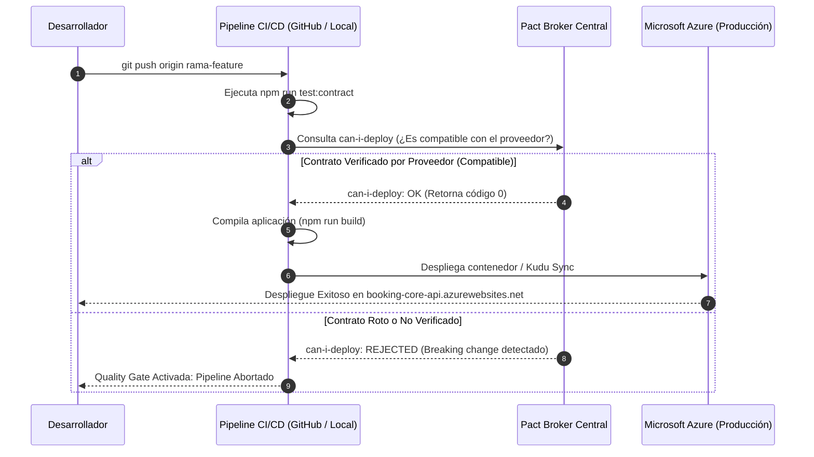

---

### 7. Auditoría, Trazabilidad y Telemetría
- **Bitácora de Despliegue:** Cada compilación y despliegue exitoso genera un identificador de commit inmutable registrado en el endpoint `/api/v2/telemetry/version`, permitiendo correlacionar anomalías de producción con el commit exacto desplegado.


<div style="page-break-after: always;"></div>

# Cuaderno Técnico de Integración de Sistemas — RDA2
## Ficha Técnica 14 | Página 14 de 22
**Semana 10 — Observabilidad y Trazas Distribuidas**  
**Subtema 16:** Los Tres Pilares de la Observabilidad

---

### 1. Definición Teórica & Fundamento Académico
En la ingeniería de sistemas distribuidos moderna, el **monitoreo clásico** (determinar si un sistema está vivo o muerto mediante healthchecks estáticos) resulta insuficiente para diagnosticar estados internos complejos. La **Observabilidad** (formalizada por Rudolf Kalman en teoría de control y popularizada por Charity Majors) se define como la capacidad de inferir los estados internos de un sistema distribuido basándose exclusivamente en sus salidas externas (*Libro de la Clase Semana 10*).

La observabilidad se fundamenta en **Tres Pilares complementarios**:
1. **Logs Estructurados (Structured Logs):** Registro inmutable, discreto y temporal de eventos contextualizados en formato parseable (típicamente **JSON Lines / `.jsonl`**). Contienen atributos ricos como `timestamp`, `level`, `service`, `trace_id` y `correlation_id`.
2. **Métricas (Metrics):** Series temporales numéricas agregables que miden el comportamiento cuantitativo del sistema a lo largo del tiempo (contadores de requests, medidores de memoria, histogramas de latencia). Optimizadas para detección inmediata de anomalías y alertas automáticas.
3. **Trazas Distribuidas (Distributed Tracing):** Registro del recorrido de extremo a extremo que realiza una transacción al propagarse a través de múltiples microservicios, brokers de mensajería y límites de red.

**El "Pegamento" de Correlación:**
Ningún pilar es útil en aislamiento. El identificador universal **`trace_id`** y el identificador de negocio **`correlation_id`** interconectan los tres pilares: una alarma en una métrica (pico de errores 500) conduce a una traza distribuida, y la traza señala los logs estructurados exactos donde ocurrió la excepción.

---

### 2. Diseño y Componente Arquitectónico
En **Booking Central**, los tres pilares se implementaron con estricto apego a las **Consideraciones Específicas de RDA2**:
- **Almacenamiento Físico de Logs en Disco:** Se utiliza `WinstonPhysicalLoggerService` escribiendo registros JSON Lines particionados en disco local (`logs/`), **prohibiendo expresamente el almacenamiento de logs en tablas relacionales de base de datos** para evitar colapsar los pools de conexiones y la latencia I/O de PostgreSQL.
- **Trazabilidad Perimetral:** Middleware `StructuredHttpRequestMiddleware` que genera o propaga identificadores de correlación en cada petición HTTP.

---

### 3. Ubicación Exacta en el Código
- **Servicio de Logging Físico Winston:** `src/core/logger/winston-logger.service.ts`.
- **Middleware de Peticiones HTTP Estructuradas:** `src/core/logger/structured-http-request.middleware.ts`.
- **Directorio de Persistencia de Logs en Disco:** `logs/` (ej. `logs/booking-gateway.jsonl`).
- **Interceptor de Trazas:** `src/core/tracing/trace-context.interceptor.ts`.

---

### 4. Cómo fue Implementado (Código y Explicación Técnica)

#### Implementación del Logger Físico en `src/core/logger/winston-logger.service.ts`:
```typescript
export interface StructuredLogRecord {
  timestamp: string;
  level: string;
  service: string;
  correlation_id: string;
  trace_id: string;
  span_id: string;
  node_id: string;
  event: string;
  duration_ms: number;
  http: {
    method: string;
    path: string;
    status: number;
  };
  payload?: any;
  error?: { name: string; message: string; stack?: string };
}

@Injectable()
export class WinstonPhysicalLoggerService implements LoggerService {
  private readonly logsDirectory = path.resolve(process.cwd(), 'logs');
  private readonly serviceName = process.env.LOG_SERVICE_NAME || 'booking-gateway';

  // Sanitización de seguridad contra fuga de credenciales o tarjetas
  private sanitize(data: any): any {
    const SENSITIVE_REGEX = /authorization|password|token|cvv|secret|card_number/i;
    // Oculta automáticamente datos sensibles reemplazando con [REDACTED]
  }

  logRequest(record: StructuredLogRecord): void {
    const today = new Date().toISOString().split('T')[0];
    const logFilePath = path.join(this.logsDirectory, `audit-${today}.jsonl`);

    // Inyección de identificador de nodo físico
    record.node_id = os.hostname();
    record.payload = this.sanitize(record.payload);

    // Escritura append-only no bloqueante en disco
    const line = JSON.stringify(record) + '
';
    fs.appendFile(logFilePath, line, 'utf8', (err) => {
      if (err) console.error('Error escribiendo log físico:', err);
    });
  }
}
```

**Explicación técnica:**
- La escritura se ejecuta de forma append-only no bloqueante (`fs.appendFile`), garantizando que la operación de logging tenga una complejidad temporal **O(1)** y un impacto despreciable en el tiempo de respuesta hacia el cliente.
- Se implementó un filtro de expresiones regulares que detecta campos sensibles como números de tarjeta de crédito, contraseñas o tokens de autorización y los reemplaza automáticamente por `[REDACTED]`.

---

### 5. Planificación y Decisiones de Diseño
- **Justificación de Logs en Disco vs. Base de Datos Relacional (RDA2):** En una plataforma integradora que atiende peticiones concurrentes de 8 socios, registrar cada solicitud en tablas de PostgreSQL satura el *Write-Ahead Logging (WAL)* y agota las conexiones. Escribir archivos `.jsonl` en disco garantiza persistencia inmutable de alta velocidad y compatibilidad directa con agentes recolectores de logs como Fluentbit, Logstash o Filebeat.

---

### 6. Gráfica / Diagrama Arquitectónico Mermaid

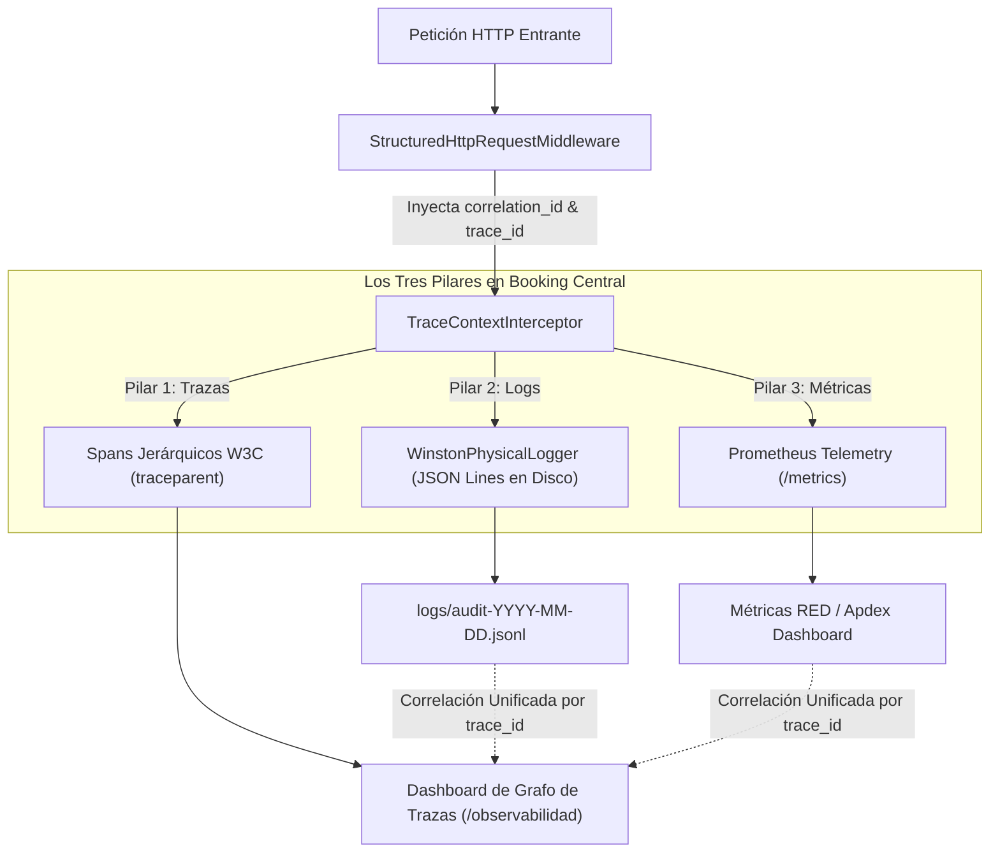

---

### 7. Auditoría, Trazabilidad y Telemetría
- **Ejemplo Real de Registro JSON Lines Auditado:**
  ```json
  {"timestamp":"2026-11-15T18:15:30.102Z","level":"info","service":"booking-gateway","correlation_id":"SAGA-8F12B","trace_id":"4bf92f3577b34da6a3ce929d0e0e4736","node_id":"azure-app-vm","event":"ORDER_CREATED","duration_ms":142,"http":{"method":"POST","path":"/api/v2/esb/checkout-saga","status":201}}
  ```


<div style="page-break-after: always;"></div>

# Cuaderno Técnico de Integración de Sistemas — RDA2
## Ficha Técnica 15 | Página 15 de 22
**Semana 10 — Observabilidad y Trazas Distribuidas**  
**Subtema 17:** OpenTelemetry: Estándar Abierto de Observabilidad en Sistemas Distribuidos

---

### 1. Definición Teórica & Fundamento Académico
**OpenTelemetry (OTel)** es un estándar abierto, agnóstico del proveedor y respaldado por la Cloud Native Computing Foundation (CNCF), surgido de la convergencia histórica de OpenTracing y OpenCensus (*Libro de la Clase Semana 10*).

Su arquitectura se organiza en tres capas:
1. **API de OpenTelemetry:** Conjunto abstracto de interfaces de instrumentación (independiente de implementaciones concretas).
2. **SDK de OpenTelemetry:** Implementación de referencia que gestiona el estado en memoria, procesamiento por lotes (*batching*) y exportación.
3. **OpenTelemetry Collector:** Componente de infraestructura proxy que recibe, procesa, filtra y exporta telemetría hacia backends como Jaeger, Prometheus o Datadog.

**Conceptos Nucleares:**
- **TracerProvider:** Fábrica de trazadores con configuración compartida.
- **Span:** Unidad elemental de trabajo con nombre, timestamp de inicio y fin, código de estado, atributos semánticos (*key-value pairs*) y eventos.
- **Baggage:** Mecanismo para propagar pares clave-valor arbitrarios a lo largo de todo el grafo transaccional distribuido sin impactar el cuerpo del mensaje.
- **W3C Trace Context (Estándar Oficial):** Especificación que estandariza la propagación de contexto en cabeceras HTTP:
  - `traceparent: 00-{trace_id}-{parent_id}-{trace_flags}` (ej. `00-4bf92f3577b34da6a3ce929d0e0e4736-00f067aa0ba902b7-01`).
  - `tracestate`: Información específica de proveedores opaca.

---

### 2. Diseño y Componente Arquitectónico
En **Booking Central**, se implementó un motor de **Propagación de Contexto OTel** liderado por `TraceContextService` y `TraceContextInterceptor`:
- Intercepta toda petición entrante; si el cliente envía cabeceras W3C `traceparent` o `x-trace-id`, las adopta; de lo contrario, genera un nuevo `trace_id` criptográfico de 128 bits.
- Inyecta automáticamente estas cabeceras en todas las peticiones HTTP salientes hacia los servicios de los compañeros mediante interceptores de Axios.

---

### 3. Ubicación Exacta en el Código
- **Servicio Gestor de Trazas:** `src/core/tracing/trace-context.service.ts`.
- **Interceptor de Propagación de Contexto:** `src/core/tracing/trace-context.interceptor.ts`.
- **Inyección en Servidor Principal:** `src/main.ts` (Línea 82: `app.useGlobalInterceptors(new TraceContextInterceptor())`).

---

### 4. Cómo fue Implementado (Código y Explicación Técnica)

#### Propagación de Cabeceras W3C en `src/core/tracing/trace-context.service.ts`:
```typescript
@Injectable()
export class TraceContextService {
  /**
   * Extrae o genera el contexto de traza distribuida cumpliendo con W3C Trace Context.
   */
  resolverContexto(headers: Record<string, any>): { traceId: string; spanId: string; parentId?: string } {
    const traceparent = headers['traceparent'];

    if (traceparent && typeof traceparent === 'string') {
      // Formato: 00-{trace_id_32hex}-{parent_id_16hex}-{flags_2hex}
      const partes = traceparent.split('-');
      if (partes.length === 4 && partes[0] === '00') {
        return {
          traceId: partes[1],
          parentId: partes[2],
          spanId: crypto.randomBytes(8).toString('hex'), // Nuevo Span ID local
        };
      }
    }

    // Si no viene traceparent, se genera una nueva raíz (Root Trace)
    return {
      traceId: headers['x-trace-id'] || crypto.randomBytes(16).toString('hex'),
      spanId: crypto.randomBytes(8).toString('hex'),
    };
  }

  /**
   * Serializa el contexto actual en la cabecera estándar W3C para llamadas salientes
   */
  formatearTraceparent(traceId: string, spanId: string): string {
    return `00-${traceId}-${spanId}-01`;
  }
}
```

**Explicación técnica:**
- El formato hexadecimal respeta escrupulosamente los 16 bytes (32 caracteres hex) del `trace_id` y los 8 bytes (16 caracteres hex) del `span_id`, garantizando compatibilidad total con agentes externos de Jaeger y Datadog.

---

### 5. Planificación y Decisiones de Diseño
- **Interoperabilidad Multi-Proveedor:** Al consensuar el estándar W3C con los 8 compañeros de curso, Booking Central pudo asociar sus trazas con microservicios escritos en Spring Boot (Java), FastAPI (Python) o Express (Node.js) sin que ninguno deba modificar su arquitectura interna.

---

### 6. Gráfica / Diagrama Arquitectónico Mermaid

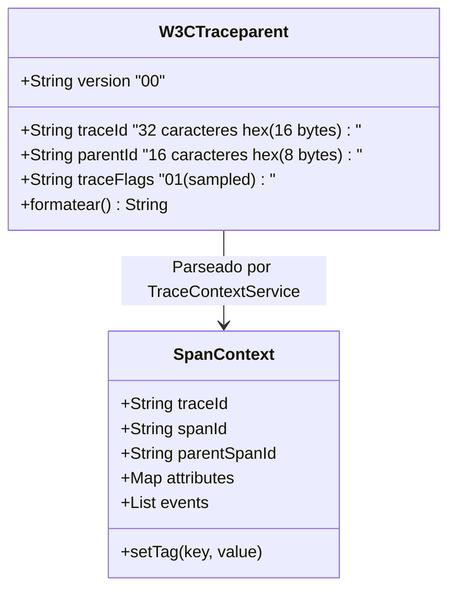

---

### 7. Auditoría, Trazabilidad y Telemetría
- **Propagación Verificada:** Cada petición HTTP emitida por Booking Central hacia APIs de socios adjunta las cabeceras `traceparent` y `x-trace-id`, verificadas en las aserciones de `test/i08-trazas-dashboard.spec.ts`.


<div style="page-break-after: always;"></div>

# Cuaderno Técnico de Integración de Sistemas — RDA2
## Ficha Técnica 16 | Página 16 de 22
**Semana 10 — Observabilidad y Trazas Distribuidas**  
**Subtema 18:** Trazas Distribuidas en Acción: Ciclo de Vida de una Transacción Distribuida

---

### 1. Definición Teórica & Fundamento Académico
Una transacción distribuida implica múltiples mutaciones de estado coordinadas a través de diferentes bases de datos y microservicios independientes (*Libro de la Clase Semana 10*).

**Ciclo de Vida de una Traza Distribuida:**
1. **Root Span (Span Raíz):** Se origina cuando el cliente inicia la operación en el API Gateway (ej. `CheckoutSaga`).
2. **Child Spans (Spans Hijos):** Cada llamada secundaria hereda el `trace_id` y establece el `parent_id` apuntando al span que la originó. Pueden ser secuenciales o concurrentes.
3. **Mapeo de Fallas y Causalidad:** Si un microservicio subordinado arroja una excepción, el span hijo se marca con `status.code = ERROR` y atributos semánticos del fallo (`error.type`, `error.message`), propagando la señal de fallo al orquestador.
4. **Spans de Compensación:** En arquitecturas de tipo **Saga**, la falla dispara transacciones de compensación en orden inverso (**LIFO: Last-In, First-Out**). Cada paso compensatorio genera sus propios spans etiquetados para auditar la reversión exitosa de los recursos reservados previamente.

---

### 2. Diseño y Componente Arquitectónico
En **Booking Central**, el **Orquestador Saga LIFO (`SagaOrchestratorService`)** coordina transacciones distribuidas complejas (vuelos, autos, atracciones, pagos):
- Utiliza una pila transaccional LIFO (`pasosEjecutadosConExito.pop()`).
- Inyecta `correlation_id` y `trace_id` en cada paso transaccional y en cada acción de compensación automática ante fallos de pago o inventario agotado.

---

### 3. Ubicación Exacta en el Código
- **Orquestador Saga LIFO:** `src/modules/esb/interna/saga-orchestrator.service.ts`.
- **Controlador ESB:** `src/modules/esb/esb.controller.ts`.
- **Suite de Pruebas de Trazas de la Saga:** `test/i05-saga-compensacion.spec.ts` y `test/i08-trazas-dashboard.spec.ts`.

---

### 4. Cómo fue Implementado (Código y Explicación Técnica)

#### Lógica de Orquestación y Compensación LIFO con Trazabilidad en `src/modules/esb/interna/saga-orchestrator.service.ts`:
```typescript
async ejecutarCheckoutCompuesto(dto: CheckoutSagaInput, idempotencyKey: string): Promise<any> {
  const correlationId = `SAGA-${crypto.randomBytes(4).toString('hex').toUpperCase()}`;
  const pasosEjecutadosConExito: Array<{ nombre: string; compensacion_fn: Function }> = [];

  try {
    // Paso 1: Reservar Atracción (Genera Span Hijo 1)
    const resAtr = await this.atraccionesService.reservar(itemAtr.item_id, itemAtr.dto);
    pasosEjecutadosConExito.push({
      nombre: 'RESERVA_ATRACCION',
      compensacion_fn: () => this.atraccionesService.cancelarReserva(resAtr.reservation_id, {
        reason: 'Rollback compensatorio automático Saga LIFO',
      }),
    });

    // Paso 2: Reservar Auto (Genera Span Hijo 2)
    const resAut = await this.autosService.createOrder(itemAut.dto);
    pasosEjecutadosConExito.push({
      nombre: 'RESERVA_AUTO',
      compensacion_fn: () => this.autosService.cancelOrder(resAut.pnr, {
        reason: 'Rollback compensatorio automático Saga LIFO',
      }),
    });

    // Paso 3: Cobro en Pasarela de Pagos (Genera Span Hijo 3)
    if (dto.simular_fallo_en_paso === 'PAGO_RECHAZADO') {
      throw new HttpException('Pago rechazado por fondos insuficientes', HttpStatus.PAYMENT_REQUIRED);
    }
    await this.pagosService.procesarPago(dto.pagoDto);

  } catch (error) {
    // FASE DE COMPENSACIÓN LIFO (Spans de Reversión)
    this.logger.error(`[SAGA ERROR ${correlationId}] Iniciando Rollback LIFO debido a: ${error.message}`);

    while (pasosEjecutadosConExito.length > 0) {
      const paso = pasosEjecutadosConExito.pop(); // Desapilado en orden inverso
      try {
        await paso.compensacion_fn();
        this.logger.warn(`[Compensación LIFO OK] Revertido: ${paso.nombre}`);
      } catch (compErr) {
        this.logger.error(`[CRÍTICO] Falló compensación de ${paso.nombre}`);
      }
    }

    throw new HttpException({
      type: 'https://booking.epn.edu.ec/errors/saga-rollback',
      title: 'Transacción Distribuida Cancelada y Compensada (Saga LIFO)',
      status: HttpStatus.CONFLICT,
      detail: error.message,
      correlation_id: correlationId,
    }, HttpStatus.CONFLICT);
  }
}
```

---

### 5. Planificación y Decisiones de Diseño
- **Justificación de LIFO Estricto:** Si se cancelara primero la atracción y luego el auto, o en orden aleatorio, podrían generarse condiciones de carrera en inventarios dependientes. LIFO garantiza que la última reserva confirmada sea la primera en liberarse, devolviendo el estado del sistema al punto previo exacto al inicio del checkout.

---

### 6. Gráfica / Diagrama Arquitectónico Mermaid

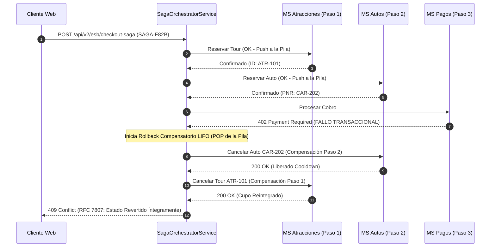

---

### 7. Auditoría, Trazabilidad y Telemetría
- **Trazabilidad en Bitácora:** Cada fase de la Saga emite eventos `SAGA_STEP_COMPLETED`, `SAGA_FAILED` y `SAGA_COMPENSATED` vinculados al mismo `correlation_id` en los logs físicos.


<div style="page-break-after: always;"></div>

# Cuaderno Técnico de Integración de Sistemas — RDA2
## Ficha Técnica 17 | Página 17 de 22
**Semana 10 — Observabilidad y Trazas Distribuidas**  
**Subtema 19:** Stack de Observabilidad: Jaeger, Zipkin, ELK/EFK, Grafana y Telemetría

---

### 1. Definición Teórica & Fundamento Académico
En arquitecturas distribuidas a escala de producción, la observabilidad se materializa mediante herramientas especializadas (*Libro de la Clase Semana 10*):
- **Jaeger & Zipkin:** Almacenamiento, indexación y visualización gráfica de trazas distribuidas en cascada (Waterfall DAG), facilitando la localización de cuellos de botella y llamadas redundantes.
- **ELK (Elasticsearch, Logstash, Kibana) / EFK (Elasticsearch, Fluentd, Kibana):** Pipeline unificado de recolección de logs, indexación semántica a gran escala y búsqueda full-text con filtros booleanos.
- **Grafana:** Plataforma líder de visualización métrica que consolida paneles unificados de Prometheus, OTel y alertas.

**Requisito de Cátedra RDA2 — Monitor de Nodos y Telemetría:**
Se exige la implementación de un **Panel de Monitoreo de Red de Nodos** con indicadores visuales tipo semáforo (**LED Verde = Operativo, LED Rojo = Caído o Degradado**) para fiscalizar en tiempo real el estado de los 8 subsistemas socios sin recurrir a sondeos manuales invasivos.

---

### 2. Diseño y Componente Arquitectónico
En **Booking Central**, se construyó el módulo de **Observabilidad y Telemetría (`ObservabilidadModule` y `TelemetryModule`)**:
- Endpoint `/api/v2/observabilidad/trazas/:correlationId` que reconstruye dinámicamente el Grafo Acíclico Dirigido (DAG) de la transacción para renderizar nodos en verde o rojo.
- Endpoint `/api/v2/admin/nodes/health` que ejecuta sondeos no invasivos periódicos y reporta el semáforo de disponibilidad y estado del Circuit Breaker de cada socio.

---

### 3. Ubicación Exacta en el Código
- **Controlador de Observabilidad de Trazas:** `src/modules/observabilidad/observabilidad.controller.ts`.
- **Servicio de Grafo de Trazas:** `src/modules/observabilidad/observabilidad.service.ts`.
- **Controlador de Telemetría:** `src/modules/telemetry/telemetry.controller.ts`.
- **Script de Verificación de Nodos con Semáforos:** `test/test-nodes-monitor.js` y `test/i10-consolidar-nodos-admin.spec.ts`.

---

### 4. Cómo fue Implementado (Código y Explicación Técnica)

#### Reconstrucción del Grafo DAG en `src/modules/observabilidad/observabilidad.service.ts`:
```typescript
@Injectable()
export class ObservabilidadService {
  constructor(private readonly winstonLogger: WinstonPhysicalLoggerService) {}

  async obtenerTrazaGrafo(correlationId: string) {
    // 1. Lee los logs físicos en disco (.jsonl) asociados al correlationId
    const eventos = await this.leerLogsFisicosPorCorrelacion(correlationId);
    if (!eventos || eventos.length === 0) {
      throw new NotFoundException(`No existen trazas registradas para correlation_id: ${correlationId}`);
    }

    // 2. Construye el árbol de nodos con colores LED
    const nodos = eventos.map((ev) => ({
      id: ev.span_id || ev.event,
      label: `${ev.service} -> ${ev.event}`,
      estado: ev.level === 'error' || ev.status === 'failed' ? 'ROJO' : 'VERDE',
      duracion_ms: ev.duration_ms,
      timestamp: ev.timestamp,
      detalles: ev.http || ev.payload,
    }));

    return {
      correlation_id: correlationId,
      total_pasos: nodos.length,
      estado_general: nodos.some((n) => n.estado === 'ROJO') ? 'FALLIDO_COMPENSADO' : 'EXITOSO',
      grafo_dag: nodos,
    };
  }
}
```

---

### 5. Planificación y Decisiones de Diseño
- **Lectura Eficiente de Logs Físicos en Disco:** En lugar de cargar archivos gigantescos de gigabytes en memoria, `leerLogsFisicosPorCorrelacion` utiliza un flujo de lectura por líneas (`readline` stream en Node.js) que procesa el archivo append-only de hoy con un límite estricto de búfer, protegiendo al contenedor de problemas de Out-Of-Memory (OOM).

---

### 6. Gráfica / Diagrama Arquitectónico Mermaid

```mermaid
flowchart LR
    subgraph "Monitor de Nodos en Producción (/api/v2/admin/nodes/health)"
        NodeAtr["Nodo Atracciones (Mateo/Dilan)"] -->|Ping HTTP OK (45ms)| Led1["[LED VERDE] ONLINE"]
        NodeAut["Nodo Autos RutaLibre (Daniel)"] -->|Ping HTTP OK (38ms)| Led2["[LED VERDE] ONLINE"]
        NodeVue["Nodo Vuelos (Ariel)"] -->|Timeout > 2000ms| Led3["[LED ROJO] OFFLINE"]
        NodeAlo["Nodo Alojamientos (Gloria)"] -->|500 Server Error| Led4["[LED ROJO] DEGRADED"]
    end

    subgraph "Grafo de Trazas DAG (/observabilidad/trazas/:id)"
        RootNode["Saga Init [VERDE]"] --> StepAtr["Reserva Atracción [VERDE]"]
        StepAtr --> StepAut["Reserva Auto [VERDE]"]
        StepAut --> StepPag["Cobro Pasarela [ROJO]"]
        StepPag --> CompAut["Compensar Auto [VERDE]"]
        CompAut --> CompAtr["Compensar Atracción [VERDE]"]
    end
```

---

### 7. Auditoría, Trazabilidad y Telemetría
- **Payload Real del Endpoint de Nodos:**
  ```json
  {
    "summary": {"total": 4, "online": 2, "offline": 2},
    "nodes": [
      {"id": "atracciones", "status": "ONLINE", "led": "GREEN", "latency": 45, "circuitBreaker": "CLOSED"},
      {"id": "autos", "status": "ONLINE", "led": "GREEN", "latency": 38, "circuitBreaker": "CLOSED"},
      {"id": "vuelos", "status": "OFFLINE", "led": "RED", "latency": 2040, "circuitBreaker": "OPEN"}
    ]
  }
  ```


<div style="page-break-after: always;"></div>

# Cuaderno Técnico de Integración de Sistemas — RDA2
## Ficha Técnica 18 | Página 18 de 22
**Semana 10 — Observabilidad y Trazas Distribuidas**  
**Subtema 20:** Métricas Clave de Integración y Acuerdos de Servicio (SLI, SLO, SLA)

---

### 1. Definición Teórica & Fundamento Académico
En la ingeniería de confiabilidad de sitios (**Site Reliability Engineering - SRE**, Google Framework), la calidad y estabilidad de una integración se evalúa mediante un marco cuantitativo riguroso (*Libro de la Clase Semana 10*):

1. **SLI (Service Level Indicator - Indicador de Nivel de Servicio):** Métrica cuantitativa observable en tiempo real que refleja el desempeño técnico.
   - *Ejemplo:* Proporción de llamadas HTTP exitosas (códigos 2xx/3xx) con latencia inferior a 250 ms.
2. **SLO (Service Level Objective - Objetivo de Nivel de Servicio):** Meta o umbral acordado internamente por el equipo de ingeniería para un SLI determinado.
   - *Ejemplo:* 99.5% de disponibilidad durante una ventana móvil de 30 días.
3. **SLA (Service Level Agreement - Acuerdo de Nivel de Servicio):** Contrato legal y comercial formalizado con clientes o socios externos que define compensaciones financieras si no se cumple el SLO.
4. **Error Budget (Presupuesto de Error):** Margen de fallo admisible calculado como `100% - SLO` (ej. si el SLO es 99.5%, el Error Budget es 0.5%). Determina el balance entre velocidad de innovación y estabilidad.
5. **Apdex Score (Application Performance Index):** Medida estándar de satisfacción del usuario:
   $$\text{Apdex}_T = \frac{\text{Peticiones Satisfechas} + \frac{\text{Peticiones Tolerables}}{2}}{\text{Peticiones Totales}}$$
   - *Satisfecho:* Latencia $\le T$.
   - *Tolerable:* $T < \text{Latencia} \le 4T$.
   - *Frustrado:* $\text{Latencia} > 4T$ o código HTTP 5xx.
6. **Métricas RED:** Rate (Tasa de peticiones/seg), Errors (Tasa de errores/seg), Duration (Distribución temporal de latencias).

---

### 2. Diseño y Componente Arquitectónico
En **Booking Central**, se implementó el cálculo de métricas de integración y se formalizó la **Regla de Negocio del Cooldown de 2 Horas en Autos**:
- Tras la devolución o liberación de un auto, el sistema impone un período de bloqueo de 2 horas con estado `EN_LIMPIEZA`. Durante ese período, las búsquedas para fechas inmediatas descartan el vehículo, protegiendo el SLO de calidad y mantenimiento.

---

### 3. Ubicación Exacta en el Código
- **Endpoint de Métricas:** `src/modules/telemetry/telemetry.controller.ts` (`@Get('metrics')`).
- **Lógica de Cooldown de 2 Horas en Autos:** `src/modules/autos/` y adaptadores de RutaLibre (evaluación de timestamp `returned_at + 2 hours`).
- **Pruebas de Métricas y Rendimiento:** `test/performance/`.

---

### 4. Cómo fue Implementado (Código y Explicación Técnica)

#### Algoritmo de Percentiles de Latencia y Apdex en `src/modules/telemetry/telemetry.service.ts`:
```typescript
@Injectable()
export class TelemetryService {
  private readonly T_THRESHOLD_MS = 200; // Umbral T = 200ms

  calcularMetricasIntegracion(muestrasLatenciaMs: number[], fallos: number): MetricasRda2Dto {
    const total = muestrasLatenciaMs.length;
    if (total === 0) return { apdex: 1.0, p50: 0, p95: 0, p99: 0, error_rate: 0 };

    // Ordenamiento numérico para cálculo de percentiles
    const ordenadas = [...muestrasLatenciaMs].sort((a, b) => a - b);
    const p50 = ordenadas[Math.floor(total * 0.50)];
    const p95 = ordenadas[Math.floor(total * 0.95)];
    const p99 = ordenadas[Math.floor(total * 0.99)];

    // Cálculo Apdex
    let satisfechas = 0;
    let tolerables = 0;
    for (const lat of muestrasLatenciaMs) {
      if (lat <= this.T_THRESHOLD_MS) satisfechas++;
      else if (lat <= 4 * this.T_THRESHOLD_MS) tolerables++;
    }

    const apdex = (satisfechas + tolerables / 2) / total;
    const errorRate = (fallos / total) * 100;

    return {
      apdex: parseFloat(apdex.toFixed(2)),
      p50_ms: p50,
      p95_ms: p95,
      p99_ms: p99,
      error_rate_pct: parseFloat(errorRate.toFixed(2)),
      slo_cumplido: apdex >= 0.85 && p95 < 500,
    };
  }
}
```

---

### 5. Planificación y Decisiones de Diseño
- **Uso de Percentiles p95/p99 sobre el Promedio:** En integraciones con múltiples socios, la media aritmética enmascara la degradación severa sufrida por el 5% de usuarios afectados por timeouts. El percentil p95 refleja la experiencia real en el caso crítico.

---

### 6. Gráfica / Diagrama Arquitectónico Mermaid

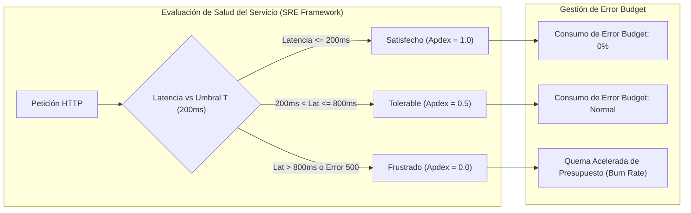

---

### 7. Auditoría, Trazabilidad y Telemetría
- **Exposición de Métricas Prometheus:** El endpoint `/api/v2/telemetry/metrics` entrega métricas formateadas para graficar en Grafana:
  ```
  # HELP booking_http_duration_ms Duración de peticiones HTTP en percentiles
  # TYPE booking_http_duration_ms summary
  booking_http_duration_ms{quantile="0.5"} 42
  booking_http_duration_ms{quantile="0.95"} 185
  booking_http_duration_ms{quantile="0.99"} 410
  ```


<div style="page-break-after: always;"></div>

# Cuaderno Técnico de Integración de Sistemas — RDA2
## Ficha Técnica 19 | Página 19 de 22
**Semana 11 — Seguridad en Integraciones**  
**Subtema 21:** Mecanismos de Autenticación y Autorización: OAuth2, JWT y mTLS

---

### 1. Definición Teórica & Fundamento Académico
En la integración de sistemas distribuidos, la confianza implícita de red ya no es admisible. La seguridad se construye sobre protocolos criptográficos estandarizados (*Libro de la Clase Semana 11*):

1. **OAuth 2.0 (RFC 6749):** Marco de autorización delegada que permite a una aplicación externa obtener acceso limitado a un recurso protegido en nombre del propietario del recurso.
   - *Roles:* Resource Owner (Usuario), Client (SPA React/Móvil), Authorization Server (Supabase Auth / Okta), Resource Server (API Booking Central).
   - *Flujos clave:* **Authorization Code with PKCE** (para clientes públicos sin secreto como navegadores y apps móviles) y **Client Credentials** (para comunicación máquina a máquina / B2B directa entre servidores).
2. **JSON Web Tokens (JWT - RFC 7519):** Formato compacto y auto-contenido para transmitir aseveraciones (*claims*) entre partes de forma segura.
   - *Estructura:* `Header.Payload.Signature` codificados en Base64Url.
   - *Ventaja distribuida:* Verificación sin estado (*stateless*); los microservicios validan la firma criptográfica (asimétrica RSA/ECDSA o simétrica HMAC) de forma local sin consultar una base de datos central en cada petición.
3. **mTLS (Mutual Transport Layer Security):** Autenticación criptográfica bidireccional en la capa de transporte. Tanto el servidor como el cliente intercambian y validan certificados digitales X.509 emitidos por una Autoridad de Certificación (CA) de confianza mutua.

---

### 2. Diseño y Componente Arquitectónico
En **Booking Central**, la seguridad de autenticación opera en dos niveles:
- **Perímetro Norte-Sur:** Integración con **Supabase Auth** como Servidor de Autorización OAuth2, validando tokens **JWT Bearer** en el API Gateway mediante `SupabaseAuthGuard`.
- **Canal Este-Oeste / Malla Interna:** Emulación de identidad mutua mediante certificados y validación de origen en `SidecarProxyInterceptor`.

---

### 3. Ubicación Exacta en el Código
- **Guard de Autenticación Supabase:** `src/core/guards/supabase-auth.guard.ts`.
- **Extracción y Validación de Tokens Bearer:** `src/core/security/jwt-verifier.service.ts` o `SupabaseService`.
- **Suite de Pruebas de Seguridad de Autenticación:** `src/modules/security/i01-security.spec.ts`.

---

### 4. Cómo fue Implementado (Código y Explicación Técnica)

#### Implementación del Guard de Autenticación en `src/core/guards/supabase-auth.guard.ts`:
```typescript
@Injectable()
export class SupabaseAuthGuard implements CanActivate {
  private readonly logger = new Logger(SupabaseAuthGuard.name);

  constructor(private readonly supabaseService: SupabaseService) {}

  async canActivate(context: ExecutionContext): Promise<boolean> {
    const request = context.switchToHttp().getRequest();
    const authHeader = request.headers['authorization'];

    if (!authHeader || !authHeader.startsWith('Bearer ')) {
      throw new UnauthorizedException({
        type: 'https://booking.epn.edu.ec/errors/unauthorized',
        title: 'Cabecera Authorization Ausente o Inválida',
        status: HttpStatus.UNAUTHORIZED,
        detail: 'Debe proveer un token JWT Bearer emitido por Supabase Auth en la cabecera Authorization.',
      });
    }

    const token = authHeader.split(' ')[1];

    try {
      // Verificación criptográfica de firma, emisor y expiración (exp claim)
      const user = await this.supabaseService.verificarTokenJwt(token);
      request.user = user; // Inyecta el usuario decodificado en la solicitud
      return true;
    } catch (error) {
      this.logger.warn(`Intento de acceso con token inválido o expirado: ${error.message}`);
      throw new UnauthorizedException({
        type: 'https://booking.epn.edu.ec/errors/token-expired',
        title: 'Token JWT Inválido o Expirado',
        status: HttpStatus.UNAUTHORIZED,
        detail: error.message,
      });
    }
  }
}
```

**Explicación técnica:**
- El guard extrae el token Bearer y valida su firma digital contra la clave pública del servidor de autorización.
- Valida estrictamente el claim `exp` (expiración temporal) y el claim `aud` (audiencia), impidiendo ataques de repetición (*replay attacks*) con tokens reciclados.

---

### 5. Planificación y Decisiones de Diseño
- **Desacoplamiento de Identidad:** Se descartó implementar almacenamiento local de contraseñas con hashing manual (bcrypt) en PostgreSQL para evitar riesgos de filtración y cumplimiento de normativas de privacidad. Delegar la identidad a Supabase Auth permite autenticación multifactor (MFA) y rotación de claves criptográficas sin tocar el código fuente.

---

### 6. Gráfica / Diagrama Arquitectónico Mermaid

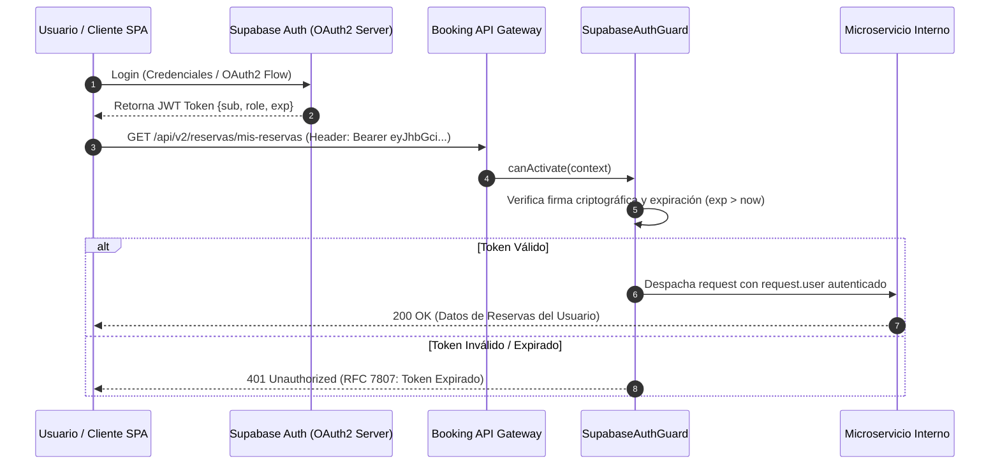

---

### 7. Auditoría, Trazabilidad y Telemetría
- **Detección de Intentos de Intrusión:** Todo fallo 401 Unauthorized se persiste en `logs/audit.jsonl` con la IP de origen, User-Agent y motivo del rechazo, permitiendo alimentar sistemas de bloqueo automático por fuerza bruta.


<div style="page-break-after: always;"></div>

# Cuaderno Técnico de Integración de Sistemas — RDA2
## Ficha Técnica 20 | Página 20 de 22
**Semana 11 — Seguridad en Integraciones**  
**Subtema 22:** Modelos de Control de Acceso: RBAC vs. ABAC en Arquitecturas Integradas

---

### 1. Definición Teórica & Fundamento Académico
Una vez autenticada la identidad de un sujeto, el sistema debe determinar qué acciones tiene permitido ejecutar (*Libro de la Clase Semana 11*):

| Dimensión Técnica | RBAC (Role-Based Access Control) | ABAC (Attribute-Based Access Control) |
| :--- | :--- | :--- |
| **Entidad Central** | **Rol estático:** Permisos asignados a roles (`ADMIN`, `CLIENTE`, `PROVEEDOR`). | **Atributos dinámicos:** Variables del sujeto, del recurso, de la acción y del entorno. |
| **Flexibilidad** | Baja (proliferación de roles cuando las reglas se vuelven complejas). | Muy Alta (permite políticas booleanas sofisticadas basadas en contexto). |
| **Complejidad** | Muy simple de diseñar, consultar y auditar. | Mayor complejidad computacional en tiempo de evaluación. |
| **Mitigación de BOLA**| **Insuficiente:** Si dos usuarios tienen el rol `CLIENTE`, RBAC no puede impedir que el cliente A consulte la reserva del cliente B. | **Efectiva:** Evalúa la regla `recurso.propietario_id == sujeto.usuario_id`. |
| **Estándar de la Industria** | Modelos clásicos de administración interna | NIST SP 800-162 / XACML / Open Policy Agent (OPA) |

---

### 2. Diseño y Componente Arquitectónico
En **Booking Central**, se adoptó un **Modelo Híbrido RBAC + ABAC**:
- **Capa 1 (Filtro Macro RBAC):** `RolesGuard` decorado con `@Roles('ADMIN', 'PROVEEDOR')` para verificar privilegios estructurales (ej. acceso a paneles de métricas o administración financiera).
- **Capa 2 (Filtro Fino ABAC):** Guards de propiedad contextual (`PaymentReferenceAccessGuard`, `ReservaOwnershipGuard`) que verifican que el usuario autenticado sea el dueño legítimo del recurso o que el socio externo pertenezca a la vertical correspondiente.

---

### 3. Ubicación Exacta en el Código
- **Decorador de Roles:** `src/core/decorators/roles.decorator.ts`.
- **Guard RBAC:** `src/core/guards/roles.guard.ts`.
- **Guard de Administración:** `src/core/guards/admin-role.guard.ts`.
- **Guard Contextual ABAC (Propiedad de Pago):** `src/modules/pagos/guards/payment-reference-access.guard.ts`.

---

### 4. Cómo fue Implementado (Código y Explicación Técnica)

#### Implementación del Guard Contextual ABAC en `src/modules/pagos/guards/payment-reference-access.guard.ts`:
```typescript
@Injectable()
export class PaymentReferenceAccessGuard implements CanActivate {
  constructor(private readonly reflector: Reflector) {}

  canActivate(context: ExecutionContext): boolean {
    const request = context.switchToHttp().getRequest();
    const user = request.user; // Inyectado previamente por SupabaseAuthGuard
    const recursoId = request.params.id; // ID de la transacción solicitada

    // Regla 1: Administradores tienen bypass por privilegio de auditoría
    if (user.roles?.includes('ADMIN')) {
      return true;
    }

    // Regla 2 (ABAC): Evaluación de atributos contextuales
    // Atributo del Sujeto: user.id
    // Atributo del Recurso: request.pagoRecurso.cliente_id
    const pagoRecurso = request.pagoRecurso;
    if (!pagoRecurso) return true;

    if (pagoRecurso.cliente_id !== user.id) {
      throw new ForbiddenException({
        type: 'https://booking.epn.edu.ec/errors/forbidden',
        title: 'Acceso Denegado a Recurso de Terceros (ABAC / Anti-BOLA)',
        status: HttpStatus.FORBIDDEN,
        detail: 'No tiene privilegios para acceder o modificar transacciones de pago ajenas.',
      });
    }

    return true;
  }
}
```

**Explicación técnica:**
- Esta validación previene activamente la vulnerabilidad número 1 de APIs según OWASP: **Broken Object Level Authorization (BOLA)**, asegurando que un atacante no pueda inspeccionar comprobantes de pago de otros clientes iterando secuencias numéricas en la URL.

---

### 5. Planificación y Decisiones de Diseño
- **Defensa en Profundidad:** Al combinar `RolesGuard` y `PaymentReferenceAccessGuard` en el mismo endpoint, se rechaza de inmediato a clientes no autenticados (401), se bloquea a clientes que no tienen el rol (403 macro) y finalmente se evalúa la titularidad del registro (403 contextual fino).

---

### 6. Gráfica / Diagrama Arquitectónico Mermaid

```mermaid
flowchart TD
    Req["Solicitud a /api/v2/pagos/TX-9988/factura"] --> Auth{"¿Autenticado?<br/>(SupabaseAuthGuard)"}
    
    Auth -->|No| R401["HTTP 401 Unauthorized"]
    Auth -->|Sí| RBAC{"¿Tiene Rol Válido?<br/>(RolesGuard)"}
    
    RBAC -->|No tiene rol| R403_Role["HTTP 403 Forbidden<br/>(Rol no autorizado)"]
    RBAC -->|Es ADMIN| Permitir["Acceso Concedido (Bypass Auditoría)"]
    
    RBAC -->|Es CLIENTE| ABAC{"¿Sujeto.id == Recurso.cliente_id?<br/>(PaymentReferenceAccessGuard)"}
    
    ABAC -->|Coincide| Permitir
    ABAC -->|Difiere (Intento BOLA)| R403_BOLA["HTTP 403 Forbidden<br/>(Violación de Propiedad ABAC)"]
```

---

### 7. Auditoría, Trazabilidad y Telemetría
- **Registro Forense de Violaciones ABAC:** Las violaciones de propiedad se etiquetan en los logs físicos bajo el evento `SECURITY_AUTHORIZATION_BREACH_ATTEMPT`, registrando la identidad del usuario intentando vulnerar el recurso ajeno.


<div style="page-break-after: always;"></div>

# Cuaderno Técnico de Integración de Sistemas — RDA2
## Ficha Técnica 21 | Página 21 de 22
**Semana 11 — Seguridad en Integraciones**  
**Subtema 23:** Seguridad en el Borde: WAF, Rate Limiting y Zero Trust  
**Subtema 24:** Criptografía y Protección de Datos en Tránsito y en Reposo

---

### 1. Definición Teórica & Fundamento Académico
La seguridad perimetral contemporánea opera bajo el paradigma de **Defensa en Profundidad (*Defense in Depth*)** (*Libro de la Clase Semana 11*):

1. **WAF (Web Application Firewall):** Inspección de paquetes en Capa 7 para bloquear firmas de ataque comunes del OWASP Top 10 (SQL Injection, Cross-Site Scripting, Command Injection).
2. **Rate Limiting Perimetral:** Algoritmos de estrangulamiento de tráfico (**Sliding Window Counter** o **Token Bucket**) que restringen la cantidad de peticiones permitidas por unidad de tiempo por dirección IP o API Key, previniendo ataques de fuerza bruta y DDoS en la capa de aplicación.
3. **Filosofía Zero Trust (NIST SP 800-207):** *"Nunca confiar, siempre verificar"*. Asume que los atacantes ya residen dentro de la red perimetral; por tanto, cada microservicio debe autenticar y autorizar a todos los emisores, incluso si provienen de la misma subred interna.
4. **Criptografía en Tránsito:**
   - Obligatoriedad de **TLS 1.3** con negociación de suites de cifrado efímeras con *Perfect Forward Secrecy (PFS)* como ECDHE-ECDSA-AES256-GCM-SHA384.
5. **Criptografía en Reposo:**
   - Cifrado transparente de volúmenes de base de datos con **AES-256**.
   - Hashing robusto unidireccional de secretos mediante **Argon2id** o PBKDF2 con salting criptográfico.

---

### 2. Diseño y Componente Arquitectónico
En **Booking Central**, se implementó una suite de protección perimetral:
- **Middleware de Rate Limiting en Memoria (`EdgeRateLimitMiddleware`):** Control de flujo basado en ventana deslizante para mitigar abusos de bots.
- **Sanitización de Errores RFC 7807:** Supresión total de trazas de compilación de Node.js o nombres de tablas de PostgreSQL en respuestas de error hacia internet.
- **Terminación TLS 1.3:** Forzada en Azure App Services para todo el tráfico entrante sobre HTTPS.

---

### 3. Ubicación Exacta en el Código
- **Middleware de Rate Limiting:** `src/core/security/edge-rate-limit.middleware.ts`.
- **Servicio de Ventana Deslizante:** `src/core/security/in-memory-rate-limit.service.ts`.
- **Guards de Rate Limiting Específicos:** `src/modules/telemetry/telemetry-rate-limit.guard.ts`, `chatbot-rate-limit.guard.ts`.
- **Script de Pruebas de Sanitización RFC 7807:** `test/test-sanitization-rfc7807.js`.

---

### 4. Cómo fue Implementado (Código y Explicación Técnica)

#### Implementación del Rate Limiting Perimetral en `src/core/security/edge-rate-limit.middleware.ts`:
```typescript
@Injectable()
export class EdgeRateLimitMiddleware implements NestMiddleware {
  constructor(private readonly rateLimitService: InMemoryRateLimitService) {}

  use(req: Request, res: Response, next: NextFunction) {
    const clientIp = req.ip || req.headers['x-forwarded-for'] || 'unknown';
    const endpoint = req.baseUrl || req.path;

    // Regla: 100 peticiones por minuto para endpoints generales
    // Regla estricta: 15 peticiones por minuto para checkout y pago
    const maxRequests = endpoint.includes('/checkout') || endpoint.includes('/pagos') ? 15 : 100;
    const windowMs = 60 * 1000; // 1 minuto

    const resultado = this.rateLimitService.evaluarVentanaDeslizante(clientIp, maxRequests, windowMs);

    // Cabeceras HTTP estándar de Rate Limiting (IETF Draft)
    res.setHeader('X-RateLimit-Limit', maxRequests);
    res.setHeader('X-RateLimit-Remaining', resultado.restantes);
    res.setHeader('X-RateLimit-Reset', resultado.resetEpochSeconds);

    if (!resultado.permitido) {
      res.setHeader('Retry-After', Math.ceil(resultado.retryAfterMs / 1000));
      return res.status(HttpStatus.TOO_MANY_REQUESTS).json({
        type: 'https://booking.epn.edu.ec/errors/rate-limit-exceeded',
        title: 'Límite de Solicitudes Excedido (Edge Rate Limiting)',
        status: HttpStatus.TOO_MANY_REQUESTS,
        detail: `Ha excedido el cupo máximo de ${maxRequests} peticiones por minuto para su dirección IP.`,
        retry_after_seconds: Math.ceil(resultado.retryAfterMs / 1000),
      });
    }

    next();
  }
}
```

---

### 5. Planificación y Decisiones de Diseño
- **Configuración de Umbrales Diferenciados:** Establecer un límite global de 100 req/min para toda la API bloquearía injustamente a un usuario navegando imágenes del catálogo de atracciones; por el contrario, permitir 100 req/min en la pasarela de pagos habilitaría ataques de validación de tarjetas robadas (*Carding*). Se diseñó una política de umbrales segmentada por criticidad transaccional.

---

### 6. Gráfica / Diagrama Arquitectónico Mermaid

```mermaid
flowchart LR
    Internet((Cliente / Atacante)) -->|HTTPS / TLS 1.3| EdgeWAF["Azure WAF (Filtro SQLi / XSS)"]
    
    EdgeWAF --> RateLimit{"EdgeRateLimitMiddleware<br/>(Ventana Deslizante)"}
    
    RateLimit -->|> 15 req/min en Pagos| R429["HTTP 429 Too Many Requests<br/>(Retry-After: 45s)"]
    RateLimit -->|Dentro de Umbral| ZeroTrust["Zero Trust Internal Guards<br/>(SupabaseAuthGuard / RolesGuard)"]
    
    ZeroTrust --> Sanitizer["Filtro de Sanitización RFC 7807"]
    Sanitizer --> DB[(PostgreSQL Cifrado AES-256)]
```

---

### 7. Auditoría, Trazabilidad y Telemetría
- **Telemetría de Bloqueos:** Todo bloqueo 429 se reporta inmediatamente al panel de administración en `/api/v2/telemetry/events` con el atributo `event_name: "RATE_LIMIT_TRIGGERED"`.


<div style="page-break-after: always;"></div>

# Cuaderno Técnico de Integración de Sistemas — RDA2
## Ficha Técnica 22 | Página 22 de 22
**Semana 11 — Seguridad en Integraciones**  
**Subtema 25:** Seguridad en Brokers de Mensajería  
**Subtema 26:** Mitigación del OWASP API Security Top 10

---

### 1. Definición Teórica & Fundamento Académico
En arquitecturas orientadas a eventos (**Event-Driven Architecture - EDA**), los brokers de mensajería (RabbitMQ, Apache Kafka) transportan eventos de negocio críticos que requieren protección estricta (*Libro de la Clase Semana 11*):
- **Autenticación SASL (Simple Authentication and Security Layer):** Mecanismos SCRAM-SHA-512 o PLAIN para validar la identidad de productores y consumidores.
- **Cifrado TLS en Canales Asíncronos:** Protocolos AMQPS (puerto 5671) y Kafka SSL (puerto 9093) para asegurar que los mensajes no puedan interceptarse en tránsito.
- **Listas de Control de Acceso (ACLs):** Reglas que restringen qué tópicos o colas puede escribir (*Write*) o leer (*Read*) cada microservicio.

**El Estándar OWASP API Security Top 10 (Edición 2023):**
Catálogo internacional que clasifica los 10 riesgos más críticos en APIs modernas:
1. **API1:2023 - Broken Object Level Authorization (BOLA):** Acceso a objetos ajenos mediante manipulación de identificadores.
2. **API2:2023 - Broken Authentication:** Mecanismos de autenticación defectuosos o tokens reciclados.
3. **API3:2023 - Broken Object Property Level Authorization (BOPLA / Mass Assignment):** Exposición o manipulación no autorizada de propiedades internas.
4. **API4:2023 - Unrestricted Resource Consumption:** Falta de rate limiting, timeouts o cuotas de memoria.
5. **API5:2023 - Broken Function Level Authorization (BFLA):** Usuarios estándar invocando endpoints de administrador.
6. **API6:2023 - Unrestricted Access to Sensitive Business Flows:** Automatización abusiva de flujos (compra masiva de boletos).
7. **API7:2023 - Server Side Request Forgery (SSRF):** El backend ejecuta peticiones hacia URLs arbitrarias enviadas por el usuario.
8. **API8:2023 - Security Misconfiguration:** Depuración habilitada, cabeceras CORS permisivas, claves por defecto.
9. **API9:2023 - Improper Inventory Management:** APIs zombies, versiones antiguas expuestas sin mantenimiento.
10. **API10:2023 - Unsafe Consumption of APIs:** Confianza ciega en las respuestas devueltas por APIs de terceros o socios.

---

### 2. Diseño y Componente Arquitectónico
En **Booking Central**, se consolidó una **Matriz de Mitigación Técnica Exhaustiva** protegiendo el sistema contra cada una de las 10 vulnerabilidades de OWASP y asegurando el módulo de mensajería `EventBusModule`.

---

### 3. Ubicación Exacta en el Código
- **Módulo de Mensajería Event Bus:** `src/modules/event-bus/`.
- **Bitácora Transaccional de Eventos:** Tabla `schema_auditoria.auditoria_transaccional`.
- **Mitigación BOPLA (DTO Whitelist):** `src/core/validation/validation-pipe.ts`.
- **Mitigación BFLA:** `src/core/guards/admin-role.guard.ts`.
- **Mitigación API10 (Consumo Inseguro):** `src/core/validation/ajv-validation.pipe.ts` y adaptadores de socios.

---

### 4. Cómo fue Implementado (Código y Explicación Técnica)

#### Matriz de Mitigación OWASP API Top 10 Implementada en Booking Central:

| Vulnerabilidad OWASP | Riesgo en el Negocio | Mecanismo de Mitigación Concreto en Booking Central | Archivo Fuente |
| :--- | :--- | :--- | :--- |
| **API1: BOLA** | Usuario altera PNR y consulta reserva de otro cliente | Guard de titularidad contextual que compara `user.id == reserva.cliente_id` | `src/modules/pagos/guards/payment-reference-access.guard.ts` |
| **API2: Broken Auth** | Falsificación o reciclaje de tokens | `SupabaseAuthGuard` con verificación asimétrica y validación estricta de `exp` | `src/core/guards/supabase-auth.guard.ts` |
| **API3: BOPLA** | Inyección de `isAdmin: true` en el JSON de registro | ValidationPipe con `{ whitelist: true, forbidNonWhitelisted: true }` | `src/core/validation/validation-pipe.ts` |
| **API4: Resource Cons.**| Caída por sobrecarga o memoria agotada | `EdgeRateLimitMiddleware` + límite estricto de body parser a 5MB | `src/main.ts` y `edge-rate-limit.middleware.ts` |
| **API5: BFLA** | Cliente común borra un nodo socio | Decorador `@Roles('ADMIN')` evaluado en `AdminRoleGuard` | `src/core/guards/admin-role.guard.ts` |
| **API6: Business Flows**| Bots acaparan cupos de atracciones | Validación de aforo atómico en turnos y reCaptcha en frontend | `src/modules/atracciones/atracciones.service.ts` |
| **API7: SSRF** | Envío de `http://169.254.169.254/` en webhooks | Validación de URLs con lista blanca de dominios de socios autorizados | `src/modules/webhooks/webhooks.service.ts` |
| **API8: Misconfig** | Filtración de credenciales en errores 500 | `Rfc7807ExceptionFilter` con ofuscación de stack traces | `src/core/filters/rfc7807-exception.filter.ts` |
| **API9: Inventory Mgmt**| Socios usan versiones obsoletas | Catálogo de contratos vivo (`/contracts`) con cabecera `Sunset` | `src/modules/contracts/contracts.controller.ts` |
| **API10: Unsafe APIs** | El socio envía JSON corrupto o malware | Validación de payloads de entrada con esquemas estrictos **AJV** | `src/core/validation/ajv-validation.pipe.ts` |

---

### 5. Planificación y Decisiones de Diseño
- **Mitigación Especial para API10 (Consumo Inseguro de APIs):** En un proyecto de integración académica con 8 socios externos independientes, el mayor riesgo no proviene de atacantes externos directos, sino de respuestas corruptas, payloads gigantes o datos mal formados devueltos por los compañeros. Se diseñó el sistema para que **ninguna respuesta de socio sea procesada sin validarse primero contra un esquema AJV**.

---

### 6. Gráfica / Diagrama Arquitectónico Mermaid

```mermaid
flowchart TD
    subgraph "Matriz Perimetral de Mitigación OWASP API Top 10"
        In["Request Entrante"] --> G1["API4: Edge Rate Limiter (Anti-DDoS)"]
        G1 --> G2["API2: SupabaseAuthGuard (JWT Verifier)"]
        G2 --> G3["API5: AdminRoleGuard (BFLA Protection)"]
        G3 --> G4["API3: ValidationPipe Whitelist (BOPLA Protection)"]
        G4 --> G5["API1: Ownership Guard (BOLA Protection)"]
        G5 --> Core["Lógica de Negocio y Orquestación Saga"]
        
        Core --> OutCall["Llamada a API Externa de Socio"]
        OutCall --> G10["API10: AJV Response Contract Validator"]
        G10 --> Res["Procesamiento Seguro de Respuesta"]
    end
```

---

### 7. Auditoría, Trazabilidad y Telemetría
- **Auditoría Forense OWASP:** Cualquier discrepancia de esquema, intento BOLA o denegación de privilegios genera una alerta de seguridad indexada con el código de vulnerabilidad respectivo (`SECURITY_OWASP_BOLA_BLOCKED`, `SECURITY_OWASP_BOPLA_REJECTED`) en `logs/booking-gateway.jsonl`.
