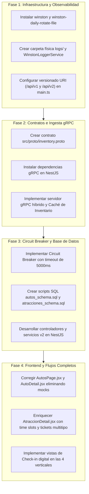

# Auditoría Automatizada de Brechas (Gap Analysis) — Booking Prototipo (RDA2)

> **Documento:** Plan Maestro de Brechas y Pendientes Técnicos  
> **Ubicación:** `Pendientes/AUDITORIA_BRECHAS_GAP_ANALYSIS.md`  
> **Sistema Auditado:** Repositorio Local `plantilla inicial` vs. Requerimientos de Producción Booking.com  
> **Fecha de Auditoría:** 14 de Octubre de 2026  
> **Normas de Arquitectura:** REST HATEOAS Nivel 3, RFC 7807 (Problem Details), Protobuf v3 / gRPC HTTP/2, Database-per-Service (Supabase Cloud PostgreSQL 15+), Observabilidad Física Rotativa Winston.

---

## 1. Resumen Ejecutivo y Alcance de la Auditoría

Esta auditoría técnica compara de forma exhaustiva la base de código actual del proyecto (`plantilla inicial`) con la especificación de requerimientos de ingeniería inversa obtenida de la plataforma en producción de **Booking.com** (sesión autenticada `semestre5grupal@gmail.com`), documentada en los módulos:
* [README_REQUERIMIENTOS.md](file:///c:/Users/ASUS/Documents/6to%20Semestre/Integración%20Sistemas/proyecto/plantilla%20inicial/Pendientes/README_REQUERIMIENTOS.md)
* [modulo_alojamientos.md](file:///c:/Users/ASUS/Documents/6to%20Semestre/Integración%20Sistemas/proyecto/plantilla%20inicial/Pendientes/modulo_alojamientos.md)
* [modulo_renta_autos.md](file:///c:/Users/ASUS/Documents/6to%20Semestre/Integración%20Sistemas/proyecto/plantilla%20inicial/Pendientes/modulo_renta_autos.md)
* [modulo_atracciones.md](file:///c:/Users/ASUS/Documents/6to%20Semestre/Integración%20Sistemas/proyecto/plantilla%20inicial/Pendientes/modulo_atracciones.md)
* [modulo_vuelos.md](file:///c:/Users/ASUS/Documents/6to%20Semestre/Integración%20Sistemas/proyecto/plantilla%20inicial/Pendientes/modulo_vuelos.md)

### Diagnóstico General:
El proyecto cuenta con un trabajo sobresaliente en la vertical de **Vuelos** (catálogo, retención, emisión, contratos OpenAPI) y un avance muy maduro en **Alojamientos** (checkout en dos pasos con cálculo impositivo, reglas de estancia y mock de huéspedes). Asimismo, el filtro de errores [Rfc7807ExceptionFilter](file:///c:/Users/ASUS/Documents/6to%20Semestre/Integración%20Sistemas/proyecto/plantilla%20inicial/src/core/filters/rfc7807-exception.filter.ts) está sólidamente estructurado.

Sin embargo, existen **brechas arquitectónicas críticas** que impiden el cumplimiento pleno de la rúbrica de integración RDA2:
1. **La versión `/api/v2` no está habilitada ni enrutada** en el Gateway NestJS; todo está bajo el prefijo único `/api/v1`.
2. **El protocolo Inbound gRPC (`src/proto/inventory.proto`) no existe en el código** ni están instaladas las dependencias de microservicios gRPC.
3. **No existe Circuit Breaker ni control de Timeout estricto de 5 segundos** para las llamadas salientes REST.
4. **Falta la persistencia aislada para Autos y Atracciones** en Supabase (*Database-per-Service*).
5. **Winston en archivos físicos (`logs/*.log`) no está instalado ni configurado.**
6. **El frontend de Renta de Autos está desconectado del backend**, utilizando datos simulados de respaldo y enviando payloads genéricos mockeados.
7. **El frontend de Atracciones carece de selección de franjas horarias (*time slots*), contadores de boletos multitipo y árbol de categorías.**

---

## 2. Matriz Global de Estado y Brechas

| Capa / Vertical | Estado | Cumplimiento | Impacto Arquitectónico | Archivos Clave Afectados |
| :--- | :---: | :---: | :---: | :--- |
| **API Gateway (NestJS v1 vs v2)** | ⚠️ Parcial | 55% | **Alto** | `src/main.ts`, `src/modules/*/*.controller.ts` |
| **Filtro Global RFC 7807** | ✅ Cumple | 90% | Bajo | `src/core/filters/rfc7807-exception.filter.ts` |
| **Inbound gRPC (`inventory.proto`)** | ❌ No existe | 0% | **Crítico** | `package.json`, `src/proto/`, `src/modules/` |
| **Outbound REST & Circuit Breaker** | ❌ No existe | 15% | **Crítico** | `package.json`, `src/common/utils/`, servicios de módulo |
| **Supabase Database-per-Service** | ⚠️ Parcial | 50% | **Alto** | `database/`, esquemas de autos y atracciones |
| **Auditoría Física Winston** | ❌ No existe | 0% | **Crítico** | `package.json`, `logs/`, `src/core/logger/` |
| **Frontend: Alojamientos** | ✅ Cumple | 85% | Bajo | `frontend/src/pages/`, `AlojamientoCheckoutModal.jsx` |
| **Frontend: Renta de Autos** | 🚨 Crítico | 30% | **Crítico** | `frontend/src/pages/AutosPage.jsx`, `AutoDetail.jsx` |
| **Frontend: Atracciones** | ⚠️ Parcial | 45% | **Alto** | `frontend/src/pages/AtraccionesPage.jsx`, `AtraccionDetail.jsx` |
| **Frontend: Vuelos** | ✅ Cumple | 85% | Medio | `frontend/src/components/FormularioBusquedaVuelos.jsx` |

---

## 3. Desglose Exhaustivo de Brechas por Capa y Módulo

---

### Capa 1: API Gateway y Versionado Dual (NestJS 10.x)

#### Estado Actual en el Código:
En [src/main.ts:85](file:///c:/Users/ASUS/Documents/6to%20Semestre/Integración%20Sistemas/proyecto/plantilla%20inicial/src/main.ts#L85), la aplicación define un prefijo global estático:
```typescript
app.setGlobalPrefix('api/v1');
```
No existe ningún controlador ni ruta mapeada a `/api/v2`.

#### Lo que debe implementarse o modificarse:
1. **Configurar Versionado Dual en NestJS:**
   * Reemplazar el prefijo fijo o habilitar versionado mediante URI:
     ```typescript
     app.enableVersioning({
       type: VersioningType.URI,
       defaultVersion: '1',
     });
     ```
   * O configurar rutas específicas con prefijo dinámico para que `/api/v1` conserve retrocompatibilidad y `/api/v2` atienda los contratos enriquecidos.
2. **Implementar los Endpoints Faltantes de la API v2:**
   * **Atracciones:**
     * `GET /api/v2/atracciones/categorias/arbol`: Árbol jerárquico recursivo de categorías (`id`, `nombre`, `slug`, `subcategorias`, `incluye_comida`, `incluye_guia`).
     * `GET /api/v2/atracciones/:id`: Detalle enriquecido con `ratings_breakdown` (limpieza, servicio, calidad), `highlights`, `itinerary` y `service_animals_allowed`.
     * `POST /api/v2/atracciones/reservas/:id/checkin`: Check-in presencial con validación de documento de identidad, asignación de guía certificado y emisión de `voucher_digital_qr`.
   * **Renta de Autos:**
     * `GET /api/v2/autos/:id`: Detalle de vehículo y estado de flota con kilometraje actual, fotos, inclusiones y políticas de recogida/devolución.
     * `POST /api/v2/autos/orders/hold`: Bloqueo temporal del vehículo y congelamiento de precio por 20 minutos.
     * `POST /api/v2/autos/orders/preview`: Cotización previa con cálculo exacto de seguro y depósito.
     * `POST /api/v2/autos/orders/:id/checkin`: Check-in y entrega con `conductor_nombre`, `licencia_numero`, `km_salida` y `deposito_retenido_usd`.
     * `POST /api/v2/autos/:id/mantenimiento/registro`: Inspección de patio con `kilometraje_llegada`, `nivel_combustible`, daños y estado `EN_LIMPIEZA` (120 minutos).
   * **Alojamientos:**
     * `POST /api/v2/alojamientos/reservations/:id/checkin`: Check-in digital anticipado con asignación de habitación (`Suite 402`) y clave digital (`9941#`).
   * **Vuelos:**
     * `POST /api/v2/vuelos/bookings/:id/check-in`: Check-in aéreo con confirmación de asiento ("14A"), generación de PNR y URL del Boarding Pass en PDF.
3. **Corregir Tipado en `AutosController`:**
   * En [src/modules/autos/autos.controller.ts:13,43](file:///c:/Users/ASUS/Documents/6to%20Semestre/Integración%20Sistemas/proyecto/plantilla%20inicial/src/modules/autos/autos.controller.ts#L13), los métodos `search(@Body() dto: any)` y `createOrder(@Body() orderData: any)` reciben `any`. Se deben crear DTOs formales con `class-validator` y `class-transformer` (`CarSearchRequestDto`, `OrderCreateRequestDto`, `OrderHoldRequestDto`).
4. **Extender Interceptor HATEOAS:**
   * [src/core/interceptors/hateoas.interceptor.ts](file:///c:/Users/ASUS/Documents/6to%20Semestre/Integración%20Sistemas/proyecto/plantilla%20inicial/src/core/interceptors/hateoas.interceptor.ts#L35-L60) actualmente solo inyecta hipermedios para Atracciones y Vuelos sobre `/api/v1`. Debe extenderse para inyectar enlaces en Alojamientos (`self`, `reservar`, `checkin`) y Autos (`self`, `hold`, `preview`, `checkin`), respetando si la petición se originó en v1 o v2.

---

### Capa 2: Ingesta Inbound gRPC y Caché de Inventario en Tiempo Real

#### Estado Actual en el Código:
* El archivo `src/proto/inventory.proto` está documentado en `RDA2_CONTRACT_UPDATES.md`, `ADR-001` y `contratos_api_v2.md`, pero **no existe en el sistema de archivos**.
* [package.json](file:///c:/Users/ASUS/Documents/6to%20Semestre/Integración%20Sistemas/proyecto/plantilla%20inicial/package.json) no incluye los paquetes de soporte gRPC ni `@nestjs/microservices`.

#### Lo que debe implementarse o modificarse:
1. **Crear el Contrato Protobuf (`src/proto/inventory.proto`):**
   ```protobuf
   syntax = "proto3";

   package inventory;

   service InventoryService {
     rpc PushStockUpdate (StockUpdateRequest) returns (StockUpdateResponse);
     rpc StreamAvailability (stream AvailabilityEvent) returns (stream StockUpdateResponse);
   }

   message StockUpdateRequest {
     string tienda_id = 1;
     string recurso_id = 2;
     int32 cantidad_disponible = 3;
     string tipo_recurso = 4;
     string timestamp = 5;
     string signature = 6;
   }

   message StockUpdateResponse {
     bool success = 1;
     string message = 2;
     string correlation_id = 3;
   }

   message AvailabilityEvent {
     string tienda_id = 1;
     string recurso_id = 2;
     string estado = 3;
     string timestamp = 4;
   }
   ```
2. **Instalar Dependencias gRPC:**
   ```bash
   npm install @grpc/grpc-js @grpc/proto-loader @nestjs/microservices
   ```
3. **Configurar el Microservicio Servidor gRPC en `main.ts`:**
   * Configurar el servidor híbrido en NestJS escuchando en un puerto gRPC independiente (ej. `50051`) con transporte `Transport.GRPC`.
4. **Implementar Controlador y Servicio de Ingesta:**
   * Crear `src/modules/inventory/inventory-grpc.controller.ts` para procesar los eventos `PushStockUpdate` y `StreamAvailability`.
5. **Caché en Memoria de Disponibilidad:**
   * Crear un servicio de caché en memoria (usando `cache-manager` ya presente en el proyecto) que almacene el stock vivo de las 4 tiendas para alimentar instantáneamente los endpoints de búsqueda sin saturar la red con polling REST continuo.

---

### Capa 3: Integración Outbound REST y Resiliencia (Circuit Breaker)

#### Estado Actual en el Código:
Las peticiones salientes hacia las tiendas externas se hacen con llamadas HTTP estándar sin tolerancia a fallos ni límites de tiempo configurados.

#### Lo que debe implementarse o modificarse:
1. **Implementar Patrón Circuit Breaker (ADR-001):**
   * Instalar e integrar `opossum` o construir un interceptor Axios / servicio wrapper de resiliencia.
   * Parámetros obligatorios:
     * **Timeout estricto:** `5000 ms` (5 segundos).
     * **Umbral de fallo:** `50%` de errores en una ventana de `10000 ms`.
     * **Tiempo de reset (Half-Open):** `30000 ms`.
2. **Manejo de Errores RFC 7807 ante Timeout:**
   * Si la tienda externa tarda más de 5000 ms o el circuito está abierto, el Gateway debe responder inmediatamente con HTTP `504 Gateway Timeout` o HTTP `503 Service Unavailable`:
     ```json
     {
       "type": "https://booking-hub.com/errors/external-service-timeout",
       "title": "Gateway Timeout",
       "status": 504,
       "detail": "El microservicio externo no respondió dentro del límite estricto de 5000 ms.",
       "instance": "/api/v2/autos/orders/create"
     }
     ```
3. **Auditar Cabecera `Idempotency-Key` en Todas las Confirmaciones:**
   * Verificar que todas las rutas `POST` de compra y cancelación exijan estrictamente la cabecera UUID v4 y respondan HTTP `400 Bad Request` bajo RFC 7807 si falta.

---

### Capa 4: Persistencia Aislada (*Database-per-Service* en Supabase)

#### Estado Actual en el Código:
* Existen scripts para Alojamientos (`database/supabase_hospitality_schema.sql`), Vuelos (`src/modules/vuelos/vuelos_schema.sql`) y Admin (`database/admin_schema.sql`).
* **No existen esquemas relacionales para Autos ni para Atracciones.**

#### Lo que debe implementarse:
1. **Crear Script SQL de Autos (`database/autos_schema.sql`):**
   * Esquema `autos` con tablas:
     * `autos.vehiculos`: id, marca, modelo, transmision, categoria, precio_por_dia, status (`DISPONIBLE`, `HOLD`, `ALQUILADO`, `EN_LIMPIEZA`), kilometraje_actual.
     * `autos.agencias`: id, nombre, iata_code, ciudad, tipo_oficina.
     * `autos.ordenes`: id, auto_id, conductor_nombre, conductor_licencia, fecha_recogida, fecha_devolucion, estado, idempotency_key.
     * `autos.coberturas`: id, orden_id, tipo_cobertura, monto_franquicia, deposito_retenido.
     * `autos.mantenimientos`: id, auto_id, km_llegada, combustible, observaciones, limpieza_fin.
2. **Crear Script SQL de Atracciones (`database/atracciones_schema.sql`):**
   * Esquema `atracciones` con tablas:
     * `atracciones.catalogo`: id, nombre, descripcion, ciudad, precio_adulto, incluye_guia, incluye_comida, servicio_animales.
     * `atracciones.categorias`: id, nombre, slug, parent_id (auto-referencia recursiva).
     * `atracciones.turnos`: id, atraccion_id, hora_inicio, aforo_maximo, aforo_disponible.
     * `atracciones.reservas`: id, atraccion_id, turno_id, titular_nombre, titular_email, titular_telefono, boletos_adulto, boletos_nino, boletos_senior, estado, qr_code, idempotency_key.
     * `atracciones.checkin_guias`: id, reserva_id, guia_nombre, guia_licencia, hora_llegada.
3. **Aislamiento Estricto:**
   * Ningún script debe contener Foreign Keys que apunten a tablas de otro microservicio. Toda relación entre dominios se orquesta mediante identificadores alfanuméricos en la capa de aplicación NestJS.

---

### Capa 5: Observabilidad y Auditoría Técnica en Archivos Físicos (Winston)

#### Estado Actual en el Código:
Planificado en `ADR-003`, pero no está instalado en `package.json` ni existe la carpeta `logs/`. La telemetría actual se guarda en PostgreSQL mediante `telemetry.service.ts`.

#### Lo que debe implementarse:
1. **Instalar Dependencias de Logging:**
   ```bash
   npm install winston winston-daily-rotate-file
   ```
2. **Crear Módulo y Servicio de Logger Winston:**
   * Crear `src/core/logger/winston-logger.service.ts` configurado con transporte rotativo diario:
     * Archivo de Auditoría: `logs/audit-%DATE%.log` (eventos: `RESERVATION_CONFIRMED`, `HOLD_CREATED`, `CHECKIN_COMPLETED`, `CANCEL_PROCESSED`).
     * Archivo de Integración: `logs/integration-%DATE%.log` (eventos: llamadas REST salientes, push gRPC, timeouts, aperturas de Circuit Breaker).
     * Formato JSON estructurado con `timestamp`, `level`, `correlation_id`, `tienda_id`, `ip`, `datos_anonimizados`.
     * Retención máxima: 14 días con compresión `.gz`.
3. **Cumplir la Regla de Oro:**
   * Desacoplar la auditoría transaccional de la base de datos: **prohibido crear tablas SQL para almacenar logs de auditoría masivos.**

---

### Capa 6: Brechas en el Frontend (React 18 + Vite)

---

#### 6.1. Módulo de Alojamientos
* **Estado:** Muy maduro (~85%).
* **Brecha Pendiente:**
  * Falta la vista de **Check-in Digital** (`frontend/src/pages/AlojamientoCheckinPage.jsx` enlazada a la ruta `/alojamientos/checkin/:reservaId`).
  * Debe solicitar el documento de identidad y hora estimada de llegada, consumir `POST /api/v2/alojamientos/reservations/:id/checkin` y renderizar la tarjeta con la habitación asignada y la clave de apertura digital (`9941#`).

---

#### 6.2. Módulo de Renta de Autos (🚨 Crítico)
* **Estado:** ~30% de cumplimiento.
* **Brechas Pendientes:**
  1. **Eliminar Datos Simulados de Respaldo:**
     * En [frontend/src/pages/AutosPage.jsx:178-180](file:///c:/Users/ASUS/Documents/6to%20Semestre/Integración%20Sistemas/proyecto/plantilla%20inicial/frontend/src/pages/AutosPage.jsx#L178-L180), la función `fetchData` tiene hardcodeado un fallback con `mockAutos` debido al 404 del backend.
  2. **Conectar Formulario de Búsqueda Real:**
     * En [frontend/src/pages/AutosPage.jsx:170-175](file:///c:/Users/ASUS/Documents/6to%20Semestre/Integración%20Sistemas/proyecto/plantilla%20inicial/frontend/src/pages/AutosPage.jsx#L170-L175), se envía un `mockRequest` fijo. Debe enviar los campos reales: `pickupLocation`, `dropLocation`, `pickupDateTime`, `returnDateTime` y `driverAge`.
  3. **Corregir Consulta de Ficha Detallada:**
     * En [frontend/src/pages/AutoDetail.jsx:20](file:///c:/Users/ASUS/Documents/6to%20Semestre/Integración%20Sistemas/proyecto/plantilla%20inicial/frontend/src/pages/AutoDetail.jsx#L20), toma el auto de `location.state?.auto`. Debe consultar `GET /api/v2/autos/:id` para permitir acceso directo por URL y recargas.
  4. **Implementar Bloqueo Temporal (Hold):**
     * Conectar `POST /api/v2/autos/orders/hold` antes de la pantalla de pago para congelar inventario por 20 minutos.
  5. **Incorporar Atributos Faltantes de Checkout:**
     * Campo obligatorio de número de vuelo (`flight_number`) para seguimiento de retrasos en aeropuertos.
     * Selector de Protección Total vs Básica con aviso mandatorio de tarjeta de crédito física para depósito.
     * Contadores de extras: Silla de bebé (`extra_baby_seat`) y GPS.
  6. **Vistas Operativas de Patio y Check-in (HU-AUT-06):**
     * Vista de entrega de vehículo con odómetro inicial y depósito retenido.
     * Vista de devolución con odómetro final, nivel de gasolina y estado de limpieza de 120 minutos.

---

#### 6.3. Módulo de Atracciones
* **Estado:** ~45% de cumplimiento.
* **Brechas Pendientes:**
  1. **Árbol Jerárquico de Categorías (HU-ATR-02):**
     * En [frontend/src/pages/AtraccionesSearchPage.jsx](file:///c:/Users/ASUS/Documents/6to%20Semestre/Integración%20Sistemas/proyecto/plantilla%20inicial/frontend/src/pages/AtraccionesSearchPage.jsx), consumir `GET /api/v2/atracciones/categorias/arbol` y renderizar el panel colapsable de subcategorías (Tours > Gastronomía > Cacao).
  2. **Selector de Franjas Horarias (*Time Slots*) (HU-ATR-03):**
     * En [frontend/src/pages/AtraccionDetail.jsx:35](file:///c:/Users/ASUS/Documents/6to%20Semestre/Integración%20Sistemas/proyecto/plantilla%20inicial/frontend/src/pages/AtraccionDetail.jsx#L35), sustituir la hora fija por botones de selección horaria dinámica (`09:00`, `11:30`, `14:00`) con control de aforo por turno.
  3. **Contadores de Boletos Multitipo (HU-ATR-03):**
     * Reemplazar el contador único `ticket_count: 1` por steppers diferenciados: Adulto, Niño (descuento), Senior y Bebé ($0 con aforo).
  4. **Ficha Técnica Enriquecida:**
     * Renderizar los bloques de `highlights`, `itinerary` cronológico y `ratings_breakdown` (limpieza, servicio, calidad).
  5. **Voucher Digital con QR y Check-in con Guía (HU-ATR-05 y 06):**
     * Pantalla de éxito con generación de código QR dinámico.
     * Vista para que el guía registre el check-in presencial validando la cédula/pasaporte.

---

#### 6.4. Módulo de Vuelos
* **Estado:** ~85% de cumplimiento.
* **Brechas Pendientes:**
  1. **Validación Perimetral Estricta de Pasajeros:**
     * Validar matemáticamente la fecha de nacimiento ingresada:
       * Adulto: `>= 12 años`.
       * Niño: `2 a 11 años`.
       * Bebé: `0 a 1 año` con restricción de `infants <= adults`.
  2. **Validación de Pasaporte Internacional:**
     * Exigir que la fecha de caducidad sea superior a 6 meses después de la fecha de salida.
  3. **Check-in Aéreo v2:**
     * Conectar con `POST /api/v2/vuelos/bookings/:id/check-in` para retornar el PNR, confirmar asiento y permitir descargar el pase de abordar en PDF.

---

## 4. Plan de Acción Recomendado (Roadmap de Implementación)



---

## 5. Criterios de Aceptación para Dar por Cerradas las Brechas

1. **Auditoría de Archivos:** Las transacciones de compra y check-in deben generar líneas legibles en `logs/audit-YYYY-MM-DD.log` sin tocar tablas de auditoría en PostgreSQL.
2. **Resiliencia de Red:** Si una tienda externa se apaga, las peticiones salientes deben abortar exactamente a los 5000 ms retornando HTTP 504 formateado bajo RFC 7807.
3. **Flujo de Autos:** La búsqueda en `AutosPage.jsx` debe consultar dinámicamente `/api/v2/autos/search` sin fallbacks a datos fijos en código.
4. **Flujo de Atracciones:** El usuario debe poder seleccionar un turno horario (`10:30`), boletos de adulto y niño, y recibir un código QR en pantalla.
5. **Check-in Digital:** Cada una de las 4 verticales debe permitir ejecutar el check-in digital postventa con sus respectivos contratos v2.
