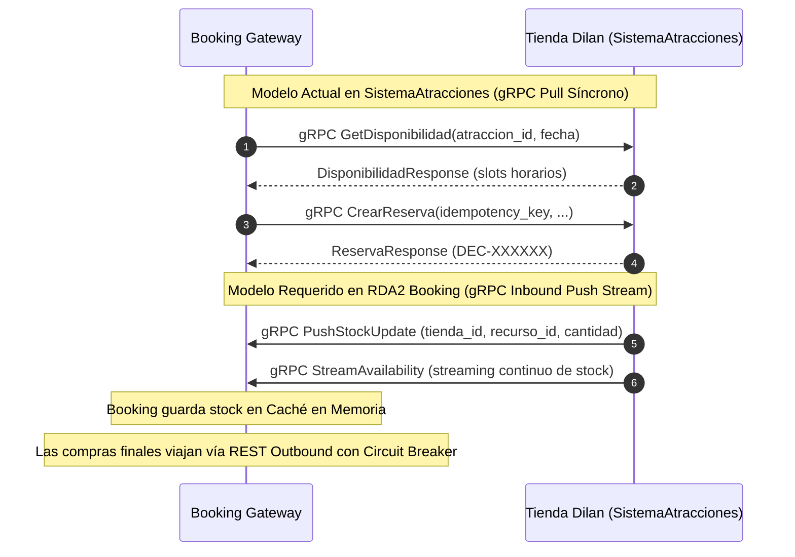

# Auditoría Automatizada de Brechas: SistemaAtracciones vs. Requerimientos Booking.com (RDA2)

> **Repositorio Evaluado:** [https://github.com/Dilanm2002/SistemaAtracciones](https://github.com/Dilanm2002/SistemaAtracciones) ("Descubre EC")  
> **Requerimientos de Referencia:** [modulo_atracciones.md](file:///c:/Users/ASUS/Documents/6to%20Semestre/Integración%20Sistemas/proyecto/plantilla%20inicial/Pendientes/modulo_atracciones.md) (HU-ATR-01 a HU-ATR-06)  
> **Contrato de Integración v2:** `docs Paúl Rosero/context/contratos_api_v2.md`  
> **Fecha de Auditoría:** 14 de Octubre de 2026  
> **Ubicación del Documento:** `Pendientes/AUDITORIA_BRECHAS_SISTEMA_ATRACCIONES.md`

---

## 1. Resumen Ejecutivo de la Auditoría

El repositorio `SistemaAtracciones` de Dilan Mendoza representa la tienda externa de referencia para la vertical de **Atracciones Turísticas** en el proyecto intergrupal RDA2. 

Al auditar su implementación técnica (backend NestJS, frontend React y base de datos PostgreSQL) contra las especificaciones derivadas de la ingeniería inversa de Booking.com ([modulo_atracciones.md](file:///c:/Users/ASUS/Documents/6to%20Semestre/Integración%20Sistemas/proyecto/plantilla%20inicial/Pendientes/modulo_atracciones.md)), se observa que el sistema **posee una base arquitectónica madura y de alta calidad** (manejo de franjas horarias, validación de cédulas, bloqueo de cupos e idempotencia en pagos). 

No obstante, existen **brechas funcionales y desalineaciones de contrato** que deben ser subsanadas o adaptadas en la capa de integración de nuestro API Gateway para lograr una conexión 100% interoperable.

---

## 2. Matriz Comparativa de Cumplimiento por Historia de Usuario

| Historia de Usuario (Booking.com) | Estado en `SistemaAtracciones` | % Cumplimiento | Brecha Principal Detectada |
| :--- | :---: | :---: | :--- |
| **HU-ATR-01: Búsqueda y Descubrimiento** | ✅ Cumple | 90% | Búsqueda por ciudad, texto y fecha operativa. Filtros de precio y duración disponibles. |
| **HU-ATR-02: Árbol Jerárquico de Categorías** | ⚠️ Parcial | 60% | La BD soporta jerarquía (`cat_padre_id`), pero la API no expone el endpoint anidado `GET /categorias/arbol` ni el frontend muestra navegación en árbol. |
| **HU-ATR-03: Time Slots y Desglose de Boletos** | ⚠️ Parcial | 65% | Soporta *time slots* (`horarios`), pero solo maneja tarifas de Adulto y Niño; faltan categorías de Senior (tercera edad) y Bebé ($0 con aforo). Falta `ratings_breakdown` y `service_animals_allowed`. |
| **HU-ATR-04: Checkout y Datos del Turista** | ⚠️ Parcial | 80% | Validación perimetral excelente pero restringida a nivel local (teléfonos ecuatorianos `09XXXXXXXX` y cédulas EC). Booking exige formato internacional E.164. |
| **HU-ATR-05: Confirmación, Idempotencia y QR** | ⚠️ Parcial | 70% | Implementa `IdempotencyKeyGuard` y genera archivo `.ics` de calendario, pero no emite el código QR dinámico de acceso rápido. |
| **HU-ATR-06: Check-in Presencial con Guía (v2)** | ❌ No implementado | 0% | No existe el endpoint `POST /reservas/:id/checkin` ni la lógica de asignación de guía acreditado para el canje presencial del voucher. |
| **Protocolo de Ingesta gRPC (`inventory.proto`)** | ⚠️ Desalineado | 40% | Dilan expone un servidor gRPC síncrono *Pull* (`atracciones.proto`), mientras que la arquitectura Booking espera un push continuo *Inbound Stream* (`inventory.proto`). |

---

## 3. Análisis Detallado de Brechas por Requerimiento Funcional

---

### HU-ATR-01: Búsqueda y Descubrimiento de Atracciones por Ciudad y Fechas

* **Requerimiento Booking:** Buscador con autocompletado de ciudades, filtro por fechas, precio *"Desde US$ XX por adulto"* y estado vacío (*Empty State*).
* **Implementación en `SistemaAtracciones`:**
  * Endpoint: `POST /api/v1/atracciones/search` con DTO `SearchAtraccionesDto` que valida `ciudad`, `q`, `fecha`, `categoria`, `precio_max` y `duracion_max`.
  * Frontend: [Home.jsx](file:///C:/Users/ASUS/.gemini/antigravity-ide/brain/57a7869d-e7f6-44cf-8981-9375339be2e1/scratch/SistemaAtracciones/frontend/src/pages/Home.jsx) y [Explore.jsx](file:///C:/Users/ASUS/.gemini/antigravity-ide/brain/57a7869d-e7f6-44cf-8981-9375339be2e1/scratch/SistemaAtracciones/frontend/src/pages/Explore.jsx) ofrecen autocompletado y selector de fechas con restricción `min: hoyEc()`.
* **Brechas / Acciones:**
  * **Menor:** En `SistemaAtracciones`, el precio mínimo se calcula dinámicamente en frontend; el Gateway de Booking puede consumir directamente `POST /search` sin adaptaciones mayores.

---

### HU-ATR-02: Navegación del Árbol Jerárquico de Categorías (API v2)

* **Requerimiento Booking (Contrato v2):**
  * Endpoint obligatorio: `GET /api/v2/atracciones/categorias/arbol`.
  * Estructura requerida:
    ```json
    [
      {
        "id": "cat-100",
        "nombre": "Tours y Experiencias",
        "slug": "tours",
        "subcategorias": [
          {
            "id": "cat-201",
            "nombre": "Tours Gastronómicos",
            "slug": "tours-gastronomicos",
            "incluye_comida": true,
            "incluye_guia": true,
            "subcategorias": [...]
          }
        ]
      }
    ]
    ```
* **Implementación en `SistemaAtracciones`:**
  * En la base de datos (`database/01_esquema.sql`), la tabla `categoria` sí tiene la columna autorreferencial `cat_padre_id REFERENCES categoria(cat_id)`.
  * Sin embargo, el controlador [catalogo.controller.ts](file:///C:/Users/ASUS/.gemini/antigravity-ide/brain/57a7869d-e7f6-44cf-8981-9375339be2e1/scratch/SistemaAtracciones/backend/src/modules/atracciones/catalogo.controller.ts) solo expone `GET /catalogo/categorias`, devolviendo un arreglo plano sin anidamiento.
  * No existen las banderas booleanas `incluye_comida` ni `incluye_guia` dentro del objeto de categoría.
* **Brechas / Acciones:**
  * El API Gateway de Booking debe orquestar la transformación recursiva si consume el catálogo plano, o Dilan debe incorporar el endpoint `/categorias/arbol` en su API.

---

### HU-ATR-03: Ficha Detallada, Selección de Turno Horario (*Time Slots*) y Desglose de Boletos

* **Requerimiento Booking:**
  * Selección de franja horaria (`09:00`, `11:30`, `14:00`) con aforo remanente por turno.
  * Desglose tarifario multitipo: Adultos, Niños, Adultos Mayores (*Seniors 65+*) y Bebés (*Infants $0 con reserva de cupo*).
  * Ficha enriquecida v2 con: `ratings_breakdown` (limpieza, servicio, calidad), `highlights`, `itinerary` por horas y bandera `service_animals_allowed`.
* **Implementación en `SistemaAtracciones`:**
  * **Acierto:** Implementa franjas horarias de forma real en base de datos (`horario`, `disponibilidad`) y expone `GET /atracciones/:id/availability?date=YYYY-MM-DD` con array de turnos (`slots: [{ time, available }]`).
  * **Brecha 1 (Tipos de Boletos):** La base de datos y los DTOs (`ReservationRequestDto`) solo contemplan `res_adultos` y `res_ninos` (`children`). No existen campos ni cálculos para `seniors` ni para `infants` (bebés).
  * **Brecha 2 (Desglose de Calidad):** Solo expone una calificación numérica promedio global (`calificacion: 4.8`, `numero_resenas: 120`). No desglosa las facetas de limpieza, servicio y calidad técnica.
  * **Brecha 3 (Animales de Servicio):** El modelo relacional no incluye la columna para animales de asistencia (`service_animals_allowed`), aunque sí maneja exclusiones de mascotas en general.
  * **Brecha 4 (Itinerario Estructurado):** El itinerario se expone como un campo de texto narrativo o inclusiones; no como un arreglo estructurado de objetos con hora y actividad (`[{ hora: "09:00", actividad: "..." }]`).

---

### HU-ATR-04: Formulario de Checkout y Datos de Contacto del Turista

* **Requerimiento Booking:**
  * Captura de turista internacional: Nombre, Apellido, Email, Teléfono internacional en formato E.164 (`+593...`, `+1...`, `+34...`) con selector de bandera/país.
  * Campo de peticiones especiales y requerimientos alimenticios.
* **Implementación en `SistemaAtracciones`:**
  * [Checkout.jsx](file:///C:/Users/ASUS/.gemini/antigravity-ide/brain/57a7869d-e7f6-44cf-8981-9375339be2e1/scratch/SistemaAtracciones/frontend/src/pages/Checkout.jsx) cuenta con una excelente validación perimetral: exige nombre y apellido separados, valida cédula ecuatoriana y valida que el teléfono cumpla con el regex `RE_TELEFONO_EC` (`^09[0-9]{8}$`).
* **Brechas / Acciones:**
  * **Restricción Local Excesiva:** Al exigir estrictamente `RE_TELEFONO_EC` y `EsDocumentoEc()`, **un usuario extranjero en Booking (ej. de España o EE. UU.) no puede completar la reserva** en la API de Dilan porque su teléfono (+34...) o su pasaporte serán rechazados con HTTP 400.
  * **Solución de Integración:** El API Gateway de Booking debe enviar un teléfono normalizado o Dilan debe flexibilizar su validador para admitir el formato E.164 internacional en la API pública de integración.

---

### HU-ATR-05: Confirmación de Compra Idempotente y Emisión de Voucher Digital QR

* **Requerimiento Booking:**
  * Procesamiento síncrono con cabecera `Idempotency-Key` (UUID v4).
  * Pantalla de éxito con generación y renderizado de un **Código QR dinámico** que encapsule la firma de la reserva.
* **Implementación en `SistemaAtracciones`:**
  * **Acierto:** Implementa [IdempotencyKeyGuard](file:///C:/Users/ASUS/.gemini/antigravity-ide/brain/57a7869d-e7f6-44cf-8981-9375339be2e1/scratch/SistemaAtracciones/backend/src/common/guards/idempotency-key.guard.ts) con almacenamiento en la tabla `idempotencia` de PostgreSQL y hash SHA-256 del cuerpo de la petición.
  * **Acierto:** Genera y permite descargar archivos de calendario `.ics` estándar para sincronización con calendarios móviles.
* **Brechas / Acciones:**
  * No genera la imagen del código QR dinámico (`voucher_digital_qr`). Booking Prototipo deberá renderizar el código QR en su propio frontend utilizando el código `res_codigo` (ej. `DEC-7F3K9Q`) retornado por la tienda de Dilan.

---

### HU-ATR-06: Check-in Presencial en Punto de Encuentro con Guía Asignado (Extensión API v2)

* **Requerimiento Booking (Contrato v2):**
  * Endpoint: `POST /api/v2/atracciones/reservas/:id/checkin`.
  * Entrada: `{ "documento_identidad": "1723456789", "hora_llegada": "2026-10-15T08:50:00Z" }`.
  * Respuesta exitosa (200 OK):
    ```json
    {
      "reserva_id": "res-999",
      "estado": "COMPLETADA",
      "guia_asignado": "Luis Paredes (Licencia #441)",
      "punto_encuentro": "Puerta Principal de la Catedral",
      "voucher_digital_qr": "https://api.booking.local/vouchers/atr-res-999.png",
      "mensaje": "Check-in exitoso. Por favor presente su voucher al guía."
    }
    ```
* **Implementación en `SistemaAtracciones`:**
  * La base de datos tiene estados `PENDING`, `CONFIRMED`, `CANCELLED`. No contempla el estado `COMPLETADA` ni `HOSPEDADO`/`CHECKED_IN`.
  * No existe ningún endpoint de check-in en el controlador de reservas.
* **Brechas / Acciones:**
  * **Brecha Total (0%):** Este endpoint debe ser implementado directamente por Dilan en su microservicio, o el Gateway de Booking debe emular la capa de postventa asignando el guía y actualizando el estado de la reserva en el esquema intermedio.

---

## 4. Desalineación Arquitectónica: Protocolo gRPC (Push vs. Pull)

Existe una diferencia conceptual importante entre el diseño previsto en Booking y el contrato gRPC desarrollado por Dilan:



### Hallazgo:
1. En `SistemaAtracciones/backend/contracts/atracciones.proto`, Dilan implementó un servidor gRPC para que Booking le pida disponibilidad y cree reservas de forma síncrona.
2. La arquitectura general de RDA2 estipula que **las tiendas externas empujan su stock mediante `inventory.proto` hacia el Gateway de Booking**, y las compras finales se confirman mediante **REST síncrono con Circuit Breaker e Idempotencia**.

---

## 5. Matriz de Cambios Requeridos para la Integración

### A. Ajustes que debe realizar el compañero Dilan en `SistemaAtracciones`:
1. **Flexibilizar Validaciones para Clientes Internacionales:** Modificar `customer_phone` para permitir números internacionales E.164 (`^\+?[1-9]\d{6,14}$`) y permitir pasaportes de cualquier nacionalidad en `customer_document`.
2. **Implementar Endpoint de Check-in Presencial:** Añadir `POST /atracciones/reservas/:id/checkin` que valide el documento, asigne un guía de la tabla `operador` y cambie el estado a `COMPLETADA`.
3. **Exponer Árbol de Categorías Recursivo:** Crear la ruta `GET /atracciones/categorias/arbol` serializando las categorías anidadas por `cat_padre_id`.

### B. Adaptaciones que debemos implementar en nuestro Gateway (Booking Prototipo):
1. **Adapter / Mapeador de Boletos:** Cuando el cliente en Booking seleccione boletos Senior o Bebé, mapearlos en la llamada a la tienda de Dilan como adultos o niños según corresponda, recalculando el precio agregado.
2. **Generador Local de Código QR:** Como la tienda de Dilan no emite el QR, el Gateway de Booking debe tomar el código de reserva retornado (`DEC-XXXXXX`) y generar la imagen del QR para el voucher digital.
3. **Consumo Híbrido de Eventos:** Suscribirse al feed Outbox `GET /api/v1/eventos` de Dilan para recibir notificaciones cuando se agoten cupos o se creen nuevas experiencias turísticas.
