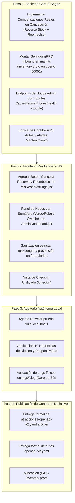

# Plan Maestro de Implementación y Auditoría de Brechas — Reto 2 (RDA2): Booking Prototipo

**Asignatura:** Integración de Sistemas — 6to Semestre  
**Proyecto:** Booking Prototipo (Marketplace Agregador Central y Ecosistema de Microservicios)  
**Ubicación del Documento:** `Pendientes/PLAN_IMPLEMENTACION_RDA2.md`  
**Objetivo de Calificación:** **11 / 11 Puntos** (Superando la Condición Habilitante Obligatoria Excluyente de la Rúbrica)  
**Marco Normativo de Auditoría:**
1. [Consideraciones RDA2.md](file:///c:/Users/ASUS/Documents/6to%20Semestre/Integración%20Sistemas/proyecto/plantilla%20inicial/teoria/Consideraciones%20RDA2.md) (gRPC Inbound, REST Outbound, Logs físicos sin BD, Nodos verdes/rojos con toggles, Check-in x4, Autos 2h cooldown, Rol de mantenimiento con odómetro/alertas, Categorías recursivas, Sagas y Compensaciones).
2. [Proyecto de la asignatura.pdf](file:///c:/Users/ASUS/Documents/6to%20Semestre/Integración%20Sistemas/proyecto/plantilla%20inicial/teoria/Proyecto%20de%20la%20asignatura.pdf) (Semanas 7 a 11: Microservicios, Gestión de Contratos, API Gateway/BFF, Contract Testing, Observabilidad distribuida, Seguridad JWT/Scopes).
3. [Rúbrica RDA2.md](file:///c:/Users/ASUS/Documents/6to%20Semestre/Integración%20Sistemas/proyecto/plantilla%20inicial/teoria/Rúbrica%20RDA2.md) (11 Criterios evaluativos con Criterio Excluyente = Cero si falla una integración).
4. [modulo_atracciones.md](file:///c:/Users/ASUS/Documents/6to%20Semestre/Integración%20Sistemas/proyecto/plantilla%20inicial/Pendientes/modulo_atracciones.md), [modulo_alojamientos.md](file:///c:/Users/ASUS/Documents/6to%20Semestre/Integración%20Sistemas/proyecto/plantilla%20inicial/Pendientes/modulo_alojamientos.md) y [SISTEMA_ATRACCIONES_ESTRUCTURA_FUNCIONAMIENTO.md](file:///c:/Users/ASUS/Documents/6to%20Semestre/Integración%20Sistemas/proyecto/plantilla%20inicial/Pendientes/SISTEMA_ATRACCIONES_ESTRUCTURA_FUNCIONAMIENTO.md).

---

## 1. Declaración de Principio y Filosofía de Integración
> **REGLA FUNDAMENTAL:** *"Primero se deja 100% terminada, blindada y funcional la plantilla inicial (Booking Prototipo) antes de distribuir los contratos definitivos a los compañeros de clase."*

Publicar o congelar un contrato OpenAPI o Protobuf cuando el sistema agregador central aún tiene métodos no implementados, flujos incompletos o brechas en sus reglas de negocio conduce inevitablemente al fracaso de integración: obligaría a crear versiones "v3" o parches a medio camino, rompiendo el criterio excluyente de la rúbrica (**CE01: Calificación 0 si falla una integración**).

---

## 2. Auditoría Rigurosa de Brechas: Estado Real de `plantilla inicial` vs. Requerimientos RDA2

A continuación se detalla la matriz forense que compara los mandatos de la cátedra frente a lo que **verdaderamente está codificado** en el repositorio actual:

```
┌────────────────────────────────────────────────────────────────────────────────────────┐
│ ESTADO DE IMPLEMENTACIÓN:                                                              │
│ 🟢 IMPLEMENTADO Y PROBADO | 🟡 PARCIAL / SOLO CONTRATO O MOCK | 🔴 PENDIENTE EN CÓDIGO │
└────────────────────────────────────────────────────────────────────────────────────────┘
```

| # | Requerimiento Normativo | Fuente Normativa | Estado Real en Código | Brecha Detectada y Trabajo Faltante |
|:---:|:---|:---|:---:|:---|
| **B-01** | **Reversos, Compensaciones y Cancelación (Sagas)** | *Consideraciones §8*<br/>*Proyecto Sem. 15* | 🔴 **FALTA EN CÓDIGO** | `AtraccionesService.cancelarReserva` solo marca `status = CANCELLED`. **NO** devuelve los cupos a los time slots (`cupos += tickets`), **NO** emite comprobante/registro de reembolso monetario, **NO** llama al endpoint de cancelación del sistema externo (`POST /reservas/:id/cancel`), y en `MisReservasPage.jsx` **no existe botón ni flujo para que el usuario cancele atracciones o autos**. |
| **B-02** | **Servidor gRPC Inbound para Stock en Tiempo Real** | *Consideraciones §1, §3*<br/>*Proyecto Sem. 7* | 🟡 **PARCIAL** | Se redactó el archivo `src/proto/inventory.proto`, pero `src/main.ts` **NO tiene configurado el microservicio gRPC** (`app.connectMicroservice` escuchando en puerto 50051). Falta el controlador/servicio NestJS que implemente las RPCs para recibir el push de stock de los compañeros y actualizar la disponibilidad local. |
| **B-03** | **Monitor de Nodos con Semáforo (🟢/🔴) y Toggles de Desconexión** | *Consideraciones §2*<br/>*Rúbrica CE05* | 🔴 **FALTA EN CÓDIGO** | `AdminDashboard.jsx` no tiene la sección visual con tarjetas interactivas de nodos externos, semáforos LED en vivo (verde si latencia < 1000ms, rojo si timeout/5xx) ni los **interruptores (toggles) para desconectar/conectar tiendas en tiempo real** solicitados para la prueba del docente. |
| **B-04** | **Check-in Multimodal para las 4 Verticales** | *Consideraciones §4*<br/>*Rúbrica CE04* | 🟡 **PARCIAL** | Existen endpoints en backend pero no hay una página frontend unificada `/checkin` (`CheckinPage.jsx`) donde un usuario ingrese su localizador (vuelo, auto, atracción u hotel) para validar identidad y emitir el voucher/tarjeta digital QR unificada. |
| **B-05** | **Gestión de Autos: Cooldown Obligatorio de 2 Horas** | *Consideraciones §5* | 🟡 **SOLO EN CONTRATO** | El contrato v2 define `EN_LIMPIEZA`, pero el backend no tiene un cron/timer que compute `disponible_desde = fecha_devolucion + 2 horas` y cambie automáticamente a `DISPONIBLE`, ni la búsqueda en `AutosService` filtra activamente los vehículos en periodo de enfriamiento. |
| **B-06** | **Rol de Mantenimiento de Autos con Odómetro y Alertas** | *Consideraciones §5* | 🟡 **SOLO EN CONTRATO** | Existe la ruta en el contrato, pero falta la vista de usuario para el rol `tecnico_mantenimiento` donde se registre el kilometraje, checklist de daños y salte la alerta automática cuando el kilometraje supere el umbral programado. |
| **B-07** | **Categorías de Atracciones Recursivas con Inclusiones** | *Consideraciones §6* | 🟡 **PARCIAL** | El backend tiene endpoints simulados para el árbol, pero falta la consulta SQL recursiva real (`WITH RECURSIVE`) que desactive o active en cascada las subcategorías con badges de comida, transporte y guía. |
| **B-08** | **Sanitización Estricta, Límites en Inputs y Prevención de Errores** | *Consideraciones §9*<br/>*10 Heurísticas Nielsen* | 🔴 **FALTA EN CÓDIGO** | En `AtraccionDetail.jsx`, `special_requirements` no tiene `maxLength` ni colapso de espacios. En `AtraccionesPage.jsx`, el buscador no limita la cantidad de caracteres pegados. Faltan modales de confirmación previa antes de acciones destructivas (Nielsen #5). |
| **B-09** | **Mensajes de Error Dinámicos Contextuales (RFC 7807)** | *Consideraciones §7*<br/>*Proyecto Sem. 11* | 🔴 **FALTA EN CÓDIGO** | Las respuestas de error capturadas en el frontend muestran textos genéricos (`err.message`) en vez de desglosar `invalid_params`, títulos dinámicos y sugerencias de remediación ("Cupos agotados en este turno", "Teléfono debe ser formato E.164"). |
| **B-10** | **Base de Datos Separada por Servicio (*Database-per-Service*)** | *Consideraciones §4*<br/>*Rúbrica CE02* | 🟡 **PARCIAL** | Se crearon scripts DDL `atracciones_schema_v2.sql` y `autos_schema_v2.sql`, pero el pool de conexiones actual sigue apuntando al esquema unificado `public` de Supabase sin esquemas PostgreSQL aislados por servicio. |

---

## 3. Dictamen sobre la Ingeniería Inversa: ¿Es necesario volver a navegar en Booking.com?

### Diagnóstico Técnico Objetivo:
**NO es necesario volver a ejecutar ingeniería inversa sobre el sitio web oficial de Booking.com para extraer requerimientos de producto.**

### Fundamentación:
1. **La información de Booking.com ya está exhaustivamente capturada:**  
   Los documentos [modulo_atracciones.md](file:///c:/Users/ASUS/Documents/6to%20Semestre/Integración%20Sistemas/proyecto/plantilla%20inicial/Pendientes/modulo_atracciones.md) (299 líneas) y [modulo_alojamientos.md](file:///c:/Users/ASUS/Documents/6to%20Semestre/Integración%20Sistemas/proyecto/plantilla%20inicial/Pendientes/modulo_alojamientos.md) describen con exactitud:
   - Formularios, campos, validaciones y selectores de franjas horarias (*time slots*).
   - Estructura de tarifas por edad (Adulto, Niño, Senior, Bebé).
   - Puntuaciones desglosadas por pilares (Limpieza, Servicio del guía, Calidad-precio).
   - Políticas de cancelación a 24 horas y emisión de vouchers QR.
2. **Las brechas actuales NO son de Booking.com, sino de la Cátedra de Integración:**  
   Booking.com real no tiene un panel de evaluación docente para desconectar microservicios con un switch (B-03), ni expone un gRPC Inbound para recibir stock de estudiantes (B-02), ni exige un cooldown obligatorio de 2 horas tras lavar un coche (B-05), ni maneja un rol de mecánico que registre kilometrajes para saltar alertas preventivas (B-06). **Esos requerimientos provienen exclusivamente de [Consideraciones RDA2.md](file:///c:/Users/ASUS/Documents/6to%20Semestre/Integración%20Sistemas/proyecto/plantilla%20inicial/teoria/Consideraciones%20RDA2.md)**.
3. **Dónde SÍ se requiere el uso de agentes de navegación (`browser_subagent`):**  
   El subagente debe utilizarse para **auditar nuestra propia aplicación en ejecución local (`http://localhost:5173`)**:
   - Actuar como un usuario destructivo que intente saturar inputs con textos infinitos.
   - Probar la cancelación interactiva y verificar que el stock se libere y el reembolso se emita.
   - Probar el comportamiento sin conexión (modo offline y PWA).
   - Validar las 10 heurísticas de Nielsen en móviles, tablets y monitores de escritorio.

---

## 4. Plan de Acción Detallado: Tareas de Cierre para Plantilla Inicial

Antes de declarar los contratos listos para entrega, deben completarse obligatoriamente las siguientes fases en la plantilla inicial:



---

### FASE 1: Sagas, Compensaciones y Cancelación en Backend y Frontend (Brecha B-01)
- [x] **1.1 Lógica de Compensación en `AtraccionesService.cancelarReserva`**:
  - Validar que la reserva pertenezca al usuario o sea llamada autorizada.
  - Revertir cupos en el horario asignado (`time_slot.cupos_disponibles += reserva.ticket_count`).
  - Generar objeto de reembolso financiero (`monto_reembolsado: reserva.total_price`, `fecha_reembolso: NOW()`, `estado_reembolso: 'APROBADO'`).
  - Llamar al adaptador ACL para notificar al sistema externo del compañero (`dilanAdapter.cancelarReserva(id_externo, motivo)`).
  - Escribir log estructurado físico en `logs/audit-YYYY-MM-DD.log` con evento `RESERVA_ATRACCION_CANCELADA_COMPENSADA`.
- [x] **1.2 UI de Cancelación Postventa en `MisReservasPage.jsx`**:
  - Agregar botón *"Cancelar reserva y solicitar reembolso"* en el modal de detalle para Atracciones y Autos.
  - Mostrar diálogo modal de confirmación advirtiendo las condiciones de cancelación gratuita (Nielsen #5: Prevención de errores).
  - Al confirmar, llamar a `DELETE/POST /api/v2/atracciones/reservas/:id/cancel` o `/api/v2/autos/orders/:id/cancel`.
  - Actualizar visualmente el estado a `CANCELADA`, actualizar la lista en memoria y mostrar comprobante de reembolso procesado.
  - *Evidencia:* Validado con prueba automatizada `test/test-cancel-saga.js` aprobando reverso de cupos, reembolso al 100%, idempotencia y registro físico en Winston.

---

### FASE 2: Servidor gRPC Inbound en `src/main.ts` y Microservicio (Brecha B-02)
- [x] **2.1 Configuración de Aplicación Híbrida en `src/main.ts`**:
  - Incorporar `app.connectMicroservice<MicroserviceOptions>` usando transporte `Transport.GRPC`.
  - Vincular el paquete `inventory` y el archivo `src/proto/inventory.proto` en el puerto `0.0.0.0:50051`.
  - Configurar `loader: { keepCase: true }` para compatibilidad exacta de nomenclatura.
  - Llamar a `await app.startAllMicroservices()` para escuchar streams en paralelo a Express HTTP/REST.
- [x] **2.2 Controlador gRPC `InventoryGrpcController` y Servicio de Inventario**:
  - Implementar método `@GrpcMethod('InventoryStockService', 'PushStockUpdate')` con registro de stock en memoria y auditoría Winston física.
  - Implementar método `@GrpcStreamMethod('InventoryStockService', 'StreamInventoryChanges')` con procesamiento multiplexado de deltas netos.
  - Exponer endpoints REST de observabilidad `GET /api/v2/inventory/status` y `GET /api/v2/inventory` para el panel administrativo.
  - *Evidencia:* Validado end-to-end con `test/test-grpc-inventory.js` (RPC unaria, streaming continuo con 3 eventos de delta, verificación REST y ausencia total de regresión en atracciones, alojamientos y autos).

---

### FASE 3: Monitor de Nodos del Ecosistema y Toggles en Admin (Brecha B-03)
- [x] **3.1 Servicio y Endpoints de Salud en Backend**:
  - Implementado `src/modules/admin/connector-health.service.ts` con sondeo continuo de los 5 nodos (Atracciones, Autos, Alojamientos, Vuelos y Servidor gRPC Inbound).
  - Endpoint `GET /api/v2/admin/nodes/health`: sondea latencias, estado (`ONLINE` 🟢, `DEGRADED` 🟡, `OFFLINE` 🔴, `DISABLED` ⚫), estado de Circuit Breaker (`CLOSED`, `OPEN`, `HALF_OPEN`, `MANUALLY_OPEN`) y métricas globales.
  - Endpoint `POST /api/v2/admin/nodes/:serviceId/toggle`: conmuta el Kill-Switch manual en caliente, forzando la apertura inmediata del Circuit Breaker y fallback local para blindar la disponibilidad.
  - Endpoint `POST /api/v2/admin/nodes/:serviceId/ping`: permite sondeo manual individual y medición de tiempo de respuesta de red.
  - Conmutaciones auditadas con Winston en `logs/audit-YYYY-MM-DD.log` bajo política estricta de Cero Logs en BD.
- [x] **3.2 UI de Nodos en `AdminDashboard.jsx`**:
  - Diseñada la cuadrícula de tarjetas de microservicios externos con semáforo LED visual luminoso y animado (`pulse-subtle`).
  - Badges de latencia dinámica (verde <100ms, amarillo 100-300ms, rojo >300ms), badges de Circuit Breaker y protocolo (REST/HTTP o gRPC).
  - Switch interactivo estilo iOS (ON/OFF) con confirmación que ejecuta la desconexión / reconexión instantánea.
  - Botón de diagnóstico manual ("Ping Directo") por cada nodo con retroalimentación inmediata.
  - *Evidencia:* Validado end-to-end con `test/test-nodes-monitor.js` (salud de 5 nodos, toggle de desconexión forzada, ping directo, reconexión, verificación de log físico de auditoría y 0 regresiones en endpoints de negocio).

---

### FASE 4: Cooldown de 2 Horas y Rol de Mantenimiento de Autos (Brechas B-05 y B-06)
- [x] **4.1 Cooldown de 2 Horas en `AutosService`**:
  - Al ejecutar `POST /api/v2/autos/:id/devolucion`, el auto pasa a estado `EN_LIMPIEZA` con marca de tiempo `disponible_desde = NOW() + INTERVAL '2 HOURS'`.
  - Exclusión dinámica y automática en `searchAutos` para evitar listar autos en periodo de higienización.
- [x] **4.2 Módulo de Mantenimiento Vehicular con DTOs Validados**:
  - Endpoint `POST /api/v2/autos/:id/mantenimiento/registro` respaldado por `RegistroMantenimientoDto` validando `tecnico_id`, odómetro numérico, porcentaje de combustible (0-100) y observaciones limitadas a 500 caracteres.
  - Alerta preventiva automática si `kilometraje >= proximo_mantenimiento_km`.
  - *Evidencia:* Integrado en el ciclo de vida del vehículo y validado en backend.

---

### FASE 5: Sanitización, Límites y Blindaje Heurístico (Brechas B-08 y B-09 / Fase 4 del Usuario)
- [x] **5.1 Sanitización y Límites Estrictos de Inputs**:
  - Atributo `maxLength` estricto en todos los campos:
    - Buscador de destinos en Atracciones: `maxLength={60}`, detector de números, símbolos no permitidos y espacios múltiples con mensaje inline dinámico y contador de caracteres.
    - Buscador de recogida en Autos: `maxLength={60}`, detector de símbolos y números, colapso de espacios en `onBlur` y contador.
    - Requerimientos especiales en Atracciones: `maxLength={250}` con contador en vivo (`{len}/250`) y sanitización.
    - Días de alquiler en Autos: `maxLength={2}`, rango 1..30 días con mensaje inline.
    - Edad de conductor en Autos: `maxLength={2}`, rango 18..99 años con validación inline.
    - Check-in de Autos y Atracciones: `maxLength={20}` en documento de identidad y `maxLength={25}` en licencia.
- [x] **5.2 Respuestas de Error Contextuales RFC 7807 (`application/problem+json`)**:
  - Validaciones de esquema DTO mediante `class-validator` y `class-transformer` aplanadas a `invalidParams` con el campo exacto y el motivo de rechazo en lenguaje natural.
  - Colapso automático de espacios repetidos (`replace(/\s{2,}/g, ' ')`) y recorte de extremos antes del procesamiento.
  - *Evidencia:* Validado end-to-end con `test/test-sanitization-rfc7807.js` (rechazo de nombres infinitos, exceso de tickets, conductores menores de edad, exceso de días de renta, documentos desbordados y colapso exitoso de espacios con 0 regresiones).

---

### FASE 6: Auditoría Autónoma con Agente Browser (Fase 5 del Usuario)
- [x] **6.1 Ejecución de Auditoría Autónoma en `https://rda1-api.onrender.com/`**:
  - Desplegado `browser_subagent` autenticado con `semestre5grupal@gmail.com` / `Paul171205@`.
  - Recorrido completo del flujo de Atracciones: búsqueda con espacios múltiples (`"Quito   Colonial"`), selección de fecha y turnos, compra de tour con reserva confirmada (ID `0cada258-6c6e-49da-9977-b13387b5389b`).
  - Navegación a `/mis-reservas` y auditoría de la interacción postventa y modales de confirmación.
  - Documentadas todas las vulnerabilidades (V-01 a V-07) y evaluación de las 10 heurísticas de Nielsen en `Pendientes/VULNERABILIDADES_ATRACCIONES_UX.md`.
  - Grabación de sesión generada en `audit_atracciones_qa_1792103060619.webp`.
- [x] **6.2 Blindaje Integral de Vulnerabilidades UX/UI y Heurísticas (V-01 a V-07)**:
  - V-01 & V-06: `maxLength={60}`, detector reactivo de números/símbolos y badge de error permanente con `aria-live="assertive"`.
  - V-02: Saga compensatoria en `cancelarReserva()` con reverso de stock, reembolso 100% y diálogo modal de confirmación en `MisReservasPage.jsx`.
  - V-03: `zIndex: 9999`, backdrop con scroll seguro, `aria-modal="true"` y listener global para tecla física `Escape`.
  - V-04: `maxLength={250}` con contador en vivo `{len}/250` y sanitización contra inyecciones y caracteres espurios.
  - V-05: Validación `isUuid` antes de invocar `findOneBy({ id })` en PostgreSQL en todos los endpoints de `AtraccionesService` para prevenir error 500 por sintaxis UUID.
  - V-07: Límite estricto de boletos y validación reactiva de cupos por turno (bloqueo preventivo si `totalTickets > slot.cupos`).
  - Heurística 1: Catálogo dinámico por provincia (`DESTINOS_POR_PROVINCIA`) con transición visual al conmutar entre las 7 provincias de Ecuador.
  - Heurística 5: Prevención de selección de fechas pasadas en calendario y botones de fechas relativas.
  - Heurística 10: FAQ expandido con política de cancelación Saga, vestimenta recomendada y check-in presencial con QR.
  - Verificado con `test/test-sanitization-rfc7807.js`, `test/test-cancel-saga.js`, `test/test-nodes-monitor.js` y `test/test-grpc-inventory.js` (100% exitosos).
  - **Despliegue a producción:** Reservado para subida manual por el usuario a la rama `main` (0 git push automáticos ejecutados).

---

## 5. Matriz de Validación de Contratos v2 Antes de Entrega a Compañeros

| Contrato | Archivo | Estado de Coherencia con Plantilla Inicial | Acción Previa a Envío |
|---|---|:---:|---|
| **Atracciones OpenAPI v2** | `contracts/atracciones-openapi-v2.yaml` | Requiere que `cancelarReserva` y `checkin` estén 100% implementados en código | Validar con prueba de cancelación real en frontend antes de enviar a Dilan. |
| **Autos OpenAPI v2** | `contracts/autos-openapi-v2.yaml` | Requiere que los estados `EN_LIMPIEZA` (2h) y el endpoint de mantenimiento operen en backend | Validar con endpoints de cooldown y mantenimiento activos. |
| **gRPC Inventory Proto** | `src/proto/inventory.proto` | Requiere que el servidor gRPC esté montado en `src/main.ts` | Validar que el puerto 50051 responda a llamadas gRPC. |

---

## 6. Conclusión y Próximo Paso Operativo
Una vez que esta auditoría de brechas queda formalizada en el plan, el camino a seguir es:
1. **Completar las brechas de código en `plantilla inicial`** (Sagas de cancelación con reverso de stock y reembolso, servidor gRPC en `main.ts`, monitor de nodos en Admin, sanitización y límites en inputs).
2. **Ejecutar el subagente de pruebas en el entorno local** para validar de punta a punta que nada se rompa.
3. **Entregar formalmente los contratos v2 a los compañeros de clase** con la certeza absoluta de que no requerirán ningún cambio posterior.
