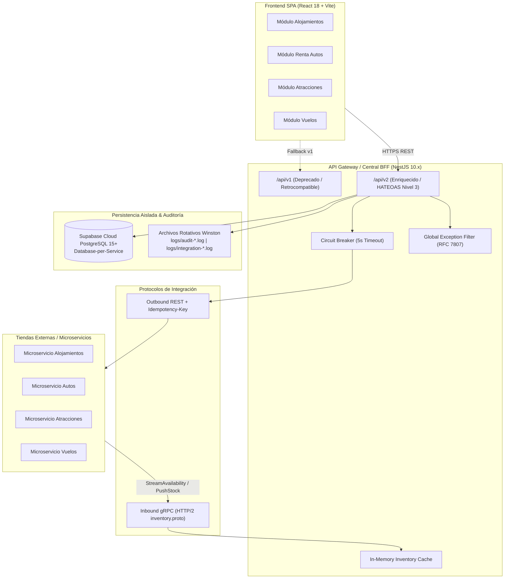

# Ecosistema Booking.com: Documento Maestro de Ingeniería Inversa y Requerimientos de Sistema (RDA2)

> **Autoría / Roles:** Lead Product Manager, Principal Interaction Designer (IxD) & Staff Reverse-Engineering Architect  
> **Sistema Destino:** Booking Prototipo (RDA2 — Arquitectura de Integración y Microservicios)  
> **Plataforma Auditada:** [Booking.com Production Web Platform](https://www.booking.com) (Sesión autenticada vía 2FA: `semestre5grupal@gmail.com`)  
> **Fecha de Auditoría:** 14 de Octubre de 2026  
> **Estándares Técnicos:** REST HATEOAS Nivel 3, RFC 7807 (Problem Details), Protobuf v3 / gRPC HTTP/2, Database-per-Service (Supabase Cloud PostgreSQL 15+), Observabilidad Física Winston.

---

## 1. Resumen Ejecutivo y Protocolo de Exploración

El presente compendio técnico es el resultado de una auditoría exhaustiva, profunda e interactiva en tiempo real sobre la plataforma web en producción de **Booking.com**, ejecutada mediante agentes de navegación web (`browser_subagent`) bajo un protocolo de autenticación asistida (*Human-in-the-Loop*). 

Se inspeccionaron minuciosamente las cuatro verticales de negocio principales:
1. **Alojamientos (Accommodations)**: Búsqueda multicriterio, inventario de habitaciones, tarificación dinámica, checkout de huéspedes y check-in digital.
2. **Renta de Autos (Car Rentals)**: Geolocalización IATA/Depots, cálculo por franjas horarias y edad de conductor, desglose de coberturas/franquicias, bloqueo de vehículo (*Hold*) y actas de entrega/mantenimiento.
3. **Atracciones (Tours & Experiences)**: Catálogo jerárquico, inventario por cupos de franja horaria (*time slots*), desglose por tipología de boletos, vouchers digitales QR y check-in presencial con guía.
4. **Vuelos (Flights)**: Búsqueda multidestino, itinerarios con escalas, segmentación tarifaria (Light/Standard/Flex), retención de PNR, mapas de asientos y emisión de tarjetas de embarque.

---

## 2. Compatibility Boundary: Mapeo a la Arquitectura Booking Prototipo (RDA2)

Cada requerimiento, pantalla, atributo e interacción descubierta se desacopla de la lógica propietaria de Booking y se normaliza contra el stack tecnológico de nuestro proyecto:



### Principios de Arquitectura Obligatorios:
1. **Frontend React 18 + Vite:** Maquetación con **Vanilla CSS modular** (BEM o CSS modules) adoptando estrictamente los tokens cromáticos corporativos:
   - Azul Corporativo Booking: `#003b95`
   - Amarillo Acento / Ofertas: `#febb02`
   - Azul Claro / Acento de Acción: `#006ce4`
   - Fondo Secundario: `#f5f5f5`
   - Bordes y Separadores: `#e7e7e7`
   - Errores de Validación: `#d4111e`
2. **NestJS 10.x API Gateway / BFF Central:** Versionado dual activo (`/api/v1` legado para clientes básicos, `/api/v2` enriquecido con HATEOAS `_links` y datos extendidos). Filtro de excepciones global normalizado bajo el estándar **RFC 7807** (`application/problem+json`).
3. **Integración Inbound (Tiendas → Gateway):** Comunicación gRPC sobre HTTP/2 gobernada por `inventory.proto` (`PushStockUpdate` y `StreamAvailability`) para refresco continuo de inventario y disponibilidad en la caché en memoria del Gateway.
4. **Integración Outbound (Gateway → Tiendas):** Peticiones síncronas REST protegidas con **Circuit Breaker** (umbral de 50% de fallos, ventana de 10s, timeout estricto de **5000 ms**) y cabecera obligatoria `Idempotency-Key: <UUID-v4>` para evitar doble procesamiento o cobro no deseado.
5. **Persistencia Aislada (Supabase PostgreSQL 15+):** Modelo *Database-per-Service*. Cada vertical gestiona sus tablas en esquemas independientes sin *Foreign Keys* ni *JOINs* cross-database a nivel de motor. Toda orquestación se resuelve en la capa de aplicación NestJS.
6. **Auditoría Técnica en Archivos Físicos:** Trazabilidad estricta registrada mediante Winston en el sistema de archivos local (`logs/audit-YYYY-MM-DD.log` y `logs/integration-YYYY-MM-DD.log`). **Queda terminantemente prohibido almacenar logs de auditoría en la base de datos relacional.**

---

## 3. Matriz de Módulos e Historias de Usuario

A continuación se presenta el desglose de los cuatro módulos auditados. Cada enlace conduce a su especificación técnica detallada en formato formal de Historias de Usuario (HU) con esquemas de inputs, validaciones, mapeos y escenarios Gherkin.

| Módulo | Archivo de Especificación | Alcance de Navegación y Descubrimiento | Total HUs |
| :--- | :--- | :--- | :--- |
| **1. Alojamientos** | [modulo_alojamientos.md](file:///C:/Users/ASUS/.gemini/antigravity-ide/brain/57a7869d-e7f6-44cf-8981-9375339be2e1/modulo_alojamientos.md) | Buscador de hospedaje, panel de resultados con desglose impositivo, selector de inventario por habitación/camas, checkout en 2 pasos con captura de datos de huéspedes, peticiones especiales y check-in digital v2. | 6 HUs |
| **2. Renta de Autos** | [modulo_renta_autos.md](file:///C:/Users/ASUS/.gemini/antigravity-ide/brain/57a7869d-e7f6-44cf-8981-9375339be2e1/modulo_renta_autos.md) | Búsqueda por IATA/Depots, validación perimetral de edad de conductor (30-65 vs sobretasa joven/senior), desglose de seguro/franquicia cero, bloqueo *Hold*, checkout con Idempotency-Key y acta digital de entrega/mantenimiento. | 6 HUs |
| **3. Atracciones** | [modulo_atracciones.md](file:///C:/Users/ASUS/.gemini/antigravity-ide/brain/57a7869d-e7f6-44cf-8981-9375339be2e1/modulo_atracciones.md) | Buscador de tours y experiencias, catálogo jerárquico con subcategorías, selección de fecha y turnos horarios (*time slots*), counters de boletos diferenciados (Adulto/Niño/Senior), checkout de turista y check-in QR con guía. | 6 HUs |
| **4. Vuelos** | [modulo_vuelos.md](file:///C:/Users/ASUS/.gemini/antigravity-ide/brain/57a7869d-e7f6-44cf-8981-9375339be2e1/modulo_vuelos.md) | Buscador multidestino con códigos IATA, matriz de itinerarios y escalas, segmentación de paquetes tarifarios (Light/Standard/Flex), retención de tarifa/PNR (*Hold*), formulario estricto de pasajeros con fechas de nacimiento y check-in con pase de abordar. | 6 HUs |

---

## 4. Matriz de Códigos de Error Globales (RFC 7807)

Todos los fallos de validación perimetral e integración detectados en los flujos de Booking.com se estandarizan en el Gateway bajo la siguiente estructura JSON:

```json
{
  "type": "https://booking-hub.com/errors/invalid-parameter",
  "title": "Unprocessable Entity / Parameter Validation Error",
  "status": 422,
  "detail": "El campo 'telefono_contacto' no cumple con el formato internacional E.164.",
  "instance": "/api/v2/alojamientos/reservar",
  "invalid_params": [
    {
      "name": "telefono_contacto",
      "reason": "Debe incluir código de país válido y entre 7 y 15 dígitos numéricos."
    }
  ],
  "timestamp": "2026-10-14T16:45:00.000Z"
}
```

### Catálogo de Errores Mapeados:
- `400 Bad Request`: Payload sintácticamente inválido o cabecera `Idempotency-Key` faltante en peticiones transaccionales.
- `404 Not Found`: Recurso inexistente en catálogo o identificador de reserva no localizado.
- `409 Conflict`: Conflicto de inventario en tiempo real (recurso agotado o bloqueado por otra transacción activa).
- `422 Unprocessable Entity`: Violación de reglas de negocio en inputs (edad de conductor insuficiente, fechas de salida previas a llegada, fecha de expiración de pasaporte vencida).
- `503 Service Unavailable / 504 Gateway Timeout`: Disparo del Circuit Breaker por timeout (>5000 ms) o caída del microservicio downstream.
