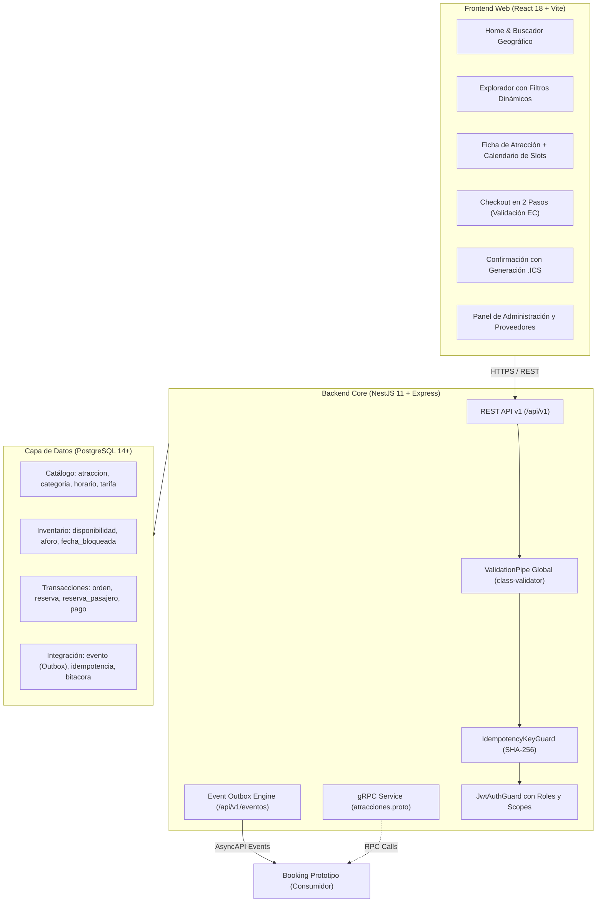

# Análisis de Estructura, Sintaxis y Funcionamiento: Sistema de Atracciones ("Descubre EC")

> **Repositorio Analizado:** [https://github.com/Dilanm2002/SistemaAtracciones](https://github.com/Dilanm2002/SistemaAtracciones)  
> **Sistema / Marca Comercial:** Descubre EC (Marketplace y E-commerce de Atracciones Turísticas del Ecuador)  
> **Rol en la Red RDA2:** Tienda Externa de Atracciones proveedora para el Booking Prototipo  
> **Fecha de Análisis:** 14 de Octubre de 2026  
> **Ubicación del Documento:** `Pendientes/SISTEMA_ATRACCIONES_ESTRUCTURA_FUNCIONAMIENTO.md`

---

## 1. Ficha Técnica y Visión General de la Arquitectura

El repositorio `SistemaAtracciones` de Dilan Mendoza implementa una solución completa de comercio electrónico y gestión de actividades turísticas diseñada bajo principios **API-First** y **Domain-Driven Design (DDD)**. Opera como una plataforma autónoma con catálogo público, pasarela de reservas, módulo de liquidación a proveedores y feed de eventos para integración asíncrona.



---

## 2. Estructura de Directorios del Repositorio

El proyecto está organizado como un monorepo desacoplado:

```text
SistemaAtracciones/
├── backend/                         # Microservicio Backend en NestJS 11
│   ├── contracts/                   # Contratos formales de integración (API-First)
│   │   ├── atracciones-openapi.yaml # Contrato REST OpenAPI 3.0.3 (31.1 KB)
│   │   ├── atracciones-asyncapi.yaml# Contrato de Eventos AsyncAPI 2.6 (9 KB)
│   │   ├── atracciones.proto        # Contrato Protobuf v3 para gRPC (3.5 KB)
│   │   ├── atracciones.graphql      # Esquema GraphQL para consultas de catálogo
│   │   └── operaciones-internas.json# Catálogo de códigos de operación
│   ├── src/
│   │   ├── app.module.ts            # Módulo raíz que orquesta los submódulos
│   │   ├── app.factory.ts           # Factory con configuración de CORS, pipes y Swagger
│   │   ├── common/                  # Componentes transversales
│   │   │   ├── auth/                # Guards JWT, decoradores @CurrentUser, scopes
│   │   │   ├── db/                  # DbService con conexión a PostgreSQL vía Pool
│   │   │   ├── errors/              # ProblemDetails RFC 7807 y catálogo de problemas
│   │   │   ├── guards/              # IdempotencyKeyGuard con hash de body
│   │   │   ├── pipes/               # ParseUUIDPipe, ParseIdPipe
│   │   │   └── utils/               # Validadores personalizados (cédula EC, Luhn, teléfono EC)
│   │   ├── database/                # Scripts de base de datos ejecutados en arranque
│   │   └── modules/
│   │       ├── atracciones/         # Módulo core: controlador, servicio, mappers, DTOs
│   │       ├── auth/                # Módulo de autenticación (clientes, operadores, admins)
│   │       ├── contacto/            # Mensajería y peticiones de soporte
│   │       ├── integracion/         # Feed de eventos Outbox (/api/v1/eventos)
│   │       └── proveedores/         # Portal B2B de operadores turísticos
│   ├── package.json                 # Dependencias backend (NestJS, class-validator, pg)
│   └── tsconfig.json                # Configuración TypeScript
├── frontend/                        # Cliente Web SPA en React 18 + Vite
│   ├── src/
│   │   ├── api/                     # Cliente Axios con interceptor de token e idempotencia
│   │   ├── components/              # Componentes UI reutilizables y modales
│   │   ├── context/                 # AuthContext y ToastContext
│   │   ├── pages/                   # Vistas principales del marketplace
│   │   │   ├── Home.jsx             # Portada con buscador por ciudad y carrusel
│   │   │   ├── Explore.jsx          # Explorador con filtros multicriterio
│   │   │   ├── AttractionDetail.jsx # Ficha técnica con selector de fecha y time slots
│   │   │   ├── Checkout.jsx         # Formulario de compra en dos pasos con tarjeta
│   │   │   ├── Confirmation.jsx     # Pantalla de confirmación con exportador .ICS
│   │   │   └── MyReservations.jsx   # Historial del cliente con cancelación
│   │   ├── utils/                   # Formateadores de moneda, fecha y validadores
│   │   ├── App.jsx                  # Enrutador de React Router DOM v6
│   │   └── main.jsx                 # Punto de entrada con montado de contextos
├── database/                        # Scripts SQL de inicialización y verificación
│   ├── 01_esquema.sql               # Esquema DDL en 3FN (43 tablas, constraints, triggers)
│   ├── 02_verificacion.sql          # Test suite en SQL para integridad referencial
│   ├── 03_eventos.sql               # Triggers de captura automática de eventos Outbox
│   ├── 04_documento_telefono_ec.sql # Validaciones de cédula y teléfono de Ecuador
│   ├── 05_contacto_pasajero.sql     # Normalización de pasajeros por reserva
│   └── 06_proveedores.sql           # Esquema B2B para operadores turísticos
└── docs/                            # Documentación de arquitectura y guías de defensa
```

---

## 3. Modelo de Datos Relacional (`database/01_esquema.sql`)

El sistema utiliza **PostgreSQL 14+** con un diseño estrictamente normalizado en **Tercera Forma Normal (3FN)**. No utiliza ORM pesado; utiliza `DbService` con consultas SQL parametrizadas para máximo rendimiento.

### Dominios y Restricciones Específicas del País:
* `dom_correo`: `VARCHAR(160)` con regex de email estándar.
* `dom_documento`: Cédula ecuatoriana de 10 dígitos o pasaporte de 6 a 9 caracteres.
* `dom_ruc`: RUC ecuatoriano de 13 dígitos (`^[0-9]{13}$`).
* `dom_telefono`: Teléfono internacional o celular ecuatoriano (`^\+?[0-9]{7,15}$`).
* `dom_importe`: `NUMERIC(12,2)` no negativo para importes monetarios.

### Entidades Centrales del Catálogo y Transacciones:
1. **`atraccion`:** Identificador público `atr_uuid UUID`, clave primaria interna `atr_id BIGINT`, nombre, slug único, duración en horas, punto de encuentro, coordenadas GPS (`atr_latitud`, `atr_longitud`), estado (`BORRADOR`, `PUBLICADA`, `INACTIVA`), tipo (`GUIDED_TOUR`, `ADMISSION`, `DAY_TRIP`, `PACKAGE`) y política de cancelación (`atr_cancelacion_gratuita`, `atr_horas_cancelacion`).
2. **`categoria`:** Soporta jerarquía mediante autorreferencia `cat_padre_id REFERENCES categoria(cat_id)`.
3. **`horario` y `disponibilidad`:** Cada atracción define sus turnos horarios recurrentes (`hor_hora TIME`, ej. `09:00:00`, `11:30:00`). La tabla `disponibilidad` almacena para cada fecha y horario el aforo total y los cupos disponibles (`dis_capacidad`, `dis_disponibles`).
4. **`tarifa`:** Permite versionamiento de precios con tarifas diferenciadas para `ADULTO` y `NINO`.
5. **`reserva`:** Guarda el localizador legible `res_codigo` (ej. `DEC-7F3K9Q`), identificador UUID `res_uuid`, fecha de la experiencia, hora del turno, número de adultos (`res_adultos`), niños (`res_ninos`), precio congelado y estado referenciado a `estado` (`PENDING`, `CONFIRMED`, `CANCELLED`).
6. **`reserva_pasajero`:** Almacena los datos de los acompañantes sin duplicar PII en la cabecera.
7. **`evento` (Patrón Outbox):** Captura mediante triggers en base de datos cada inserción o cambio de estado (`RESERVA_CREADA`, `RESERVA_CONFIRMADA`, `RESERVA_CANCELADA`) con un correlativo secuencial `evt_id` para streaming asíncrono.

---

## 4. Contratos de Integración y Endpoints Expuestos

### 4.1. Contrato REST OpenAPI (`/api/v1/atracciones`)
El backend publica las siguientes rutas principales:

| Método | Endpoint | Descripción | Parámetros Clave / DTO |
| :--- | :--- | :--- | :--- |
| `POST` | `/api/v1/atracciones/search` | Búsqueda multicriterio con paginación por cursor | `SearchAtraccionesDto` (`ciudad`, `fecha`, `q`, `categoria`) |
| `GET` | `/api/v1/atracciones` | Listado paginado de atracciones | `ListAtraccionesQueryDto` (`page`, `limit`, `city`) |
| `GET` | `/api/v1/atracciones/:id` | Detalle individual de la experiencia | `id` (UUID v4) |
| `GET` | `/api/v1/atracciones/:id/availability` | Consulta de cupos por franja horaria | `date` (`YYYY-MM-DD`) -> retorna array de slots |
| `POST` | `/api/v1/atracciones/:id/reservations` | Creación de reserva con Idempotencia | `Idempotency-Key` (Header obligatorio) + `ReservationRequestDto` |
| `GET` | `/api/v1/atracciones/reservations/:resId` | Consulta de reserva específica | `reservationId` (UUID v4) + Token JWT |
| `POST` | `/api/v1/atracciones/reservations/:resId/cancel` | Cancelación de reserva con Idempotencia | `Idempotency-Key` + `CancelReservationRequestDto` |
| `GET` | `/api/v1/eventos` | Feed Outbox de eventos de integración | `after` (Cursor secuencial), `limit`, `type` |

### 4.2. Contrato Protobuf / gRPC (`backend/contracts/atracciones.proto`)
Expone el servicio `atracciones.v1.AtraccionesService` con las RPCs:
* `GetAtraccion (GetAtraccionRequest) returns (AtraccionResponse)`
* `BatchGetAtracciones (BatchGetAtraccionesRequest) returns (BatchGetAtraccionesResponse)`
* `GetDisponibilidad (GetDisponibilidadRequest) returns (DisponibilidadResponse)`
* `CrearReserva (CrearReservaRequest) returns (ReservaResponse)`: Requiere `idempotency_key`, `atraccion_id`, `fecha`, `hora`, `tickets`, `ninos`, `nombre_titular`, `documento_titular`, `metodo_pago`.
* `CancelarReserva (CancelarReservaRequest) returns (ReservaResponse)`

---

## 5. Funcionamiento del Frontend y Flujo de Usuario

### 5.1. Búsqueda y Navegación (`Home.jsx` y `Explore.jsx`)
* Presenta autocompletado de ciudades turísticas del Ecuador (Quito, Guayaquil, Cuenca, Baños, Galápagos, Mindo).
* Filtros laterales por rango de precio, tipo de experiencia (`GUIDED_TOUR`, `DAY_TRIP`, `PACKAGE`), idioma del guía y cancelación gratuita.

### 5.2. Selección de Turno Horario (`AttractionDetail.jsx`)
* El usuario interactúa con un calendario mensual de disponibilidad (`/availability/calendar`).
* Al seleccionar un día, la interfaz consulta `/availability?date=YYYY-MM-DD` y renderiza botones con las franjas horarias disponibles (`slots`, ej. `09:00`, `11:30`, `14:00`). Los horarios sin cupo se deshabilitan.
* Permite seleccionar la cantidad de adultos y niños antes de pasar al checkout.

### 5.3. Formulario de Reserva y Validación Perimetral (`Checkout.jsx`)
* **Paso 1: Datos del Titular:**
  * `customer_name`: Exige al menos nombre y apellido (mínimo 2 palabras, solo caracteres alfabéticos).
  * `customer_email`: Validación estricta RFC de correo.
  * `customer_phone`: Validación perimetral de número celular de Ecuador (`09XXXXXXXX`).
  * `customer_document`: Validación algorítmica de cédula ecuatoriana (algoritmo Módulo 10 con dígito verificador).
  * `notes`: Texto de peticiones especiales o restricciones alimentarias.
* **Paso 2: Pago Seguro:**
  * Métodos de pago: Tarjeta de crédito, Transferencia bancaria o Pago en el sitio.
  * Validación local de tarjeta: Algoritmo de Luhn, fecha de expiración `MM/YY` no vencida y detección dinámica de marca (Visa, Mastercard, Amex, Diners).
  * **Seguridad PCI-DSS:** El frontend **nunca envía el número de tarjeta completo ni el CVV al backend**; solo transmite la marca (`brand`), los últimos 4 dígitos (`last4`), el titular y la fecha de expiración.
  * **Idempotencia en Cliente:** Genera un UUID v4 (`newIdempotencyKey()`) en la referencia `idemKey.current`. Si el usuario hace doble clic o la conexión vacila, se envía exactamente la misma clave evitando reservas duplicadas.

### 5.4. Confirmación y Postventa (`Confirmation.jsx`)
* Renderiza el localizador de reserva `res_codigo` (ej. `DEC-9K2L1P`) con botón de copiado rápido al portapapeles.
* Genera dinámicamente un archivo de calendario **`.ics`** estándar (`downloadIcs`) para sincronizar la fecha y hora de la atracción en Google Calendar, Apple Calendar o Outlook.
