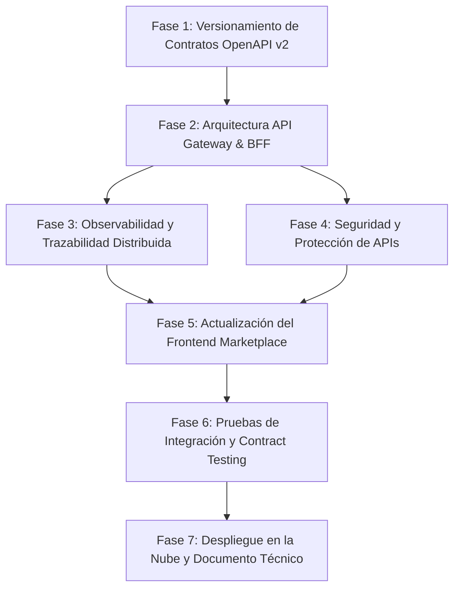

# Plan de Implementación — Reto 2 (RDA2): Booking Prototipo

**Asignatura:** Integración de Sistemas  
**Objetivo:** Evolucionar la plataforma central *Booking Prototipo* desde un monolito modular API-First hacia un ecosistema distribuido basado en **API Gateway / BFF, Microservicios integrados, Contratos versionados (v2), Seguridad, Observabilidad y Pruebas de Integración**.  
**Calificación máxima objetivo:** 11 / 11 puntos (incluyendo Criterio Excluyente CE01).

---

## 1. Matriz de Trazabilidad: Rúbrica vs Fases del Plan

| ID Criterio | Criterio de Evaluación RDA2 | Tipo | Fase Asociada |
|---|---|---|---|
| **CE01** | Todas las tiendas del curso integradas con Booking Prototipo | **Excluyente (Obligatorio)** | Fase 2, Fase 5, Fase 6 |
| **CE02** | Migración correcta a arquitectura de microservicios | Evaluativo | Fase 2 |
| **CE03** | Consumo correcto de APIs y/o eventos de sistemas integrados | Evaluativo | Fase 2, Fase 5 |
| **CE04** | Marketplace web integrado funcional en entorno distribuido | Evaluativo | Fase 5 |
| **CE05** | Sistema de administración operativo en arquitectura distribuida | Evaluativo | Fase 3, Fase 5 |
| **CE06** | API Gateway funcional y correctamente configurado | Evaluativo | Fase 2 |
| **CE07** | Contratos entre servicios documentados y versionados | Evaluativo | Fase 1 |
| **CE08** | Pruebas de integración funcionales entre sistemas (Contract Testing) | Evaluativo | Fase 6 |
| **CE09** | Mecanismos de seguridad (JWT, roles, scopes, rate-limiting) | Evaluativo | Fase 4 |
| **CE10** | Todos los sistemas desplegados y accesibles en Internet | Evaluativo | Fase 7 |
| **CE11** | Dominio técnico del código, arquitectura y defensa | Evaluativo | Fase 7 |

---

## 2. Fases Detalladas de Implementación

---

### Fase 1: Versionamiento Formal de Contratos OpenAPI (v1 → v2) y Esquemas
> **Fundamento en Rúbrica:** Criterio **CE07** (*Contratos documentados y versionados*) y Sílabo **Semana 7** (*Gestión de contratos, control de versiones, retrocompatibilidad y esquemas JSON*).

#### ¿Por qué se realiza?
El frontend de Booking actualmente tiene bloques visuales comentados porque los contratos iniciales (v1.0.0 a v1.2.0) carecían de atributos como fotos, opiniones desglosadas, políticas de recogida/devolución y diferenciación de tarifas niño/adulto. Además, la rúbrica evalúa expresamente cómo evoluciona una API manteniendo compatibilidad hacia atrás (`backward compatibility`).

#### Acciones Técnicas Concretas:
1. **Crear contratos v2 en `contracts/`**:
   - `contracts/atracciones-openapi-v2.yaml`:
     - Incorporar esquema `RatingBreakdown` (limpieza, servicio, calidad, general).
     - Incorporar esquema `ReviewItem` (usuario, país, fecha, comentario, puntuación).
     - Añadir soporte de desglose de tickets (adultos, niños).
     - Añadir campos descriptivos: `highlights`, `itinerary`, `additional_info`, `service_animals_allowed`.
   - `contracts/autos-openapi-v2.yaml`:
     - Añadir en `CarDetailsResponse`: `transmission` (string enum), `images` (array uri), `included_in_price` (array string), `supplier_rating_label` (string) y `reviews_count` (integer).
     - Añadir en `OrderDetail`: `pickup_instructions` y `dropoff_instructions`.
   - Actualizar versiones en cabecera de `alojamientos`, `vuelos` y `facturacion` a especificación v2/v1.x unificada.
2. **Política de Retrocompatibilidad y Deprecación**:
   - Mantener accesibles las rutas v1 mientras se habilitan las v2.
   - Incluir la cabecera HTTP `X-API-Deprecation-Date: 2027-12-31` y `Sunset: Fri, 31 Dec 2027 23:59:59 GMT` en respuestas v1.
3. **Documento de Auditoría de Cambios**:
   - Crear `contracts/CAMBIOS_CONTRATOS_RDA2.md` documentando las diferencias semánticas (SemVer), campos nuevos opcionales (non-breaking changes) y estrategia de migración.

---

### Fase 2: Arquitectura API Gateway, Patrón BFF e Integración de Microservicios
> **Fundamento en Rúbrica:** Criterios **CE01** (Excluyente), **CE02** (Microservicios), **CE03** (Consumo de APIs/Eventos) y **CE06** (API Gateway). Sílabo **Semana 8** (*API Gateways, BFF, Proxy, Aggregator*).

#### ¿Por qué se realiza?
El Booking Prototipo no debe almacenar inventarios propios como un monolito; su función según las bases del proyecto es ser el **Agregador Central (BFF)** que orquesta las llamadas a los microservicios individuales de cada equipo del curso, gestionando resiliencia para que la caída de una tienda externa no congele el marketplace.

#### Acciones Técnicas Concretas:
1. **Configuración de Variables de Entorno de Tiendas Externas**:
   - En `.env.example` y `.env`, formalizar las URLs base de los compañeros de clase:
     - `TIENDA_ATRACCIONES_URL`
     - `TIENDA_AUTOS_URL`
     - `TIENDA_ALOJAMIENTOS_URL`
     - `TIENDA_VUELOS_URL`
2. **Implementación del Módulo Gateway / BFF Aggregator**:
   - Crear interceptores o servicios de integración con `@nestjs/axios` con:
     - **Timeout estricto de 5 segundos**: Evitar que una petición colgada en una tienda agote los sockets de Node.js.
     - **Circuit Breaker / Fallback local**: Si el servicio externo del compañero devuelve 5xx o Timeout, responder con datos en caché o catálogo de contingencia sin romper la UI.
3. **Adaptación de DTOs del Backend**:
   - Actualizar DTOs en `src/modules/atracciones/dto/` y `src/modules/autos/dto/` para mapear los nuevos campos de los contratos v2 hacia el frontend.
4. **Soporte de Versionamiento URI en NestJS**:
   - En `src/main.ts`, habilitar `app.enableVersioning({ type: VersioningType.URI, defaultVersion: '1' })` para servir `/api/v1/...` y `/api/v2/...` simultáneamente.

---

### Fase 3: Observabilidad, Métricas y Trazabilidad Distribuida
> **Fundamento en Rúbrica:** Criterio **CE05** (*Admin operativo en entorno distribuido*), **CE11** y Sílabo **Semana 10** (*Logs estructurados, métricas, trazas distribuidas, latencia y errores de integración*).

#### ¿Por qué se realiza?
En una arquitectura distribuida es imposible diagnosticar errores sin identificar el flujo de una petición entre el frontend, el API Gateway y los microservicios externos. El profesor evaluará si se puede demostrar la latencia de cada tienda conectada y el origen de los fallos.

#### Acciones Técnicas Concretas:
1. **Trazabilidad Distribuida (Correlation ID)**:
   - Crear un Middleware global `CorrelationIdMiddleware` en `src/core/middlewares/correlation-id.middleware.ts`:
     - Lee `X-Correlation-Id` si viene del frontend, o genera un UUID v4 nuevo.
     - Inyecta la cabecera en la respuesta del backend y en todas las peticiones salientes de Axios hacia las tiendas de los compañeros.
2. **Métricas de Integración en Tiempo Real**:
   - Conectar el `TelemetryService` (`provider_api_calls`) en cada llamada de integración para registrar:
     - Proveedor (`tienda_atracciones`, `tienda_autos`, etc.).
     - Operación (`search`, `details`, `reservation`).
     - Código de estado HTTP y tiempo de respuesta real (`latency_ms`).
     - Tasa de éxito/error.
3. **Monitor de Estado de Servicios Externos en el Admin**:
   - Exponer un endpoint en `AdminController`: `GET /api/v1/admin/health/integraciones` que haga un ping síncrono al `/health` de cada tienda externa.
   - En `AdminDashboard.jsx`, mostrar el estado visual en vivo: 🟢 Operativo / 🔴 Inaccesible / 🟡 Degradado (>2s latencia).

---

### Fase 4: Seguridad y Protección de APIs
> **Fundamento en Rúbrica:** Criterio **CE09** (*JWT, autenticación, roles, scopes y protección de APIs*) y Sílabo **Semana 11** (*Seguridad en integraciones*).

#### ¿Por qué se realiza?
Un API Gateway expuesto en Internet sin limitación de tráfico es vulnerable a denegación de servicio (DoS) o fuerza bruta. Además, la especificación de los contratos OpenAPI exige scopes específicos según el rol del usuario.

#### Acciones Técnicas Concretas:
1. **Rate Limiting / Throttling**:
   - Instalar `@nestjs/throttler` y registrar `ThrottlerModule.forRoot([{ ttl: 60000, limit: 120 }])` en `app.module.ts`.
   - Aplicar límites más estrictos en rutas de checkout/pago (`@Throttle({ default: { limit: 10, ttl: 60000 } })`).
2. **Seguridad de Cabeceras HTTP (Helmet)**:
   - Configurar `helmet()` en `main.ts` para proteger contra Clickjacking, sniffing de MIME y ataques XSS.
3. **Validación de Roles y Scopes en `SupabaseAuthGuard`**:
   - Ampliar el guard para validar que usuarios con rol `cliente` no puedan ejecutar operaciones administrativas, y que tokens de servicio porten los scopes requeridos (`attractions:book`, `autos:cancel`, etc.).
4. **Sanitización de Payloads**:
   - Mantener el `ValidationPipe` global con `whitelist: true`, `forbidNonWhitelisted: true` y sanitización estricta de cadenas para evitar inyección de código.

---

### Fase 5: Actualización del Frontend Marketplace y Conexión de Campos v2
> **Fundamento en Rúbrica:** Criterio **CE04** (*Marketplace web en entorno distribuido*) y **CE01** (Excluyente).

#### ¿Por qué se realiza?
El frontend debe ofrecer una experiencia completa de compra y visualización de catálogo consumiendo los datos enriquecidos de la versión 2 sin inconsistencias de interfaz.

#### Acciones Técnicas Concretas:
1. **Descomentar y Enlazar en `AtraccionDetail.jsx`**:
   - Descomentar el bloque de reseñas (`reviews`), enlace a comentarios y renderizado de estrellas/puntuaciones reales.
   - Descomentar el desglose de calificaciones por categoría (Limpieza, Servicio, Calidad).
   - Renderizar las razones para ir (`highlights`) e itinerario del recorrido si vienen provistos por el microservicio.
2. **Descomentar y Enlazar en `AutoDetail.jsx`**:
   - Descomentar modales de instrucciones de recogida (`pickup_instructions`) y devolución (`dropoff_instructions`).
   - Mostrar el tipo de transmisión y beneficios incluidos en el precio (`included_in_price`).
3. **Trazabilidad en Axios del Frontend**:
   - Configurar en `frontend/src/services/api.ts` la generación automática de un `X-Correlation-Id` por sesión/pestaña para adjuntarlo a todas las solicitudes.
4. **Resiliencia Visual**:
   - Asegurar que si una tienda externa no responde, la UI muestre un estado amigable (*"Temporalmente no pudimos obtener opiniones de este proveedor"*) en lugar de romper el renderizado del componente React.

---

### Fase 6: Pruebas de Integración Automatizadas y Contract Testing
> **Fundamento en Rúbrica:** Criterio **CE08** (*Pruebas de integración funcionales entre sistemas*) y Sílabo **Semana 9** (*Contract testing provider-consumer, mocking y automatización*).

#### ¿Por qué se realiza?
El archivo `runner-pruebas.js` actual solo emula salida de texto en consola. La rúbrica exige pruebas reales ejecutables (`automated testing`) que comprueben la comunicación entre el Booking y los microservicios y validen que las respuestas cumplan el esquema JSON del contrato OpenAPI.

#### Acciones Técnicas Concretas:
1. **Creación de Suite de Pruebas con Jest / Supertest**:
   - Crear directorio `test/integration/`:
     - `test/integration/atracciones-contract.spec.ts`: Verifica que las respuestas de atracciones cumplan el esquema OpenAPI v2 (códigos 200, 201, 400 RFC 7807).
     - `test/integration/autos-contract.spec.ts`: Verifica que el flujo de búsqueda, hold y creación de orden cumpla el esquema estricto.
     - `test/integration/gateway-resilience.spec.ts`: Simula caída de una tienda externa (mock 500 / timeout) y comprueba que el Gateway responda con fallback adecuado.
2. **Script de Ejecución Automatizado en `package.json`**:
   - Añadir script `"test:integration": "jest --config ./test/jest-integration.json"`.
   - Generar reporte HTML o markdown con la evidencia de ejecución para presentar durante la defensa.

---

### Fase 7: Despliegue en la Nube y Documento Técnico de Reto 2
> **Fundamento en Rúbrica:** Criterios **CE10** (*Sistemas desplegados y accesibles en Internet*) y **CE11** (*Dominio técnico y documentación*).

#### ¿Por qué se realiza?
El entregable final del Reto 2 exige que tanto el Booking como las tiendas individuales estén en producción (Vercel / Render / Supabase) con HTTPS, acompañadas del Documento Técnico actualizado.

#### Acciones Técnicas Concretas:
1. **Despliegue del Backend y Frontend**:
   - Desplegar Backend en Render con las variables de entorno de producción (`DATABASE_URL`, URLs de microservicios de los compañeros, `JWT_SECRET`).
   - Desplegar Frontend en Vercel apuntando al backend en producción.
   - Probar interoperabilidad completa en Internet con los compañeros antes de la defensa (garantizando el cumplimiento de **CE01**).
2. **Elaboración del Documento Técnico de Reto 2 (`Documento_Tecnico_Reto2.md`)**:
   - Diagrama de arquitectura de microservicios y API Gateway (Mermaid).
   - Diagrama de secuencia del flujo de reserva distribuida.
   - Tabla formal de contratos versionados (v1 deprecada vs v2 activa).
   - Evidencias de pruebas de integración y contract testing.
   - Evidencias de observabilidad, trazas distribuidas y seguridad.

---

## 3. Plan de Verificación y Validación

### Pruebas de Cumplimiento por Criterio:
1. **Verificación CE01 (Integración Excluyente)**:
   - Realizar una búsqueda en vivo en el Marketplace y concretar una reserva en cada una de las verticales (Atracciones, Autos, Alojamientos, Vuelos), comprobando que el registro impacte en la tienda externa del compañero.
2. **Verificación CE06 (API Gateway)**:
   - Probar que el frontend llame exclusivamente al API Gateway (`/api/v1` y `/api/v2`) y que este enrute internamente a los microservicios sin exponer las IPs o puertos privados de los compañeros.
3. **Verificación CE07 (Contratos v2)**:
   - Cargar `contracts/atracciones-openapi-v2.yaml` y `contracts/autos-openapi-v2.yaml` en Swagger Editor y verificar cero errores de sintaxis o esquema.
4. **Verificación CE08 (Pruebas Automatizadas)**:
   - Ejecutar `npm run test:integration` y verificar que el 100% de casos de prueba pasen en verde.
5. **Verificación CE09 (Seguridad)**:
   - Disparar 150 peticiones consecutivas con un script para comprobar que el Throttler bloquee con `429 Too Many Requests`.
   - Probar petición protegida sin JWT o con JWT inválido y verificar respuesta RFC 7807 `401 Unauthorized`.
