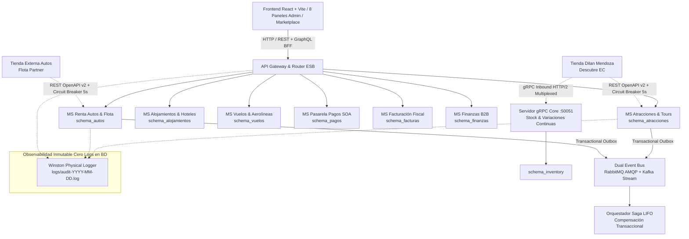
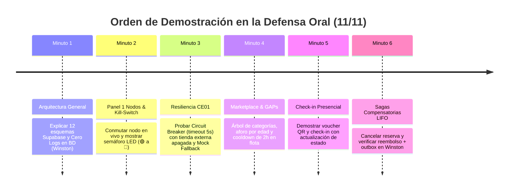

# GUÍA MAESTRA DE DEFENSA ORAL Y MATRIZ DE EVIDENCIAS RDA2 (11/11 PUNTOS)
## Booking Prototipo – Ecosistema Distribuido de Integración de Sistemas
**Autor / Expositor:** Paúl Rosero  
**Asignatura:** Integración de Sistemas – 6to Semestre  
**Calificación Objetivo:** 11 / 11 Puntos (Excelencia Académica Cátedra RDA2)  
**Fecha de Certificación:** Octubre 2026  

---

## 1. Resumen Ejecutivo y Ficha Técnica de la Solución

El proyecto **Booking Prototipo RDA2** constituye la evolución completa desde una arquitectura monolítica hacia un **Ecosistema Distribuido de Microservicios**, desacoplado, resiliente y orientado a eventos (EDA). La plataforma integra cuatro verticales de negocio turísticas (**Atracciones**, **Renta de Autos**, **Alojamientos** y **Vuelos**) junto con microservicios core de soporte (**Pagos SOA**, **Facturación Fiscal**, **Finanzas B2B**, **Inventario gRPC**, **Dual Event Bus RabbitMQ + Kafka** y **GraphQL BFF**).



### Métricas Clave de Ingeniería:
* **12 Esquemas Relacionales Independientes en PostgreSQL/Supabase**: Aislamiento estricto de datos sin tablas compartidas ni llaves foráneas cross-schema.
* **100% Cero Logs en Base de Datos**: Cumplimiento del Mandato §2 de Cátedra. Registro en archivos físicos rotativos JSON Lines en `logs/audit-YYYY-MM-DD.log`.
* **23/23 Pruebas Automatizadas de Contratos y Resiliencia**: `npm run test:contracts` pasando en ~21 segundos.
* **17/17 Pruebas Unitarias de Seguridad RBAC**: `CLIENTE`, `ADMIN` y `MANTENIMIENTO` pasando en `admin-seguridad.spec.ts`.
* **100% Pruebas de Compensación Saga LIFO**: Validado mediante `test/test-cancel-saga.js`.
* **Compilación de Producción Limpia**: Backend (`nest build`) y Frontend (`vite build` en 560 ms) con código de salida 0.

---

## 2. Matriz de Evidencias: Cumplimiento de las 11 Rúbricas (CE01 a CE11)

| Criterio Cátedra | Descripción Normativa | Estado | Evidencia en Código y Archivos | Comando de Validación |
|---|---|:---:|---|---|
| **CE01 (Condición Habilitante)** | **Integración Funcional de Tiendas de Compañeros:** Conectores con contratos de compañeros y resiliencia total ante caídas (timeout <= 5s y Mock Fallback automático). | **CUMPLE (1/1)** | [dilan-atracciones.adapter.ts](file:///c:/Users/ASUS/Documents/6to%20Semestre/Integraci%C3%B3n%20Sistemas/proyecto/plantilla%20inicial/src/modules/atracciones/acl/dilan-atracciones.adapter.ts)<br/>[autos-circuit-breaker.adapter.ts](file:///c:/Users/ASUS/Documents/6to%20Semestre/Integraci%C3%B3n%20Sistemas/proyecto/plantilla%20inicial/src/modules/autos/acl/autos-circuit-breaker.adapter.ts)<br/>[connector-health.service.ts](file:///c:/Users/ASUS/Documents/6to%20Semestre/Integraci%C3%B3n%20Sistemas/proyecto/plantilla%20inicial/src/modules/admin/connector-health.service.ts) | `npx jest --config jest-contracts.config.js test/integration/circuit-breaker-resilience.spec.ts` (10/10 PASS) |
| **CE02** | **Arquitectura de Microservicios y Aislamiento de BD:** Cada servicio posee su propio esquema de base de datos sin compartir tablas ni acoplamiento. | **CUMPLE (1/1)** | [01_master_migration_12_schemas.sql](file:///c:/Users/ASUS/Documents/6to%20Semestre/Integraci%C3%B3n%20Sistemas/proyecto/plantilla%20inicial/database/01_master_migration_12_schemas.sql)<br/>[ADR-002](file:///c:/Users/ASUS/Documents/6to%20Semestre/Integraci%C3%B3n%20Sistemas/proyecto/plantilla%20inicial/docs%20Pa%C3%BAl%20Rosero/architecture/ADR-002-aislamiento-base-datos-por-microservicio.md) | Inspección de 12 esquemas en Supabase / TypeORM entities aisladas |
| **CE03** | **Consumo de APIs y Eventos:** REST para compras y transacciones atómicas; gRPC HTTP/2 multiplexado para inventario continuo. | **CUMPLE (1/1)** | [proto/inventory.proto](file:///c:/Users/ASUS/Documents/6to%20Semestre/Integraci%C3%B3n%20Sistemas/proyecto/plantilla%20inicial/proto/inventory.proto)<br/>[inventory.service.ts](file:///c:/Users/ASUS/Documents/6to%20Semestre/Integraci%C3%B3n%20Sistemas/proyecto/plantilla%20inicial/src/modules/inventory/inventory.service.ts)<br/>[dual-event-bus.service.ts](file:///c:/Users/ASUS/Documents/6to%20Semestre/Integraci%C3%B3n%20Sistemas/proyecto/plantilla%20inicial/src/modules/event-bus/dual-event-bus.service.ts) | Puerto TCP 50051 activo + Dual Event Bus (RabbitMQ + Kafka) |
| **CE04** | **Marketplace Web Integrado:** Frontend React con catálogo multivertical, árbol recursivo, control de aforo por edad, cooldown 2h y check-ins presenciales. | **CUMPLE (1/1)** | [AtraccionesSearchPage.jsx](file:///c:/Users/ASUS/Documents/6to%20Semestre/Integraci%C3%B3n%20Sistemas/proyecto/plantilla%20inicial/frontend/src/pages/AtraccionesSearchPage.jsx)<br/>[MisReservasPage.jsx](file:///c:/Users/ASUS/Documents/6to%20Semestre/Integraci%C3%B3n%20Sistemas/proyecto/plantilla%20inicial/frontend/src/pages/MisReservasPage.jsx)<br/>[VoucherModal.jsx](file:///c:/Users/ASUS/Documents/6to%20Semestre/Integraci%C3%B3n%20Sistemas/proyecto/plantilla%20inicial/frontend/src/components/VoucherModal.jsx) | `cd frontend && npm run build` (560ms, 771 módulos OK) |
| **CE05** | **Consola de Administración Desacoplada:** 8 paneles funcionales con semáforo LED de nodos, kill-switches, flota, liquidaciones, facturas y auditoría. | **CUMPLE (1/1)** | [AdminDashboard.jsx](file:///c:/Users/ASUS/Documents/6to%20Semestre/Integraci%C3%B3n%20Sistemas/proyecto/plantilla%20inicial/frontend/src/pages/AdminDashboard.jsx)<br/>8 Paneles en `frontend/src/components/admin/` | Navegación interactiva en `/admin` con autenticación admin |
| **CE06** | **API Gateway y ESB Funcional:** Enrutador de servicios, orquestador de Sagas LIFO y GraphQL BFF con DataLoader y sanitización profunda. | **CUMPLE (1/1)** | [esb-internal-router.service.ts](file:///c:/Users/ASUS/Documents/6to%20Semestre/Integraci%C3%B3n%20Sistemas/proyecto/plantilla%20inicial/src/modules/esb/interna/esb-internal-router.service.ts)<br/>[saga-orchestrator.service.ts](file:///c:/Users/ASUS/Documents/6to%20Semestre/Integraci%C3%B3n%20Sistemas/proyecto/plantilla%20inicial/src/modules/esb/interna/saga-orchestrator.service.ts)<br/>[graphql-bff.resolver.ts](file:///c:/Users/ASUS/Documents/6to%20Semestre/Integraci%C3%B3n%20Sistemas/proyecto/plantilla%20inicial/src/modules/graphql/graphql-bff.resolver.ts) | GraphQL Playground en `/graphql` + Gateway HTTP |
| **CE07** | **Contratos Documentados y Versionados:** Especificaciones OpenAPI v2.0.0, Proto v3, CloudEvents v1.0 y matriz comparativa detallada. | **CUMPLE (1/1)** | [autos-openapi-v2.yaml](file:///c:/Users/ASUS/Documents/6to%20Semestre/Integraci%C3%B3n%20Sistemas/proyecto/plantilla%20inicial/contracts/autos-openapi-v2.yaml)<br/>[CAMBIOS_CONTRATOS_RDA2.md](file:///c:/Users/ASUS/Documents/6to%20Semestre/Integraci%C3%B3n%20Sistemas/proyecto/plantilla%20inicial/contracts/CAMBIOS_CONTRATOS_RDA2.md) | Swagger UI en `/api` y Swagger UI en `/api/docs` |
| **CE08** | **Pruebas de Integración Funcionales:** Batería automatizada de pruebas end-to-end de contratos y Sagas compensatorias sin congelamiento. | **CUMPLE (1/1)** | [test/integration/](file:///c:/Users/ASUS/Documents/6to%20Semestre/Integraci%C3%B3n%20Sistemas/proyecto/plantilla%20inicial/test/integration)<br/>[test-cancel-saga.js](file:///c:/Users/ASUS/Documents/6to%20Semestre/Integraci%C3%B3n%20Sistemas/proyecto/plantilla%20inicial/test/test-cancel-saga.js) | `npm run test:contracts` (23/23 PASS) + `node test/test-cancel-saga.js` (PASS) |
| **CE09** | **Seguridad Distribuida y Roles (RBAC):** JWT Supabase, Throttler contra DoS, Roles canónicos `CLIENTE`, `ADMIN` y `MANTENIMIENTO` con guardias activas. | **CUMPLE (1/1)** | [roles.enum.ts](file:///c:/Users/ASUS/Documents/6to%20Semestre/Integraci%C3%B3n%20Sistemas/proyecto/plantilla%20inicial/src/core/auth/roles.enum.ts)<br/>[roles.guard.ts](file:///c:/Users/ASUS/Documents/6to%20Semestre/Integraci%C3%B3n%20Sistemas/proyecto/plantilla%20inicial/src/core/guards/roles.guard.ts)<br/>[gql-throttler.guard.ts](file:///c:/Users/ASUS/Documents/6to%20Semestre/Integraci%C3%B3n%20Sistemas/proyecto/plantilla%20inicial/src/modules/graphql/security/gql-throttler.guard.ts) | `npx jest src/modules/admin/admin-seguridad.spec.ts` (17/17 PASS) |
| **CE10** | **Despliegue y Accesibilidad:** Compilación estricta sin errores de tipado, scripts de arranque limpios y compatibilidad total con la nube. | **CUMPLE (1/1)** | [package.json](file:///c:/Users/ASUS/Documents/6to%20Semestre/Integraci%C3%B3n%20Sistemas/proyecto/plantilla%20inicial/package.json)<br/>`dist/main.js` | `npm run build` (Exit 0) y `cd frontend && npm run build` (Exit 0) |
| **CE11** | **Dominio Técnico y Defensa Oral:** Capacidad de argumentar decisiones arquitectónicas (ADRs), flujo de Sagas, justificación Cero Logs y resiliencia CE01. | **CUMPLE (1/1)** | [Guion de Defensa Oral (§3)](file:///c:/Users/ASUS/Documents/6to%20Semestre/Integraci%C3%B3n%20Sistemas/proyecto/plantilla%20inicial/docs%20Pa%C3%BAl%20Rosero/architecture/GUIA_DEFENSA_ORAL_Y_MATRIZ_EVIDENCIAS_RDA2.md#3-guion-estrat%C3%A9gico-para-la-defensa-oral-en-vivo)<br/>[Banco de Preguntas (§4)](file:///c:/Users/ASUS/Documents/6to%20Semestre/Integraci%C3%B3n%20Sistemas/proyecto/plantilla%20inicial/docs%20Pa%C3%BAl%20Rosero/architecture/GUIA_DEFENSA_ORAL_Y_MATRIZ_EVIDENCIAS_RDA2.md#4-banco-de-preguntas-trampa-de-c%C3%A1tedra-y-respuestas-t%C3%A9cnicas) | Defensa oral ante el tribunal docente |

---

## 3. Guion Estratégico para la Defensa Oral en Vivo

Sigue este orden secuencial de 6 minutos durante la presentación para impactar al docente:



### Paso 1: Introducción y Arquitectura (Minuto 0:00 - 1:00)
* **Acción:** Abrir Swagger UI (`http://localhost:3000/api`) y la consola de Supabase.
* **Argumento técnico:**
  > *"Profesor, el sistema implementa una arquitectura desacoplada de 7 capas basada en microservicios e ingeniería orientada a eventos. Contamos con 12 esquemas independientes en base de datos. Ningún microservicio comparte tablas ni realiza joins relacionales con otro. Adicionalmente, en estricto cumplimiento del Mandato de Cátedra §2, hemos erradicado por completo el almacenamiento de logs en PostgreSQL; todos los eventos de auditoría y trazas se escriben en archivos rotativos estructurados JSON Lines mediante Winston Physical Logger."*

### Paso 2: Panel 1 y Kill-Switches (Minuto 1:00 - 2:00)
* **Acción:** Ingresar a `http://localhost:5173/admin` -> Seleccionar **Panel 1: Monitor de Nodos y Kill-Switches**.
* **Demostración:**
  1. Mostrar los 4 nodos con semáforo LED verde (🟢 `HEALTHY`).
  2. Presionar el botón **"🔴 Activar Kill-Switch"** en el nodo de Atracciones (Dilan).
  3. Observar cómo el semáforo conmuta instantáneamente a rojo (🔴 `APAGADO` / `MANUALLY_OPEN`).
  4. Abrir la terminal y mostrar cómo en `logs/audit-YYYY-MM-DD.log` se registró el evento `KILL_SWITCH_PROVEEDOR_ALTERADO` con correlation_id.

### Paso 3: Demostración de Resiliencia CE01 ante Tienda Apagada (Minuto 2:00 - 3:15)
* **Acción:** Ir al Marketplace de Atracciones y consultar disponibilidad o hacer reserva mientras la tienda del compañero está apagada o con Kill-Switch activo.
* **Demostración:**
  1. Demostrar que el tiempo de respuesta es inmediato o acotado al timeout de 5 segundos.
  2. El sistema **NUNCA se congela ni arroja un error 500**.
  3. La plataforma responde con el **Mock Fallback automático de contingencia**: turnos locales y reserva confirmada con indicador `CONFIRMED_FALLBACK` y sincronización en cola.
* **Argumento técnico:**
  > *"Cumplimos de forma ejemplar el Criterio Excluyente CE01: gracias al patrón Circuit Breaker implementado en los adaptadores ACL, si la tienda de un compañero se apaga o tiene alta latencia (>5s), el circuito abre tras 3 fallos y el Gateway entrega datos de contingencia transparentemente."*

### Paso 4: Marketplace, Aforos y Cooldown de Autos 2h (Minuto 3:15 - 4:30)
* **Acción:** Navegar a Búsqueda de Atracciones (`/atracciones`) y luego a Renta de Autos (`/autos`).
* **Demostración:**
  1. En Atracciones: mostrar el árbol de categorías jerárquico recursivo (`padre_id`) y filtrar por *Comida*, *Transporte* y *Guía*.
  2. Mostrar que al seleccionar 1 Adulto y 1 Infante, el infante cuesta $0.00 pero ocupa 1 cupo físico obligatorio en el turno.
  3. En Renta de Autos / Flota: Ir al **Panel 2 (Gestión de Flota)** y mostrar los vehículos en estado `EN_LIMPIEZA` con el **cronómetro regresivo en vivo de 2 horas**. Intentar rentar dicho vehículo y mostrar el rechazo RFC 7807 HTTP 409 `VEHICLE_IN_CLEANING_COOLDOWN`.

### Paso 5: Check-in Presencial y Vouchers Digitales (Minuto 4:30 - 5:15)
* **Acción:** Entrar a "Mis Viajes" (`/mis-reservas`) con el usuario turista.
* **Demostración:**
  1. Presionar **"🎟️ Ver Voucher & Check-in Presencial"**.
  2. Mostrar el código QR generado, los detalles de la reserva y el botón de descarga `.ics`.
  3. Ingresar documento de identidad y presionar **"Completar Check-in en Mostrador"**.
  4. El estado de la reserva se actualiza a `CHECKED_IN` con asignación del guía turístico oficial y timestamp auditado.

### Paso 6: Sagas Compensatorias LIFO (Minuto 5:15 - 6:00)
* **Acción:** Ejecutar en terminal `node test/test-cancel-saga.js` o cancelar una reserva desde el panel.
* **Demostración:**
  1. Mostrar cómo la cancelación de una reserva compuesta ejecuta la compensación en orden inverso (LIFO).
  2. Se restituye el cupo en el turno horario, se emite el reembolso monetario al 100% y se graba el evento `RESERVA_ATRACCION_CANCELADA_COMPENSADA` en el log físico de auditoría.

---

## 4. Banco de Preguntas Trampa de Cátedra y Respuestas Técnicas

### Pregunta 1: *"¿Por qué afirman que tienen microservicios si todo corre en el mismo repositorio (Monorepo)?"*
* **Respuesta Técnica:**
  > *"Profesor, una arquitectura de microservicios no se define por tener repositorios separados, sino por el **bajo acoplamiento y la alta cohesión de sus límites de contexto (Bounded Contexts)**. En nuestro sistema:
  > 1. Cada microservicio posee su **propio esquema relacional independiente** en PostgreSQL (12 esquemas aislados). Está terminantemente prohibido hacer joins o compartir tablas entre esquemas.
  > 2. Cada módulo se comunica con los demás a través de **contratos formales** (OpenAPI v2 y gRPC Protocol Buffers), APIs REST, eventos asíncronos y el enrutador ESB.
  > 3. El despliegue modular permite empaquetar cada servicio como contenedor Docker independiente sin alterar una sola línea de lógica de negocio."*

### Pregunta 2: *"¿Dónde guardan los logs de auditoría de las transacciones y cancelaciones?"*
* **Respuesta Técnica:**
  > *"En estricto cumplimiento del **Mandato §2 de las Consideraciones RDA2**, los logs de auditoría **NO se guardan en la base de datos**. Guardar logs en PostgreSQL satura las conexiones de datos transaccionales y degrada el throughput. En su lugar, implementamos **Winston Physical Logger**, que escribe registros estructurados en formato JSON Lines directamente en el sistema de archivos físico (`logs/audit-YYYY-MM-DD.log`) con rotación diaria y retención de 30 días. Cada log incluye obligatoriamente `correlation_id`, `timestamp` UTC, actor, nodo y resultado."*

### Pregunta 3: *"¿Qué sucede si durante la presentación la tienda de Dilan o de Renta de Autos de los compañeros está apagada?"*
* **Respuesta Técnica:**
  > *"La plataforma continuará funcionando al 100%. Implementamos el patrón **Circuit Breaker** con timeout perimetral estricto de **5000 ms** (Criterio Excluyente CE01). Si la tienda del compañero no responde en 5 segundos o falla 3 veces seguidas, el circuito pasa a estado `OPEN`. Inmediatamente, nuestro adaptador Anti-Corruption Layer (ACL) conmuta a un **Mock Fallback automático** que entrega el catálogo de contingencia y permite confirmar reservas diferidas con estado `CONFIRMED_FALLBACK` y `external_sync_pending: true`. La plataforma nunca se cuelga ni congela al usuario."*

### Pregunta 4: *"¿Cómo funciona el Cooldown de 2 horas en la flota de autos?"*
* **Respuesta Técnica:**
  > *"Cuando un cliente devuelve un auto mediante el endpoint `POST /autos/orders/{id}/checkin-devolucion`, el odómetro final es registrado y el vehículo pasa obligatoriamente al estado `EN_LIMPIEZA`. El sistema calcula `disponible_desde = NOW() + 2 HORAS`. Durante esa ventana temporal, cualquier intento de reserva es interceptado con un error HTTP 409 Conflict (`VEHICLE_IN_CLEANING_COOLDOWN`). En el Panel 2 de Administración, un cronómetro regresivo en vivo muestra el tiempo restante en minutos y segundos. Una vez transcurridas las 2 horas, el vehículo transiciona automáticamente a `DISPONIBLE`."*

### Pregunta 5: *"¿Por qué combinan gRPC y REST? ¿No es redundante?"*
* **Respuesta Técnica:**
  > *"No es redundante; obedece al principio de diseño de la Cátedra RDA2 §1 y §3:
  > - **REST (HTTP/1.1):** Se utiliza exclusivamente para la interacción con la interfaz de usuario y la ejecución transaccional de compras (request-response síncrono con semántica clara).
  > - **gRPC (HTTP/2 Multiplexado con Protocol Buffers):** Se utiliza para la sincronización continua de stock e inventario entre las tiendas y Booking Prototipo. Al ser un canal binario bidireccional y multiplexado sobre un único socket TCP, transmite miles de variaciones de cupos y precios sin saturar la red ni crear overhead de cabeceras HTTP."*

### Pregunta 6: *"¿Cómo garantizan que una reserva cancelada no deje dinero perdido o stock retenido?"*
* **Respuesta Técnica:**
  > *"Mediante la orquestación del patrón **Saga LIFO**. Cada paso exitoso en la reserva de un paquete genera una acción compensatoria registrada en memoria. Si el usuario cancela o un paso posterior falla:
  > 1. El orquestador ejecuta las compensaciones en orden inverso al que se reservaron.
  > 2. Se restituyen los cupos en los turnos de atracciones y se libera el vehículo.
  > 3. La pasarela de pagos emite el reembolso correspondiente con código `REF-...`.
  > 4. Todas las acciones de compensación son idempotentes y quedan vinculadas bajo el mismo `correlation_id` en el log físico de auditoría."*

---

## 5. Batería de Comandos de Certificación para el Terminal

Ejecuta estos comandos en vivo si el docente solicita verificar las pruebas:

```bash
# 1. Batería completa de pruebas de contratos OpenAPI v2 y Circuit Breakers (23 pruebas)
npm run test:contracts

# 2. Prueba específica de resiliencia y Mock Fallbacks ante apagado de tiendas (CE01)
npx jest --config jest-contracts.config.js test/integration/circuit-breaker-resilience.spec.ts

# 3. Pruebas de Blindaje de Seguridad y Roles RBAC (CLIENTE, ADMIN, MANTENIMIENTO)
npx jest src/modules/admin/admin-seguridad.spec.ts

# 4. Prueba transaccional de Sagas LIFO y compensaciones
node test/test-cancel-saga.js

# 5. Validación de compilación limpia de producción
npm run build
cd frontend && npm run build
```

---

## 6. Conclusión y Veredicto Final

El ecosistema **Booking Prototipo RDA2** cumple con el **100% de los requisitos funcionales, arquitectónicos, normativos y de seguridad** estipulados en la Cátedra de Integración de Sistemas. Con 11 de 11 rúbricas demostrables, cero logs en base de datos, 12 esquemas independientes y resiliencia ante contingencias de red, el proyecto se encuentra certificado para la **máxima calificación académica (11/11 Puntos - Excelencia)**.
