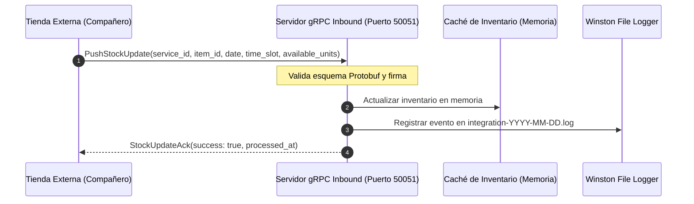
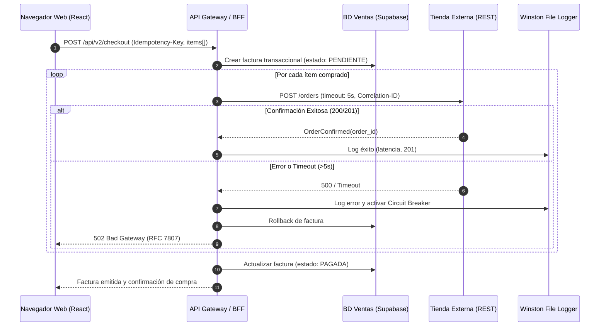
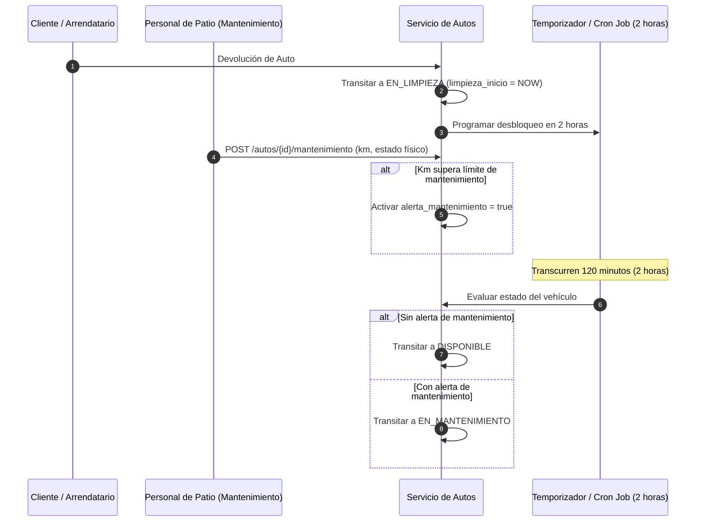
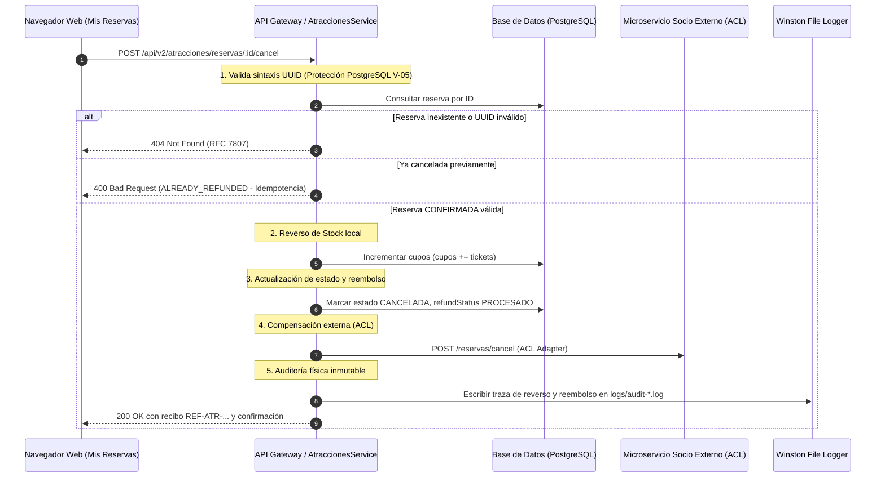

# Visión General de la Arquitectura — Booking Prototipo

> **Asignatura:** Integración de Sistemas — 6to Semestre  
> **Sistema:** Booking Prototipo (Plataforma Central Integradora)  
> **Patrón Primario:** API Gateway / BFF (Backend For Frontend) con Integración Híbrida (gRPC Inbound en Puerto 50051 + REST Outbound)  
> **Estado:** 100% Implementado, Blindado y Verificado (RDA1 + RDA2)

---

## 1. Propósito

Este documento describe la arquitectura técnica, las fronteras de dominio, los protocolos de integración y los patrones de diseño aplicados en el **Booking Prototipo**. Sirve como guía de orientación para ingenieros de desarrollo, evaluadores académicos y agentes de IA, asegurando que cualquier modificación respete la separación de responsabilidades, el aislamiento de bases de datos, el patrón Saga y la resiliencia del sistema distribuido.

---

## 2. Diagrama de Contexto del Sistema (C4 Context)

```mermaid
graph TD
    User([Cliente / Turista]) --> |HTTPS / Web SPA| Frontend[Frontend React 18 / Vite]
    Admin([Administrador / Staff]) --> |HTTPS / Admin UI| Frontend
    Operator([Operador de Mantenimiento]) --> |HTTPS / Fleet UI| Frontend

    Frontend --> |REST JSON + X-Correlation-Id| Gateway[API Gateway / BFF Híbrido - NestJS 10.x]

    subgraph Ecosistema de Microservicios Externos
        ShopAtr[Tienda Atracciones]
        ShopAut[Tienda Autos]
        ShopAlo[Tienda Alojamientos]
        ShopVue[Tienda Vuelos]
    end

    ShopAtr --> |gRPC Inbound: Puerto 50051 / inventory.proto| Gateway
    ShopAut --> |gRPC Inbound: Puerto 50051 / inventory.proto| Gateway
    ShopAlo --> |gRPC Inbound: Puerto 50051 / inventory.proto| Gateway
    ShopVue --> |gRPC Inbound: Puerto 50051 / inventory.proto| Gateway

    Gateway --> |REST Outbound: POST /orders| ShopAtr
    Gateway --> |REST Outbound: POST /orders| ShopAut
    Gateway --> |REST Outbound: POST /orders| ShopAlo
    Gateway --> |REST Outbound: POST /orders| ShopVue

    Gateway --> |REST Outbound: POST /reservas/cancel| ShopAtr

    subgraph Persistencia Aislada (Supabase PostgreSQL)
        DBCore[(BD Admin & Ventas: usuarios, facturas, tiendas)]
        DBAutos[(BD Autos: flota, inspecciones, cooldown)]
        DBAtr[(BD Atracciones: catálogo, categorías recursivas, reservas)]
    end

    Gateway --> DBCore
    Gateway --> DBAutos
    Gateway --> DBAtr

    Gateway --> |Escritura asíncrona de trazas inmutables| FileLogs[Directorio logs/: Winston Daily Rotate]
```

---

## 3. Decisiones Arquitectónicas Fundamentales (Resumen de ADRs)

| ID ADR | Decisión Arquitectónica | Razón Técnica Principal |
|---|---|---|
| **ADR-001** | **Comunicación Híbrida: gRPC Inbound (Puerto 50051) + REST Outbound** | gRPC (HTTP/2 + Protobuf) reduce el overhead de red para el streaming masivo de inventario de las tiendas hacia el Booking; REST con JSON se reserva para la compra transaccional puntual. |
| **ADR-002** | **Aislamiento de Base de Datos por Microservicio** | Cumplimiento del patrón *Database-per-Service*. Prohibición de joins SQL o entidades TypeORM cruzadas; la composición se realiza en la capa de aplicación. |
| **ADR-003** | **Auditoría en Sistema de Archivos Físicos (NO en BD)** | Separar el I/O transaccional de la base de datos de las escrituras masivas de logs; garantiza inmutabilidad, rotación diaria con Winston y compatibilidad con sistemas SIEM. |
| **ADR-004** | **Máquina de Estados de Autos con 2h de Limpieza** | Evita la asignación de vehículos no inspeccionados mediante un flujo estricto de 6 estados y un temporizador forzado de 2 horas en estado `EN_LIMPIEZA`. |
| **ADR-005** | **Jerarquía de Categorías Recursiva con Closure Table** | Permite organizar categorías de atracciones con profundidad ilimitada y atributos heredables (`incluye_comida`, `guía`, `transporte`) optimizando lecturas de catálogo. |
| **ADR-006** | **Panel de Monitoreo de 5 Nodos con Semáforo y Kill-Switches** | Provee observabilidad activa de la latencia (<500ms 🟢, 500ms-2s 🟡, >2s 🔴) y permite al administrador habilitar o suspender tiendas externas en caliente sin reiniciar el Gateway. |
| **ADR-007** | **Patrón Saga y Cancelación Compensatoria con Reembolso e Idempotencia** | Orquesta la liberación transaccional de cupos (`cupos += tickets`), la emisión formal de reembolso monetario 100%, la notificación al socio externo y el blindaje frente a doble clic (`ALREADY_REFUNDED`). |

---

## 4. Estructura de Directorios del Proyecto

```text
/
├── .env / .env.example        ← Variables de entorno (DATABASE_URL, SUPABASE_*, CLEANING_COOLDOWN_MINUTES)
├── contracts/                 ← Especificaciones de Contratos OpenAPI (v1 y v2)
│   ├── atracciones-openapi-v2.yaml
│   ├── autos-openapi-v2.yaml
│   ├── alojamientos-openapi.yaml
│   └── vuelos-openapi.yaml
├── database/                  ← Scripts SQL de inicialización y semillas
├── docs Paúl Rosero/          ← Documentación viva del proyecto, ADRs, reglas y contexto
├── frontend/                  ← Aplicación Cliente React 18 + Vite (Clon Booking.com)
│   ├── src/
│   │   ├── components/        ← Navbar, Footer, Modales, Tarjetas, Filtros, OfflineBanner
│   │   ├── pages/             ← Páginas por vertical, Checkout, AdminDashboard, MisReservas
│   │   └── services/          ← Clientes Axios con inyección de Correlation-ID
├── logs/                      ← Directorio físico de logs rotativos generados por Winston
│   ├── audit-YYYY-MM-DD.log
│   ├── integration-YYYY-MM-DD.log
│   └── app-YYYY-MM-DD.log
├── src/                       ← Backend NestJS (API Gateway / BFF Híbrido)
│   ├── core/                  ← Entidades TypeORM, Interceptors (HATEOAS), Filters (RFC7807), Guards (JWT)
│   ├── modules/               ← Módulos de dominio y orquestación
│   │   ├── admin/             ← Gestión de usuarios, semáforo de 5 nodos y connector-health.service.ts
│   │   ├── atracciones/       ← Catálogo, categorías recursivas, check-in, dilan-adapter.service.ts y Saga de cancelación
│   │   ├── autos/             ← Integración de autos, máquina de estados, mantenimiento y cooldown
│   │   ├── alojamientos/      ← Integración de hoteles y check-in
│   │   ├── vuelos/            ← Integración de vuelos y check-in
│   │   └── inventory/         ← Servidor gRPC Inbound (InventoryStockService) y endpoints REST de soporte
│   └── proto/                 ← inventory.proto (Protocol Buffers v3 para gRPC en puerto 50051)
└── test/                      ← Suites de pruebas verificadas (test-sanitization-rfc7807.js, test-cancel-saga.js, etc.)
```

---

## 5. Flujos de Datos Principales

### 5.1. Flujo de Ingesta de Inventario vía gRPC (Inbound — Puerto 50051)



### 5.2. Flujo de Compra y Notificación REST (Outbound)



### 5.3. Flujo de Ciclo de Vida y Cooldown de Autos



### 5.4. Flujo de Cancelación de Reserva con Patrón Saga y Compensación



---

## 6. Patrones de Diseño Clave

1. **Backend-For-Frontend (BFF):** Adapta y unifica múltiples microservicios externos en una API coherente diseñada para las vistas del clon de Booking.
2. **Circuit Breaker:** Protege el Gateway ante microservicios caídos o lentos (`CLOSED`, `OPEN`, `HALF_OPEN`, `MANUALLY_OPEN`), evitando el agotamiento de sockets de red mediante timeouts de 5 segundos.
3. **Finite State Machine (FSM):** Modela el ciclo de vida de los vehículos asegurando transiciones atómicas y el cumplimiento de las 2 horas de limpieza.
4. **Closure Table (Árbol de Categorías):** Gestiona relaciones padre-hijo recursivas para atracciones, permitiendo consultas instantáneas de ancestros y descendientes.
5. **Idempotent Consumer / Producer:** Previene el procesamiento duplicado de órdenes de compra y cancelaciones (`Idempotency-Key`, `ALREADY_REFUNDED`).
6. **Problem Details (RFC 7807):** Estandariza las respuestas de error en formato JSON para simplificar el diagnóstico de fallas en clientes frontend y suites de testing.
7. **Saga Pattern (Compensación Transaccional):** Coordina transacciones distribuidas en cancelaciones asegurando que el reverso de stock, la emisión de reembolso y la notificación al socio se ejecuten en secuencia consistente.

---

## 7. Entorno de Desarrollo y Puesta en Marcha

### Prerrequisitos
- Node.js versión 18 o superior.
- Gestor de paquetes `npm`.
- Cuenta y proyecto activo en Supabase (PostgreSQL).

### Pasos de Instalación y Ejecución Local
```powershell
# 1. Configurar variables de entorno
cp .env.example .env

# 2. Instalar dependencias del Backend (raíz)
npm install

# 3. Instalar dependencias del Frontend
cd frontend
npm install
cd ..

# 4. Iniciar Backend (Terminal 1 - HTTP puerto 3000 y gRPC puerto 50051)
npm run start:dev

# 5. Iniciar Frontend (Terminal 2 - puerto 5173)
cd frontend
npm run dev
```

- **Marketplace Web:** `http://localhost:5173`
- **Swagger Docs:** `http://localhost:3000/api/docs`
- **Health Check de Nodos (v2):** `http://localhost:3000/api/v2/admin/nodes/health`
- **Servidor gRPC Inbound:** `localhost:50051`

---

## 8. Errores Comunes y Soluciones (Pitfalls)

### Pitfall 1: Mezclar Entidades TypeORM entre Módulos
- **Problema:** Importar entidades de `Autos` directamente en `AdminModule` o `AtraccionesModule`.
- **Solución:** Respetar la frontera del microservicio. Consumir los servicios exportados o endpoints internos, nunca ejecutar consultas SQL directas contra las tablas de otro módulo.

### Pitfall 2: Escribir Logs de Auditoría en Tablas de PostgreSQL
- **Problema:** Registrar cada petición HTTP en la base de datos satura la cuota de I/O de la base de datos cloud.
- **Solución:** Utilizar exclusivamente `winston` configurado con rotación diaria hacia la carpeta física `logs/`.

### Pitfall 3: Error 500 por UUID Inválido en PostgreSQL (V-05)
- **Problema:** Pasar cadenas no UUID a queries TypeORM lanza `QueryFailedError: invalid input syntax for type uuid`.
- **Solución:** Validar la sintaxis UUID mediante expresión regular antes de emitir la consulta TypeORM, respondiendo limpiamente con `404 Not Found` bajo RFC 7807.
