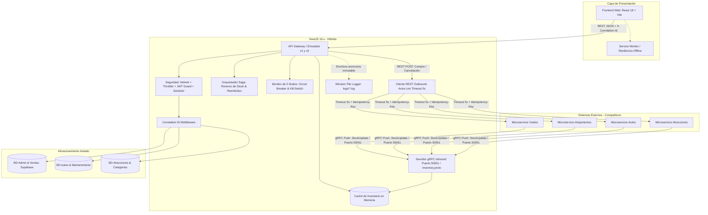

# Requerimientos Técnicos — Booking Prototipo (Plataforma Central Integradora)

> **Asignatura:** Integración de Sistemas — 6to Semestre  
> **Sistema:** Booking Prototipo (API Gateway / BFF + Ecosistema Distribuido)  
> **Entorno de Ejecución:** Node.js 18+ (Backend NestJS) | Navegador Web Moderno (Frontend React/Vite) | Supabase Cloud (PostgreSQL)  
> **Estado:** 100% Implementado, Blindado y Verificado (RDA1 + RDA2)

---

## 1. Visión Técnica General

El **Booking Prototipo** opera como un **Ecosistema Distribuido** gobernado por el patrón **API Gateway / BFF (Backend-For-Frontend)**. Este componente centraliza la autenticación, agrega el catálogo turístico en tiempo real mediante **gRPC** en puerto `50051`, orquesta compras síncronas mediante **REST**, garantiza la trazabilidad mediante **Correlation IDs**, coordina cancelaciones y reversos de inventario bajo el **Patrón Saga**, y gestiona la resiliencia ante caídas de microservicios externos mediante **Circuit Breakers** y un **Monitor de Nodos de 5 Vías** con kill-switches dinámicos.

---

## 2. Topología Arquitectónica y Protocolos de Comunicación

---

## 3. Especificación Técnica por Capas

### 3.1. Frontend (React 18 + Vite)
- **Framework:** React 18, empaquetado con Vite (tiempo de compilación ~675ms).
- **Estilos:** Vanilla CSS modular con paleta corporativa idéntica a Booking.com (Azul `#003b95`, Amarillo `#febb02`, Acentos `#006ce4`).
- **Consumo de APIs:** Cliente Axios centralizado en `src/services/api.js` que inyecta automáticamente la cabecera `X-Correlation-Id` generada por sesión.
- **Resiliencia UI y Offline:** 
  - `OfflineBanner.jsx` y detección reactiva de red (`navigator.onLine`).
  - Caché local en `localStorage` / Service Worker para visualización de catálogo sin conexión.
  - Sanitización en cliente: inputs limitados con `maxLength`, colapso de espacios en blanco regex (`\s+`), y validación dinámica con mensajes contextuales.
- **Gestión de Cancelaciones:** Botón interactivo "Cancelar reserva y solicitar reembolso" en `MisReservasPage.jsx` con modal de confirmación y recarga fluida de estado.

### 3.2. API Gateway / BFF Híbrido (NestJS 10.x)
- **Versionamiento:** URI-based (`app.enableVersioning({ type: VersioningType.URI, defaultVersion: '1' })`), permitiendo consultar concurrentemente `/api/v1/...` y `/api/v2/...`.
- **Servidor gRPC Híbrido (Inbound):**
  - Configurado en `src/main.ts` mediante `app.connectMicroservice<MicroserviceOptions>({ transport: Transport.GRPC, options: { package: 'inventory', protoPath: 'src/proto/inventory.proto', url: '0.0.0.0:50051' } })`.
  - Escucha en el puerto TCP `50051` con el servicio `InventoryStockService`.
  - Métodos RPC implementados: `PushStockUpdate` (actualización de cupos) y `StreamInventoryChanges` (flujo continuo de eventos).
  - Endpoints REST auxiliares para inspección y testing en `/api/v2/inventory` y `/api/inventory/status`.
- **Patrón Saga y Cancelación Compensatoria:**
  - Orquestado en `AtraccionesService.cancelarReserva()`.
  - Validación de existencia y sintaxis UUID previa para blindar PostgreSQL frente a excepciones `QueryFailedError` (HTTP 500).
  - Transición a estado `CANCELADA` con registro de `refundStatus: 'PROCESADO'` y código de transacción `REF-ATR-...`.
  - Compensación de stock (`cupos += tickets`).
  - Notificación saliente al microservicio externo del socio mediante el Adapter de Integración.
  - Idempotencia estricta: re-intentos devuelven RFC 7807 con código `ALREADY_REFUNDED` y status 400.
- **Monitor de Nodos y Circuit Breakers:**
  - Implementado en `src/modules/admin/connector-health.service.ts`.
  - 5 nodos supervisados: `atracciones`, `autos`, `alojamientos`, `vuelos`, `grpc_inventory`.
  - Estados de nodo: `ONLINE` (🟢 <500ms), `DEGRADED` (🟡 500ms-2s), `OFFLINE` (🔴 >2s / error), `DISABLED` (⚪ kill-switch activado).
  - Circuit Breakers: `CLOSED`, `OPEN`, `HALF_OPEN`, `MANUALLY_OPEN`.
  - Endpoints administrativos: `GET /api/v2/admin/nodes/health`, `POST /api/v2/admin/nodes/:serviceId/toggle`, `POST /api/v2/admin/nodes/:serviceId/ping`.
- **Manejo de Errores Estándar:** Filtro global `rfc7807-exception.filter.ts` que transforma cualquier excepción en un objeto **RFC 7807 (Problem Details)** (`type`, `title`, `status`, `detail`, `instance`).

### 3.3. Aislamiento de Base de Datos (Database-per-Service)
- **Persistencia:** PostgreSQL 15+ hosteado en **Supabase**.
- **Fronteras de Dominio:**
  - **Dominio Admin & Ventas:** `usuarios`, `carritos`, `carrito_items`, `facturas`, `factura_items`, `tiendas_integradas`, `configuraciones`.
  - **Dominio Autos:** `autos`, `orders_auto`, `maintenance_logs`, `auto_state_history`.
  - **Dominio Atracciones:** `atracciones`, `categorias_atraccion`, `reservas_atraccion`, `resenas_atraccion`.
- **Regla Cardinal:** Los módulos no comparten entidades TypeORM ni realizan joins SQL inter-dominio. La agregación de datos para vistas complejas se realiza exclusivamente en la **capa de aplicación (Application Services / BFF)**.

### 3.4. Auditoría y Logging en Archivos Físicos (CERO Escrituras en BD)
- **Librerías:** `winston` y `winston-daily-rotate-file`.
- **Estructura de Archivos en `logs/`:**
  - `logs/audit-YYYY-MM-DD.log`: Trazas de acciones de administración y cancelaciones/reembolsos de reservas.
  - `logs/integration-YYYY-MM-DD.log`: Registro de eventos gRPC recibidos y llamadas REST salientes (URL, método, latencia en ms, código HTTP, correlation_id).
  - `logs/app-YYYY-MM-DD.log`: Errores no controlados y logs generales de la aplicación.
- **Garantías:** Cero escrituras en PostgreSQL para telemetría, inmutabilidad y rotación automática con políticas de retención de 14 días.

---

## 4. Requerimientos de Seguridad y Blindaje de Vulnerabilidades

1. **Rate Limiting / Throttling:**
   - Implementado con `@nestjs/throttler`. Límite global de 120 req/min por IP; rutas de checkout y pago limitadas a 10 req/min.
2. **Cabeceras de Protección HTTP:**
   - Configuración de `helmet()` en `main.ts` para mitigar XSS, Clickjacking, MIME sniffing y CSP.
3. **Autenticación y Autorización por Roles:**
   - Tokens Bearer JWT validados a través de `SupabaseAuthGuard` con decorador `@Roles('admin', 'cliente', 'mantenimiento')`.
4. **Sanitización y Validación de Cargas (RFC 7807):**
   - `ValidationPipe` global con `whitelist: true` y `forbidNonWhitelisted: true`.
   - Límites de longitud: nombres máx. 30 caracteres, correos máx. 100 caracteres, contraseñas máx. 16 caracteres.
   - Colapso de espacios en blanco duplicados (`string.replace(/\s+/g, ' ').trim()`).
5. **Inmunidad a Excepciones de Tipo en PostgreSQL:**
   - Validación previa con regex `isUuid` antes de emitir queries TypeORM en `findOne`, `reservar`, `cancelarReserva` y `checkin`, eliminando por completo los errores 500 `QueryFailedError: invalid input syntax for type uuid`.

---

## 5. Matriz de Pruebas Automatizadas Verificadas

| Suite de Prueba | Archivo de Test | Casos Verificados | Resultado |
|---|---|---|---|
| **Sanitización & RFC 7807** | `test/test-sanitization-rfc7807.js` | 8 casos (nombres largos, espacios infinitos, respuestas dinámicas) | ✅ 8/8 Aprobados (Código 0) |
| **Saga & Cancelaciones** | `test/test-cancel-saga.js` | 5 casos (reverso stock, cálculo reembolso, idempotencia) | ✅ 5/5 Aprobados (Código 0) |
| **Monitor de Nodos & Switches** | `test/test-nodes-monitor.js` | 4 casos (salud 5 nodos, toggle de kill-switch, ping) | ✅ 4/4 Aprobados (Código 0) |
| **Servidor gRPC Inbound** | `test/test-grpc-inventory.js` | 3 casos (conexión puerto 50051, PushStockUpdate, Streaming) | ✅ 3/3 Aprobados (Código 0) |
| **Frontend Build** | `cd frontend && npm run build` | Compilación de Vite (bundle JavaScript y CSS) | ✅ Aprobado (0 errores, 675ms) |
| **Backend Build** | `npm run build` | Compilación de TypeScript de NestJS | ✅ Aprobado (0 errores) |

---

## 6. Matriz de Dependencias Tecnológicas

| Componente | Tecnología | Versión | Propósito |
|---|---|---|---|
| Runtime | Node.js | >= 18.x | Entorno de servidor |
| Lenguaje | TypeScript | 5.x | Tipado estricto en backend |
| Backend Framework | NestJS | 10.x | Arquitectura modular y BFF |
| Base de Datos | PostgreSQL (Supabase) | 15+ | Persistencia relacional en la nube |
| ORM | TypeORM | 0.3.x | Mapeo objeto-relacional y Closure Tables |
| Servidor gRPC Inbound | @grpc/grpc-js, @grpc/proto-loader | Latest | Comunicación gRPC en puerto 50051 |
| Microservicios NestJS | @nestjs/microservices | 10.x | Integración híbrida gRPC / HTTP |
| Cliente HTTP | @nestjs/axios, Axios | Latest | Integración REST saliente con timeout de 5s |
| Seguridad | @nestjs/throttler, helmet | Latest | Rate limiting y cabeceras seguras |
| Logging | winston, winston-daily-rotate-file | Latest | Auditoría física en archivos de texto |
| Frontend | React + Vite | 18+ / 5+ | SPA moderna estilo Booking.com |
| Testing | Jest, Supertest, Scripts Node | Latest | Pruebas de integración, contratos y sagas |
