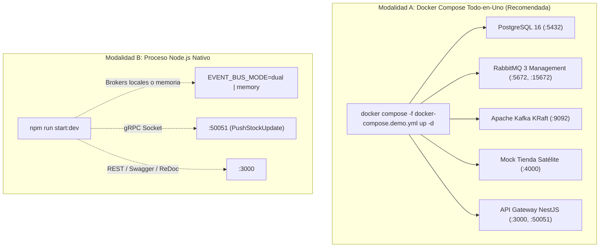
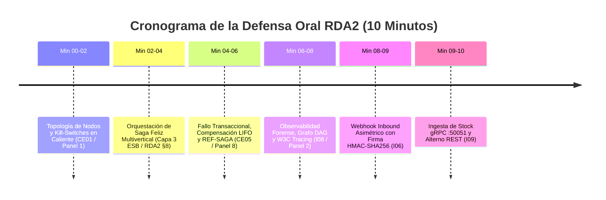

# Guía Maestra de Despliegue y Defensa Oral (10 Minutos) — Booking RDA2

> **Proyecto:** Booking Prototipo — Integración de Sistemas (RDA2)  
> **Documento:** Guía de Despliegue, Guion Cronometrado de Defensa Oral y Plan de Contingencias  
> **Fecha:** Octubre 2026  
> **Versión:** 2.0.0 (SemVer)  
> **Entregable:** I12 (`I12-despliegue-demo.md`)

---

## 1. Topología del Entorno de Demostración

Para la evaluación y defensa técnica se disponen dos modalidades de ejecución completamente reproducibles:



### 1.1 Puertos y Consolas de Monitoreo

| Componente | Dirección / Endpoint Local | Credenciales Demo | Propósito en la Demostración |
|---|---|---|---|
| **API Gateway REST** | `http://localhost:3000` | N/A | Pasarela ESB, BFF, Webhooks y enrutamiento. |
| **Swagger UI** | `http://localhost:3000/api/docs` | N/A | Exploración interactiva de los 11 contratos OpenAPI v2. |
| **ReDoc UI** | `http://localhost:3000/api/redoc` | N/A | Documentación unificada de lectura técnica. |
| **Dashboard DAG (I08)** | `http://localhost:3000/api/v2/telemetry/graph/dashboard` | N/A | Visualización en vivo del grafo de dependencias y latencias. |
| **Servidor gRPC** | `localhost:50051` | Bearer en Metadata | Ingesta continua asimétrica de stock (`PushStockUpdate`). |
| **RabbitMQ Management** | `http://localhost:15672` | `guest` / `guest` | Inspección de colas y exchanges (`booking.events`). |
| **Kafka KRaft Broker** | `localhost:9092` | N/A | Tópicos de streaming (`topic-catalogo-sync`, etc.). |
| **Mock Tienda Satélite** | `http://localhost:4000/health` | N/A | Simulación local de tiendas externas (Atracciones, Autos, etc.). |

---

## 2. Preparación Previa (Pre-Flight Check — 5 Minutos Antes)

Antes de que inicie la sesión con el jurado docente, ejecute los siguientes pasos para verificar que todos los servicios responden correctamente:

### Opción A: Despliegue con Docker Compose (1 comando)

```bash
# 1. Levantar la infraestructura completa en segundo plano
docker compose -f docker-compose.demo.yml up -d

# 2. Verificar estado de los contenedores
docker compose -f docker-compose.demo.yml ps

# 3. Ejecutar el script de verificación y pre-sembrado
node scripts/demo/seed.js
```

### Opción B: Ejecución Local Nativa (si no se usa Docker)

```bash
# 1. Copiar las variables de entorno preconfiguradas
cp .env.demo.example .env

# 2. Iniciar el servidor mock de tiendas socias en otra terminal (puerto 4000)
node scripts/demo/mock-tienda.js &

# 3. Iniciar el backend central NestJS
npm run start:dev

# 4. En una terminal nueva, ejecutar el pre-flight check
node scripts/demo/seed.js
```

---

## 3. Guion Cronometrado de Defensa Oral (10 Minutos)

Estructura rigurosa minuto a minuto diseñada para responder directamente a la rúbrica y a los criterios de evaluación **CE01 a CE11**:



---

### Minuto 00:00 – 02:00: Topología de Nodos y Semáforo en Caliente (CE01 / Panel 1)

* **Objetivo de la demostración:** Demostrar que Booking es una pasarela desacoplada que no tiene almacenamiento estático de inventario, sino que conecta tiendas externas en tiempo real con Circuit Breakers y Kill-Switches manuales.
* **Acción en vivo:**
  1. Mostrar en el navegador o terminal `GET /api/v2/nodes` evidenciando los nodos registrados (`atracciones`, `autos`, `vuelos`, `alojamientos`) con su estado de salud y latencia.
  2. Ejecutar la conmutación en caliente de Kill-Switch:
     * **Bash / Linux / Mac:** `./scripts/demo/killswitch.sh`
     * **PowerShell / Windows:** `.\scripts\demo\killswitch.ps1`
* **Explicación verbal para el jurado:**
  > *"Profesor, aquí observamos el Panel 1 de Administración. Cada tienda satélite está modelada como un nodo socio con su propio Circuit Breaker. Para proteger la plataforma ante caídas de proveedores, implementamos un Kill-Switch en caliente. Al ejecutar el comando, conmutamos el nodo de Atracciones a `DESCONECTADO_MANUAL` de forma inmediata. El tráfico hacia ese proveedor queda cortado al instante sin necesidad de reiniciar el gateway ni afectar a las demás verticales. Al restaurarlo, el tráfico fluye nuevamente de forma transparente."*

---

### Minuto 02:00 – 04:30: Orquestación de Saga Feliz Multivertical (Capa 3 ESB — RDA2 §8, CE05)

* **Objetivo de la demostración:** Mostrar la orquestación distribuida de una compra multivertical compuesta (ej. Tour Mitad del Mundo + Auto Chevrolet Onix) coordinada por el ESB central.
* **Acción en vivo:**
  1. Ejecutar el script del caso feliz:
     * **Bash:** `./scripts/demo/saga-ok.sh`
     * **PowerShell:** `.\scripts\demo\saga-ok.ps1`
  2. Mostrar en pantalla la respuesta con código `200 OK`, el `correlationId`, el monto total y el diario de pasos (`journal`).
* **Explicación verbal para el jurado:**
  > *"Ahora pasamos a la Capa 3 del ESB: la orquestación de transacciones complejas mediante el patrón Saga. Un turista realiza una compra combinada de un tour y el alquiler de un auto. El orquestador ejecuta secuencialmente: Reserva en Atracciones → Reserva en Autos → Cobro atómico en la pasarela de pagos. Como todos los pasos fueron exitosos, la transacción se marca como `CONFIRMADA`, se genera el código de reserva global y se publica el evento `order.confirmed` en el bus de mensajería (RabbitMQ y Kafka) para notificaciones y facturación electrónica."*

---

### Minuto 04:30 – 06:30: Fallo Transaccional, Compensación LIFO y Código `REF-SAGA-...` (CE05 / Panel 8)

* **Objetivo de la demostración:** Demostrar tolerancia a fallos transaccionales: si una vertical intermedia falla, las reservas previas se deshacen en orden estrictamente inverso (LIFO) y se emite el código de auditoría.
* **Acción en vivo:**
  1. Ejecutar el script de fallo transaccional:
     * **Bash:** `./scripts/demo/saga-falla.sh`
     * **PowerShell:** `.\scripts\demo\saga-falla.ps1`
  2. Resaltar la respuesta con código `409 Conflict` (formato RFC 7807) conteniendo el código `codigo_referencia: REF-SAGA-...`.
  3. Consultar la auditoría de la saga en `GET /api/v2/esb/sagas/{correlationId}`.
* **Explicación verbal para el jurado:**
  > *"Para cumplir con el criterio CE05 de atomicidad distribuida, simulamos una condición crítica: el tour de Atracciones se reserva exitosamente, pero el proveedor de Autos reporta `INVENTARIO_AGOTADO`. En una arquitectura tradicional esto dejaría datos inconsistentes. Nuestro orquestador activa de inmediato la compensación LIFO: desanda los pasos en orden inverso, llama al endpoint de compensación de la tienda de Atracciones para liberar el cupo retenido, y revierte el cobro. La API responde con un 409 Conflict estándar RFC 7807 y emite el código de rastreo formal `REF-SAGA-...` para reclamos y auditoría contable."*

---

### Minuto 06:30 – 08:00: Observabilidad Forense, Grafo DAG y W3C Tracing (I08 / Panel 2)

* **Objetivo de la demostración:** Demostrar la visibilidad punto a punto de cada petición distribuida mediante grafos visuales y correlación.
* **Acción en vivo:**
  1. Abrir en el navegador el dashboard visual interactivo:
     `http://localhost:3000/api/v2/telemetry/graph/dashboard`
  2. Si se desea filtrar por la saga previa, ingresar en la URL:
     `http://localhost:3000/api/v2/telemetry/graph/dashboard?correlationId=corr-demo-saga-ok-...`
  3. Mostrar el grafo DAG renderizado con Cytoscape.js: nodos (`booking-gateway`, `atracciones`, `autos`, `pagos`, `event-bus`), estado semafórico (verde/rojo) y latencias medidas en milisegundos.
  4. Mostrar en terminal la existencia física de los archivos rotativos JSONL en `logs/`.
* **Explicación verbal para el jurado:**
  > *"Aquí presentamos el Panel 2 de Observabilidad Forense. Cada interacción HTTP, gRPC y evento asíncrono viaja etiquetado con cabeceras estándar W3C TraceContext (`traceparent`, `X-Correlation-Id`). El endpoint `/telemetry/graph` compila dinámicamente el grafo acíclico dirigido (DAG) de la petición, permitiendo a los operadores detectar inmediatamente cuellos de botella de latencia y fallos en componentes externos sin necesidad de revisar logs dispersos manualmente."*

---

### Minuto 08:00 – 09:00: Webhook Inbound Asimétrico con Firma HMAC-SHA256 (I06)

* **Objetivo de la demostración:** Demostrar la recepción asíncrona de eventos externos mediante el estándar CloudEvents v1.0 y seguridad criptográfica perimetral.
* **Acción en vivo:**
  1. Ejecutar el script de webhook:
     * **Bash:** `./scripts/demo/webhook.sh`
     * **PowerShell:** `.\scripts\demo\webhook.ps1`
  2. Mostrar la respuesta inmediata `202 Accepted`.
  3. Explicar qué ocurre si la firma criptográfica se manipula (rechazo inmediato con `401 Unauthorized`).
* **Explicación verbal para el jurado:**
  > *"Para comunicaciones asimétricas inbound, implementamos webhooks bajo la especificación CloudEvents v1.0. Cuando una aerolínea asociada reprograma un vuelo, envía un evento HTTP POST firmado con HMAC-SHA256 en la cabecera `X-Webhook-Signature`. El API Gateway valida la firma contra el secreto compartido del proveedor y responde inmediatamente `202 Accepted` para no bloquear al socio, enrutando el procesamiento pesado al bus de eventos."*

---

### Minuto 09:00 – 10:00: Ingesta de Stock gRPC :50051 y Alterno REST (I09) y Cierre

* **Objetivo de la demostración:** Evidenciar el cumplimiento de la directriz arquitectónica de cátedra: *las tiendas externas nos envían inventario vía gRPC (:50051), y nosotros les consultamos vía REST*.
* **Acción en vivo:**
  1. Mostrar la definición Protocol Buffers en `src/proto/inventory.proto` con el método RPC `PushStockUpdate`.
  2. Ejecutar la actualización de stock en vivo:
     * **Bash:** `./scripts/demo/inventario-push.sh`
     * **PowerShell:** `.\scripts\demo\inventario-push.ps1`
  3. Resaltar la respuesta exitosa con la asimilación del nuevo stock.
* **Explicación verbal para el jurado:**
  > *"Finalmente, cumpliendo estrictamente con la directriz de integración: las tiendas asociadas nos transmiten cambios de cupos continuos conectándose al microservicio gRPC en el puerto TCP 50051 mediante `PushStockUpdate` autenticado por metadata, o utilizando el endpoint alterno REST `POST /api/v2/inventory/push`. Con esto cerramos una arquitectura desacoplada, observable, tolerante a fallos y preparada para alta concurrencia. Quedamos a su disposición para preguntas."*

---

## 4. Plan de Contingencia y Fallback (Respuestas a Imprevistos)

| Incidente / Imprevisto | Causa Posible | Acción Inmediata de Recuperación durante la Demo |
|---|---|---|
| **La tienda real de un compañero no contesta** | Caída del servidor externo, corte de internet o cambio de IP del compañero. | El gateway ya cuenta con adaptadores ACL y Circuit Breakers. Además, las variables `TIENDA_*_URL` en `.env` pueden apuntar al `mock-tienda` local (`http://localhost:4000/api/v2`) para que la demo continúe al 100% sin depender de redes externas. |
| **Docker no arranca o la máquina se satura** | Conflictos de virtualización WSL2 o memoria RAM insuficiente. | Ejecutar la Modalidad B: `node scripts/demo/mock-tienda.js &` y `npm run start:dev` con `EVENT_BUS_MODE=memory`. Todas las pruebas, sagas y endpoints corren en memoria sin necesidad de Docker. |
| **No hay conexión a internet (Supabase offline)** | Red del aula o Wi-Fi desconectado. | La variable `SECURITY_ALLOW_TEST_AUTH=true` en `.env.demo.example` permite que los scripts de prueba usen cabeceras técnicas (`X-Admin-Key: Admin123!`, `X-Role: admin`) autorizando inmediatamente los endpoints sin consultar Supabase en la nube. |
| **Un puerto está ocupado (ej. 3000 o 5432)** | Otro proceso local está usando el puerto. | Modificar `PORT=3001` en `.env` o ejecutar `netstat -ano | findstr :3000` para identificar y cerrar el proceso competidor. |

---

## 5. Viabilidad de Despliegue en la Nube (Render PaaS)

En cumplimiento de las reglas del entregable I12, a continuación se documentan de forma transparente y contrastada con la documentación técnica oficial de Render ([render.com/docs](https://render.com/docs)) las condiciones de despliegue en la nube:

1. **Restricción de Puerto Único en Web Services Gratuitos de Render:**
   * Render asigna un único puerto público por Web Service a través de la variable `PORT` (por defecto `10000`).
   * El proxy perimetral de Render enruta el tráfico HTTPS exterior exclusivamente hacia dicho puerto.
   * **En un Web Service gratuito de Render no es posible abrir simultáneamente el puerto 3000 (HTTP) y el puerto 50051 (gRPC TCP) a la Internet pública**.
2. **Alternativas Verificadas para Operación de gRPC en la Nube:**
   * **Opción A (Híbrida para Evaluación):** El backend corre en Render para REST y Swagger; el servidor gRPC se levanta localmente o mediante un túnel TCP seguro con `ngrok tcp 50051`.
   * **Opción B (Servicios Privados en Render):** Desplegar dos instancias dentro de la misma cuenta de Render: un Web Service público para REST y un *Private Service* para gRPC que se comunican entre sí por la red privada interna de Render.
3. **Brokers de Mensajería en la Nube:**
   * Render no provee brokers RabbitMQ o Kafka nativos dentro del tier gratuito.
   * Para producción en la nube se utilizan servicios PaaS especializados externos:
     * **RabbitMQ:** CloudAMQP (instancia gratuita *Little Lemur*, conectada vía `RABBITMQ_URL=amqps://...`).
     * **Apache Kafka:** Upstash Serverless Kafka (conectado vía SASL SSL con `KAFKA_BROKERS=...`).
